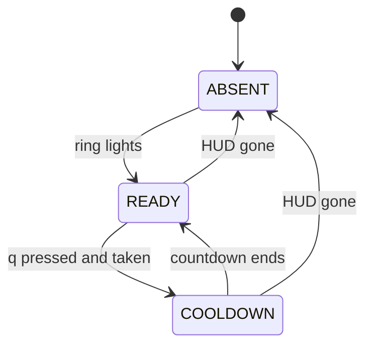

# ADR 173 — The Special Weapon Fires on the Jet's Trigger When Its Icon Is Lit

| Status | Date       | Wingman Version |
|--------|------------|-----------------|
| Draft  | 2026-11-07 | 1.9.4           |

Operator, 2026-11-07: "implementing the special weapon function activation via the 'q' key, special
weapon must be unlocked first so the GAME_BATTLE icon may not be available ... near the altitude and
speed numbers shows a Q with a circle above it indicating special weapon available, each jet has its own
special weapon type in the case of the Mig-23 it deploys Flare burst which should activate when incoming
missile is detected, once deployed the second screenshot shows cool down before its available again. the
implementation shall be reusable across jets, with the circle icon lighting up indicating special weapon
available, when the j20 jet is flown, the special weapon should activate flare reload, when the jas39 is
flown it should activate cloaking mode".

This builds on [ADR 167](167-read-each-rounds-jet-from-the-lobby.md) and
[ADR 168](168-read-the-jet-again-through-the-wait-for-a-match.md) (the jet on record),
[ADR 171](171-the-jet-picks-the-mission-and-j20-comes-back-from-a-rearm.md) (the jet profile, and its
D8 J-20 flare reload) and [ADR 145](145-mission-jas39-cloak-and-u-launches-the-configured-mission.md)
(the JAS39 cloak, whose blind 3 s `q` loop [ADR 160](160-acs-mission-and-j20-are-the-only-missions.md)
removed).

## Decision

**D1. Wingman reads the special weapon's ring every battle tick.** A new crop, `SPECIAL_WEAPON`, hugs
the ring above the `Q` key cap, left of the speed and altitude readout (`ALTITUDE_SPEED`). The crop's
centre is the ring's centre and its half-height the ring's radius, fitted on the operator's frame:
(570.5, 717.2) px, radius 34.4 px, on 1920×1200.

The live MiG-23 frames of 2026-11-07 (about 3,100 path black-box frames, 20 rounds) show four states,
not the three this ADR first assumed:

| What the HUD shows | When | Example |
|--------------------|------|---------|
| A thin white ring all the way round the jet's glyph | ready | `ready_full_mig23.png` (`screenshot_20261107_025510.png`) |
| The glyph with the ring draining as an arc | about 3.5 s after a press | `active_arc_1.jpg`, 03:03:44 |
| A grey disc with the seconds left, 60 to 0 | cooldown | `cooldown_full_mig23.png` (`screenshot_20261107_025549.png`) |
| Nothing at all, not even the `Q` key cap | the ability is not unlocked | all 2,770 frames of the 00:01–01:45 session, 18 MiG-23 rounds on another account |

Only the full ring means a press will be taken, so the reader answers one question: `special_weapon_ready()`
is True when the ring is lit all the way round, False when it is not, and None with no fresh read. It
does not tell cooldown from a locked ability; nothing gates on that difference.

The test is on pixels, not OCR (0.7 ms a read), and on the ring only, because the glyph differs per jet.
The ring is split into 16 sectors. A sector is lit when the brightest tenth of its ring pixels reaches
value 200 at saturation 60 or less, and stands 40 above the disc just inside the ring and 8 above the
background just outside it. The disc is translucent, so its inside alone says nothing. The outside margin
is small because a bright haze behind the icon lifts the outside nearly to the ring's own brightness.
READY needs 15 of 16 sectors on two reads in a row. A read that is not READY takes effect at once, so a
taken press shows on the next tick.

Measured on the 20 MiG-23 rounds with the ability unlocked: 112 frames scored 16/16. Every frame
between 1/16 and 14/16 was a draining arc or a cooldown disc, checked by eye. No frame of the locked
session scored above 6/16, and sun glare that whitens the whole spot scores 0.

**D1a. A ring under a HUD marker is still READY** (added 2026-11-07, from the first live run). That run had
8 single-read drops to 11–14 of 16 with no press. The drop capture (Implementation item 5) caught 2 of them
in the next run, and both were a yellow target marker across a lit ring. A sector that is not lit but whose
ring pixels are mostly strongly coloured (saturation and value 120 or more on 30% of them) now counts as
covered. The ring is READY with 15 lit, or with `min_lit_when_covered` (13) lit and lit plus covered reaching
15. The floor of 13 matters: a taken press can also show a coloured gap (12 lit and 4 covered on
2026-11-07 at 04:27:12, likely the burst's own glow), and its draining arc loses sectors on every read, so it
cannot hold 13 for the two reads READY needs. Measured cost of the misreads before the fix: 8 × 3 s in
52 minutes, under 1% of flying time, and none landed on an alert. Of the 4 misreads caught on camera,
3 read READY under this rule (14+2, 13+3, 14+1 lit plus covered). The fourth (04:57:29) was a large
marker over 6 sectors, leaving 10 lit, and still reads not ready. That is a known limit: lowering the floor
to admit it would also admit the press arc with a coloured gap (12+4). Sector counts cannot tell a marker
across most of the ring from a drained arc, and the cost is one 3 s read.

A second cause, seen at 05:24:43 on D1a's first run: a lit ring over bright white cloud, 14 lit and 0
covered, where two sectors miss the 8-point outside margin. The outside margin cannot be relaxed, because it
is what keeps a cooldown disc on a bright sky from reading lit (`cooldown_bright_sky.jpg`).
`min_lit_sectors` 14 would admit it. A taken press can read 14 on its first read (03:33:09, 03:55:00) but
lower on the next, so the two-read rule would hold. That change waits for D1a's run to show how often each
cause occurs (`crops/misread_bright_cloud_14of16.png`). One caution, from 05:36:50: a taken press read 14 on its
first read. At a threshold of 14 that read counts as lit, so READY holds one more read, about 1.5 s, before the
drop shows. That is safe only because `press_retry_s` (3 s) is longer than two reads, so keep it that way.

**D1b. READY at 14 of 16** (added 2026-11-07, from D1a's run). After D1a, the 2 misreads in 6 rounds were
both 14 lit and 0 covered. One was a lit ring over bright cloud (05:24:43). The other was a ring beside a
small yellow objective marker that brightened the outside band (05:44:52). Both miss the outside margin in
2 sectors, and that margin must stay, as D1a explains. `min_lit_sectors` goes from 15 to 14. Every cooldown
and arc fixture still reads 13 or less. A taken press can read 14 on its first read, but its arc drains below
that before the next read, and `press_retry_s` (3 s) is longer than two reads.
Still open after D1b: at 06:07:48 a lit ring over bright haze read 13 lit and 0 covered
(`crops/misread_bright_haze_13of16.png`). The threshold does not go lower, because a taken press commonly
reads 12–13 on its first read. The cloud cases share one weakness, the outside margin against a bright
background, and the next fix belongs there: measure each sector's margin against the bright-sky cooldown
fixture.

Measured on 2026-11-07, and rejected: a "line, not edge" test. In each sector it compared the ring band's
peak with the band just outside it (1.12–1.25 radii). On the cloud misreads (14, 14, 13 and 12 lit), many
sectors stand only 3–8 above that band. The bright-sky cooldown disc, which has no ring, stands 0–9 in 14 of
16 sectors. A lit ring over plain white cloud stands 32–41 in every sector. Against bright cloud a lit ring
is not measurably brighter than its background, so no brightness margin separates it from a cooldown disc.
That makes the remaining cloud misreads a limit of this pixel test, not a tuning problem. A fix would need
another signal, such as the cooldown digits. Their cost: about 0.3 a round, each one read (3 s), and none at
an alert in the runs so far. The tuning stops at D1b.

The handlers read it from the analyzer, not through the Perception port, because the port lists what
the controller may read (CR-018-15) and the controller does not read this.

**D2. A jet's profile names its special weapon and the trigger that spends it.** `jet_profile.profiles.<x>`
gains a `special_weapon` section:

```yaml
jet_profile:
  profiles:
    mig23:
      match: MIG-23           # lobby label MIG-23-FLOGGER
      special_weapon: {ability: flare_burst, trigger: incoming}
    j20:
      match: J-20             # lobby label J-20-MIGHTY-DRAGON
      mission: j20
      special_weapon: {ability: flare_reload, trigger: low_flares, flares_at: 1}
    jas39:
      match: JAS39            # lobby label JAS39-GRIPEN
      special_weapon: {ability: cloak, trigger: ready}
```

- `ability` is a label for the log and the session summary. It does not change the press, which is the
  same 0.1 s tap of `SPECIAL_ABILITY` (`q`) for every jet (`Controller.activate_special_weapon`, kept by
  ADR 160 D3).
- `trigger` is one of three:
  - `incoming`: on a new incoming-missile alert, the same edge `deploy_flares_on_new_incoming` acts on.
  - `low_flares`: when the flare count reads `flares_at` or fewer, in `GAME_BATTLE` or
    `GAME_BATTLE_EJECT`.
  - `ready`: whenever the icon reads `READY`.
- A jet with no `special_weapon` section, or a round whose jet was not read, never presses `q` through
  this path.

Adding a jet is a profile and nothing else. The schema declares the section in `wingman/config_schema.py`
with its defaults, as CR-018-16 requires.

**D3. One handler presses `q` only when the icon is lit.** `SpecialWeaponHandler` in
`wingman/tick_handlers.py` owns every special-weapon press. It presses when all of these hold:

1. the jet on record has a `special_weapon` profile;
2. the profile's trigger has fired;
3. the icon reads `READY`;
4. the game state is `GAME_BATTLE` or `GAME_BATTLE_EJECT`, and the post-respawn grace is over;
5. no press went out in the last `special_weapon.press_retry_s` (default 3.0 s; a taken press leaves
   READY within one frame, about 0.5 s, so 3 s is two ticks of margin).

The press goes through `_execute_key_press` with `ignore_cancel=True`, as the flares do, so the pursuit
(which runs with the mission cancelled) still gets it. `_execute_key_press` still drops it in manual
takeover (SAF-001).

After a press the handler expects the icon to leave `READY`. If it still reads `READY` after
`press_retry_s`, the press was dropped, and it presses once more. After two unanswered presses
(`max_presses`) it logs a warning and waits for a new edge or for the icon to change. On the MiG-23 the
ring starts draining within one frame of a press. Whether the JAS39's ring does the same while cloaked is
not yet measured, so the retry limit matters.

A trigger that fires while the icon reads `COOLDOWN` or `ABSENT` is dropped, not queued. The
`incoming` and `low_flares` triggers are edges: a missile seen during the cooldown is answered by the
ordinary flares alone.

**D4. On an incoming alert the flares go first.** For an `incoming` jet the handler is called after the
flare-burst thread starts in `deploy_flares_on_new_incoming`, in the same place as the flare roll
(ADR 164) and the pursuit evade (ADR 163), so nothing here can delay a flare. The MiG-23's burst adds to
the three ordinary flares and does not replace them.

**D5. The jet-specific triggers replace the blind reloads.**

- `handle_jet_flare_reload` and the profile key `flare_reload_at` (ADR 171 D8) become the J-20's
  `low_flares` trigger. The icon gate replaces `flare_reload_cooldown_s` for that jet.
- `handle_low_flares` (a `q` press at exactly 2 flares, in battle) stays only for a jet with no
  `special_weapon` profile. On any other jet it would spend the weapon on the wrong trigger: a MiG-23's
  burst at 2 flares, a JAS39's cloak as a reload.
- ADR 145 D2's fixed 3 s cloak loop is not restored. The JAS39 presses when its icon lights instead.

**D6. Every press and every state change is logged and counted.** One INFO line per press:
`Special weapon <ability>: trigger <trigger>, icon READY`, and one per dropped `incoming` trigger:
`Special weapon <ability>: incoming trigger with the icon not lit; flares only`. One DEBUG line per
icon change: `Special weapon icon: READY (lit 16/16)` or `not ready`. The session summary counts
`special_weapon_used` (per round as `special_weapon_count`) and `special_weapon_skipped`, on one line:
`Special weapon : N used, M triggers with the icon unlit`. The J-20's press also counts as a
`flare_reload`, so that count keeps its meaning.



Without Mermaid: the icon starts `ABSENT`, goes to `READY` when the ring lights, to `COOLDOWN` when a
press is taken, and back to `READY` when the countdown ends. Leaving the HUD (death, round end) returns it
to `ABSENT`.

## Consequences

- `q` is pressed only when the game will take it. That removes the blind 2-flare reload on jets that
  have a special weapon of their own, and the J-20's timer-based reload.
- Three jets get a special weapon on day one. Any other jet needs only a profile.
- A jet whose ability is not yet unlocked costs nothing: the icon reads `ABSENT` and no press goes out.
- One new crop must be calibrated (`make calibrate-crop CROP=SPECIAL_WEAPON`). It is fixed in the HUD,
  but a HUD scale change moves it, as it moves `ALTITUDE_SPEED`.
- The pixel test is a new misread risk. A false `READY` costs one wasted press per `press_retry_s` and
  stops after two. A false `COOLDOWN` or `ABSENT` costs the ability, silently except in the summary's
  counts.
- `tests/test_perception_port.py` gains one member. The fakes in `tests/perception_fake.py` need it.

## Implementation

1. Crop `SPECIAL_WEAPON` at `[0.2792, 0.5690]`–`[0.3150, 0.6263]`, the box that hugs the fitted ring.
   Recalibrate it with `make calibrate-crop CROP=SPECIAL_WEAPON` by dragging round the ring.
2. `wingman/special_weapon.py`: `SpecialWeaponReader` (the ring test and the debounce) and
   `SpecialWeaponPresser` (D3's rules, no I/O, clock passed in). The analyzer reads the ring in
   `analyze_frame` in the battle states and answers `special_weapon_ready()`. Thresholds live in
   `config.yaml` under `special_weapon:`, with their defaults in `config_schema.py`.
3. The `special_weapon` profile section, with profiles `mig23` (`MIG-23`) and `jas39` (`JAS39`) beside
   `j20`. `flare_reload_at` and `Controller.flare_reload_at` are gone; `Controller.special_weapon_profile`
   replaces them. `activate_special_weapon` presses through a cancelled mission, as the flares do.
4. `AmmoEventsHandler.tick_special_weapon`, called from `tick_events` (every tick: `low_flares`, `ready`
   and the retry) and at the end of `deploy_flares_on_new_incoming` (the `incoming` edge).
   `handle_jet_flare_reload` is removed, and `handle_low_flares` skips any jet with a special weapon.
5. Misread evidence (added during the first live run): a READY that drops to 8–14 of 16 saves the icon's
   crop to `special_weapon.capture_dir` (`test_screenshots/special_weapon/live/`), up to `capture_max`
   (40) a session. A taken press makes the same drop, so a crop is a misread only when no `Special
   weapon` press line precedes it by under 2 s. A drop to 0 (the HUD gone) is not saved.
6. Tests: `tests/test_special_weapon.py`. The reader is tested on 17 enumerated frames in
   `test_screenshots/special_weapon/`: 7 ready, 3 draining arcs, 2 cooldowns and 5 with no icon (two of
   them sun glare, one from the locked session). There is one test per gate in D3, plus the retry limit,
   the MiG-23 burst on an alert, and the shipped profiles.

## Validation

- Offline: the reader classifies every frame in `test_screenshots/special_weapon/` correctly, including
  at least five `READY` frames with a cloud or bright sky behind the icon.
- Live, MiG-23: in at least 10 rounds, every `special weapon flare_burst` line follows an incoming alert
  by less than one tick, and the icon reads `COOLDOWN` within 1 s of the press.
- Live, J-20: reloads happen at 1 flare or fewer. No reload is logged while the icon reads `COOLDOWN`.
- Live, JAS39: the cloak is pressed within one tick of each `READY`. The number of retried presses shows
  whether the ring stays lit while cloaked (D3).
- Live, any jet with the ability locked: no `q` press in the round.

## Open questions

- ~~A locked-ability frame.~~ Answered 2026-11-07: a locked ability draws nothing, not even the key cap
  (D1).
- **Does the MiG-23's burst stop an incoming missile alone?** If it does, the three ordinary flares could
  be skipped while the special weapon is `READY`. That is a separate trial, judged by the evade outcome per
  engagement, not this ADR.
- **The JAS39's icon while cloaked.** See D3.

## Trial record

| Date | Session | Code | Jet | Rounds | Incoming alerts | `q` presses | Note |
|------|---------|------|-----|--------|-----------------|-------------|------|
| 2026-11-07 | 02:51, acct3, operator's | `38d25af`, before this ADR | MiG-23 | 2 at 03:05 | 22 | 0 | Baseline: wingman never spent the burst. The ring went out at 03:03:43.9 with no wingman `q` (the operator's press, inferred) |
| 2026-11-07 | 03:30, acct3, `make r3` | `38d25af` + ADR 173 (uncommitted) | MiG-23 | round 1 (03:32–03:37) | 4 | 2 | Ring READY 1.5 s after battle entry and after each respawn (the cooldown resets on a new life, 3 of 3). First alert 03:33:08.622: first flare and `q` both at 08.645, ring draining (14/16) on the next read at 09.831, no retry. Second press 03:36:35.5 on the next life; health went blank 1 s later, so whether it was taken is unknown. 2 alerts in cooldown got flares only. 4 misreads (13–14/16, one read each, READY again 3 s later) with no press, death or alert near: none cost a press, but the cause is not seen because no frame is saved |
| 2026-11-07 | same session | same | MiG-23 | round 2 (03:38–03:43) | 17 | 3 | All 3 presses taken (ring draining on the next read: 12/16, 6/16, 12/16), no retry, no give-up. 14 alerts in cooldown got flares only; every alert with the ring lit got a press. 5 deaths; the ring came back on each new life. 1 misread (11/16 at 03:40:59, READY again 3 s later) |
| 2026-11-07 | same session | same | MiG-23 | round 3 (03:45–03:50) | 9 | 3 | 2 presses taken (ring draining on the next read), 1 followed by a death within 1 s (03:45:49), no retry. 6 alerts in cooldown got flares only. 4 deaths; the ring came back on each new life. The ring stayed out from a press at 03:46:22 through an alert 57 s later, which fits a 60 s cooldown. 0 misreads |
| 2026-11-07 | same session | same | MiG-23 | round 4 (03:51–03:55) | 14 | 3 | All 3 presses taken (ring draining on the next read), no retry. 11 alerts in cooldown got flares only. 2 deaths; the ring came back on each new life. 2 misreads (11/16 at 03:53:13, 14/16 at 03:54:19, each one read) |
| 2026-11-07 | same session | same | MiG-23 | round 5 (03:58–04:00) | 5 | 3 | 1 press taken (03:59:05, the aircraft lived 16 s more). 2 were followed by a death within 1 s (03:58:39, 04:00:09), so whether they were taken is unknown. No retry. 2 alerts in cooldown got flares only. 3 deaths. 0 misreads |
| 2026-11-07 | same session | same | MiG-23 | round 6 (04:02–04:06) | 7 | 3 | 2 presses taken (04:03:39, 04:04:38: ring draining on the next read). 1 followed by a death within 1 s (04:02:59). No retry. 4 alerts in cooldown got flares only. 3 deaths; every early return of the ring followed one. Round end at 04:05:56 (ring 0/16). 0 misreads |
| 2026-11-07 | same session | same | MiG-23 | round 7 (04:08–04:13) | 10 | 4 | 3 presses taken (04:08:46, 04:10:41, 04:11:01: ring draining on the next read). 1 followed by a death within 1 s (04:09:38). No retry. 6 alerts in cooldown got flares only. 4 deaths; every early return of the ring followed one. 1 misread (12/16 at 04:10:24, one read) |
| 2026-11-07 | same session | same | MiG-23 | round 8 (04:14–04:17) | 11 | 3 | All 3 presses taken (ring draining on the next read), no retry. 8 alerts in cooldown got flares only. 3 deaths. 0 misreads. **Rounds 1–8: 77 alerts, 24 presses, every one with the ring lit; 18 taken, 6 followed by a death within 1 s; 0 retries; 53 alerts in cooldown got flares only; 8 misreads, all one read at 11–14/16, none at an alert** |
| 2026-11-07 | same session | same | MiG-23 | round 9 (04:19–04:22) | 2 | 2 | Both presses followed by a death within 3 s (04:20:17, 04:21:58). 3 deaths. Session stopped with `z` at 04:19:36 and exited at the lobby at 04:22:57. **Session summary: 52 min, 9 rounds, `Special weapon: 26 used, 53 triggers with the icon unlit`, matching the log counts. Score 352.6 per round against 425 in the 2-round baseline, which is inside the round-to-round noise (SD about 200), so no verdict on score** |
| 2026-11-07 | 04:23–05:11, acct3, `make r3` | the above + the drop capture (Implementation item 5) | MiG-23 | 7 | | 28 | 48 min. Summary: `Special weapon: 28 used, 44 triggers with the icon unlit`; score 422.9 per round. 26 drop crops: 22 were taken presses (a crop 1–1.5 s after a press line) and 4 were misreads, **every one a yellow target marker across a lit ring** (D1a). Deaths within 1 s of a press were confirmed against respawn lines; no press went out with the ring unlit. Stopped with `z` at 05:08:45 |
| 2026-11-07 | 05:12, acct3, `make r3` | the above + D1a (covered sectors) | MiG-23 | 11 (05:13–06:14) | | 28 | 62 min. Summary: `Special weapon: 28 used, 74 triggers with the icon unlit`; score 299.6 per round, inside the round noise, so no verdict on score. 4 misreads in 11 rounds (0.36 a round, against 0.6–0.9 before D1a), all a lit ring against a bright background: 3 at 14 lit and 0 covered (2 cloud, 1 beside an objective marker), 1 at 13 and 0 covered (haze). No marker across the ring. No press went out with the ring unlit, and no retry. Stopped with `z` at 06:11:06 |
| 2026-11-07 | 06:15, acct3, `make r3` | the above + D1b (READY at 14) | MiG-23 | 20 (06:17–08:25) | | 69 | 2 h 10 min. Summary: `Special weapon: 69 used, 140 triggers with the icon unlit`; score 346.0 per round. 0 retries, 0 errors. Misreads in the first 3 rounds: 3, none at 14 (12 and 13 lit over bright cloud, 9 lit over glare), all the bright-background limit. Ended by the operator's `z` during matchmaking at 08:25:10, followed by their own `make r` |
