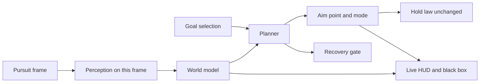
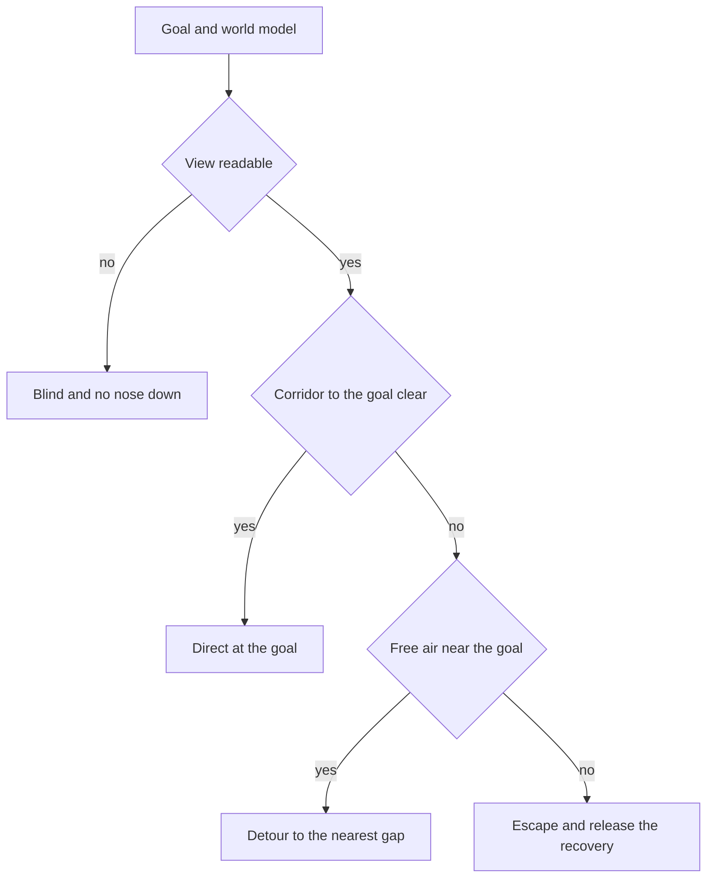
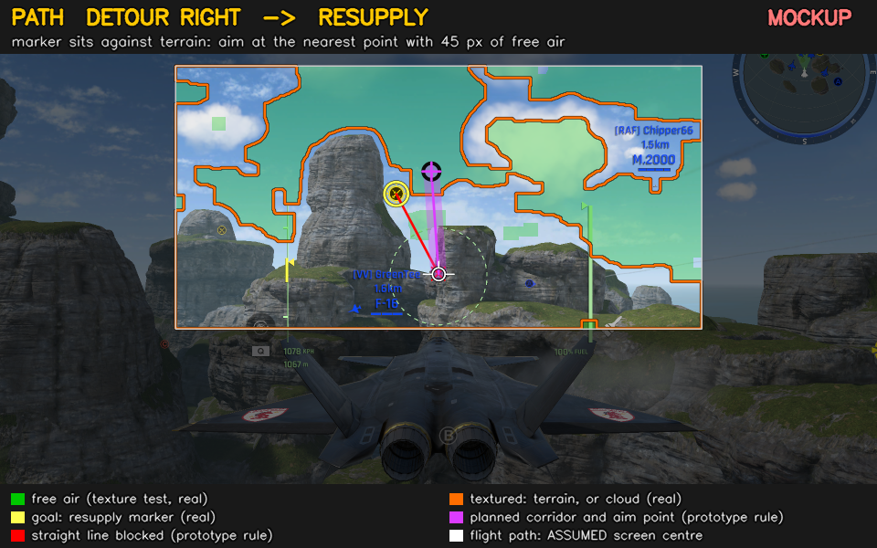

# Code Review 019 — Design: Terrain Avoidance (HLDD 001) Against Pursuit and Objective Capture

| Status | Date       | Wingman Version |
|--------|------------|-----------------|
| Draft  | 2026-10-15 | 1.9.2           |

## Scope

Operator, 2026-10-15: "deep review the terrain avoidance design of hldd1, we need this to operate in
conjunction with pursuit mode and objective capture, the next phase should make use of the
live_hud.png so we can see what wingman is detecting, in order to for example fly a resupply
objective wingman should identify a path clear of obstruction and follow that, similar to self
driving cars".

A design review of [Design 001](../hldd/001-terrain-avoidance-hldd.md) on branch `acs-optimization`
(HEAD `d45d4c5` plus the uncommitted working tree, ADR 160's removals among it). One question: what
does terrain avoidance need to work inside pursuit mode
([Design 015](../hldd/015-target-tracking-pursuit-mode-hldd.md)) and during objective capture
(resupply, the crown, control points), steering along a clear path and showing its reasoning on
`tests/test-output/live_hud.png`?

Method:

- Read: Design 001 in full; Design 015's pursuit, priority target, air superiority and objective
  count sections; [ADR 136](../adr/136-heatseeker-dive-invokable-mode.md) D4,
  [ADR 148](../adr/148-a-dive-recovery-flies-through-a-pursuit.md),
  [ADR 160](../adr/160-acs-mission-and-j20-are-the-only-missions.md),
  [Anomaly 011](../anomaly/011-resupply-focus-steers-at-terrain-and-exhaust.md),
  [Action Item 002](../action-item/002-emergency-climb-abandons-resupply.md) and
  [Action Item 003](../action-item/003-resupply-climb-out-baseline.md). Code: `pursue_and_engage`,
  `climb_mode`'s pursuit gates, `BehaviorTreeHandler.tick` and `_measure_loom`,
  `ClimbCondition.update_emergency`, `terrain_loom.py`, `terrain_shapes.py`, `hud.py`, and the
  `terrain_avoidance` and `pursuit_mode` blocks of `config.yaml`.
- Measured: one overnight session, `logs/wingman_20261015_060154.log` (2026-10-14 18:47 to
  2026-10-15 06:01, 11.2 h, ACS mission). The definitions are in "How the numbers were taken".
- Drawn: a mockup of the proposed HUD on the rock-map reference frame, from wingman's own texture
  test and resupply-marker detector ([019-2026-10/clear-path-hud-mockup.png](019-2026-10/clear-path-hud-mockup.png)).
- Not run: `make test`, any gate, or a live session. An operator session was running on `:3`
  throughout, so nothing was run against a display. No Mermaid renderer is installed here, so the
  two diagrams follow CLAUDE.md's compatibility profile but have not been rendered.

**Numbering.** CR-019-01 to -05 are cited in code from the parked shutdown review
(`tests/test_cr019_handback.py`, `analyzer.py`), so this review's items start at **CR-019-06**.

## Review summary

Design 001 built useful perception and gave it nothing to act on where wingman flies.

1. **Where wingman dies, terrain avoidance cannot act.** Overnight, 343 of 353 deaths ended a
   pursuit. Inside a pursuit a terrain verdict could reach the controls only as the tree's hard
   emergency, through ADR 148's recovery. That recovery does not start when the flight path is level
   or climbing, and it is held off while a target or objective is in view. Phase 1's motivating case,
   level flight into a cliff, fails the first gate by definition, and an objective approach fails the
   second. Graduating Phase 1 or Phase 2 as the HLDD plans would change almost nothing in the mode
   wingman flies (CR-019-06).
2. **The risk is concentrated in objective approaches, and the existing perception already sees
   it.** Approaches during which a shadow terrain warning fired ended in a death within 10 s far more
   often than approaches without one: control points 21 of 26 (81%) against 8 of 67 (12%), the crown
   9 of 15 (60%) against 7 of 29 (24%), the resupply marker 51 of 118 (43%) against 32 of 171 (19%).
   The steering flies straight at the marker, nose-down included (CR-019-07).
3. **The pieces of a planner exist; the planner does not.** Free air against texture, outlines with
   a time to contact each, a goal on screen and a hold law are all built. Missing are three things:
   the step that turns them into an aim point, a run on the frame the steering uses, and a HUD that
   shows that decision (CR-019-08 to -13).

"The next phase" below proposes a local planner in image space, between "what to fly at" and "how to
press keys", and a HUD redrawn around its decision. It is the reactive kind of planner that small
autonomous vehicles use when they have one sensor and no map.

## Findings

| ID | Severity | Area | Finding |
|----|----------|------|---------|
| CR-019-06 | High | Actuation | Terrain verdicts have no route to the controls inside a pursuit; the emergency climb cannot be terrain avoidance's actuator there |
| CR-019-07 | High | Objectives | Objective approaches steer straight at the marker, and the one terrain safeguard is held off for exactly that time |
| CR-019-08 | Medium | Timing | Terrain perception runs on the 1.5 s main tick; the steering it should inform runs about every 0.17 s on another thread |
| CR-019-09 | Medium | HUD | `live_hud.png` shows three detectors' verdicts, measured on other frames, in text too small to read, and no decision |
| CR-019-10 | Medium | Perception | Each detector reduces the view to one verdict; a planner needs free space and a time to contact per object |
| CR-019-11 | Medium | Perception | The flight path is approximated by a box that was refitted three times in one day |
| CR-019-12 | Medium | Approach | A steep approach puts the flight path behind the own airframe, outside the analysed view |
| CR-019-13 | Medium | Structure | The pursuit loop has no seam where a planner could go |
| CR-019-14 | Low | Documentation | HLDD 001 no longer says what the design is |
| CR-019-15 | Low | Measurement | Detectors are scored against a death label that keeps being revised |
| CR-019-16 | High | Safety (SAF-001) | Found in cycle 10: the `:3` key listener's deaf-restart left it dead for the rest of the session, so the operator's takeover keys on the game window went unheard |

---

### CR-019-06 — Terrain verdicts have no route to the controls inside a pursuit (High)

ACS activates pursuit mode at its last step ([docs/missions/acs.md](../missions/acs.md)), so a
session is mostly pursuit. Overnight, 343 of the 353 deaths ended a `pursue_and_engage`.

What each detector feeds today:

- Phase 1, the sky fraction, feeds the terrain term of `ClimbCondition.update_emergency`
  ([behavior_tree.py:752-769](../../wingman/behavior_tree.py#L752-L769)). It is shadowed, so it
  never joins `emergency`. The reason it stays shadowed is now night maps, where the sky reads 0.00
  (`config.yaml`, 2026-10-03 00:10), not the padlock camera that the HLDD's Open Questions still
  give.
- Phase 2, the pair readings and the shapes, feeds the BT log line, the `LOOM[shadow]` and
  `SHAPE[shadow]` warnings and the HUD, and nothing else
  ([tick_handlers.py:2515-2529](../../wingman/tick_handlers.py#L2515-L2529)). No condition reads
  either verdict.

Suppose both graduated. Inside a pursuit the tree reaches the airframe only through ADR 148's
recovery, and `climb_mode` starts that only past two gates
([controller.py:5637-5675](../../wingman/controller.py#L5637-L5675)):

1. **A level or climbing path: not started**
   ([controller.py:5656-5663](../../wingman/controller.py#L5656-L5663)). Phase 1 exists for "an
   aircraft flying level or gently climbing straight at a cliff face" (HLDD 001, "Redesign note").
   That case fails this gate by definition.
2. **A target or objective in view within `crash_recovery_clear_view_s` (1.0 s): held off**
   ([controller.py:5668-5675](../../wingman/controller.py#L5668-L5675), Action Item 002). Overnight,
   238 of 343 pursuit deaths had a `crash recovery held off` line in the 15 s before them. The line
   is rate-limited to one per 10 s, so this counts deaths, not episodes.

When the recovery does run, it is a nose-up hold. HLDD 001's own measurements (2026-10-04 02:40
row): 24 holds in 16 minutes lost a median of over 1,200 m each, and 11 were followed by a death
within 30 s. Before the overnight objective-steered deaths, the way out that the shapes offered was
`UP` 98 times, `LEFT` 13 and `RIGHT` 6. The HLDD's own note on that is "up is what the aircraft
already does and it fails against rising ground".

"Why the original design doesn't fit" argued that "a brand-new actuator isn't needed" because the
emergency climb existed. For the mode wingman now flies, the evidence gathered since says the
opposite.

**Recommendation.** Stop treating the emergency climb as terrain avoidance's actuator inside a
pursuit. The next phase's output is an aim point for the pursuit's existing steering. The
time-to-ground recovery stays as the last-resort backstop, gated on the planner's verdict instead of
on "something is in view" (step 3f below).

### CR-019-07 — Objective approaches steer straight at the marker, and the safeguard is held off for exactly that time (High)

The resupply marker is flown at by its offset from the screen centre on both axes
([controller.py:4443-4453](../../wingman/controller.py#L4443-L4453) roll,
[4512-4523](../../wingman/controller.py#L4512-L4523) pitch), and the crown and control points the
same way ([4454-4463](../../wingman/controller.py#L4454-L4463),
[4524-4534](../../wingman/controller.py#L4524-L4534)). Only the dive guard withholds pitch toward a
marker below the nose, and the dive guard is off (`pursuit_mode.dive_safety: false`, operator
2026-09-26). Nothing asks whether terrain lies between the nose and the marker, yet the markers sit
low among terrain. Design 015 has "A at 1,800 m between rock pillars", and Action Item 002 has
"Resupply markers sit near terrain".

Measured overnight:

| Objective | Flown through | Then a death within 10 s |
|-----------|---------------|--------------------------|
| Resupply (rearm confirmed) | 84 | 13 (15%) |
| Control point | 90 | 32 (36%) |
| Crown | 31 | 14 (45%) |

By approach (objective steering for 1 s or more; the outcome within 10 s of the approach's end):

| Objective | Shadow warning during it | Approaches | Then a death | Flown through, survived |
|-----------|--------------------------|------------|--------------|-------------------------|
| Resupply marker | yes | 118 | 51 (43%) | 21 |
| Resupply marker | no | 171 | 32 (19%) | 30 |
| Control point | yes | 26 | 21 (81%) | 5 |
| Control point | no | 67 | 8 (12%) | 9 |
| Crown | yes | 15 | 9 (60%) | 5 |
| Crown | no | 29 | 7 (24%) | 4 |

What the table does and does not say: it says the shadow detectors separate dangerous approaches
from safe ones, which is what a planner needs from its perception. It does not say that an earlier
turn would have saved those aircraft, because some warnings come only when the ground already fills
the view. Over all deaths with a warning in the 15 s before, the lead from the first warning to the
death was a median 5.7 s (10th percentile 2.7 s). A warning episode was followed by a death within
15 s 44% of the time for the shapes and 47% for the pair readings. At one death every 115 s, the
chance rate is about 12%.

One approach, from the log:

| Time | Event |
|------|-------|
| 18:49:24.2 | A control point's marker has the steering, at (940,488) |
| 18:49:25.2 | 2,321 m, -73 m/s. `SHAPE[shadow]`: growing in the middle, contact 1.2 s, way out LEFT; pair readings 2.7 s and 2.6 s |
| 18:49:26.1 | 1,860 m, 1,236 KPH, nose -14 deg |
| 18:49:26.9 | `LOOM[shadow]`: terrain closing, 2.7 s, on course |
| 18:49:27.7 | `crash recovery held off — the pursuit has the control point in view` |
| 18:49:28.7 | `OBJECTIVE: flew through an air superiority point` (65 px, 77 px off the centre) |
| 18:49:29.4 | The hard-emergency recovery takes the airframe at 1,562 m, nose -15 deg |
| 18:49:29.9 | It hands back after 0.5 s: `the pursuit has the target in view` |
| 18:49:31.1 | The health digits are gone: the death |

Both detectors called it 4 to 6 s ahead, and the shapes named a side. The steering flew at the marker, and the
safeguard waited for the marker, then gave way to a target.

**Recommendation.** Start the next phase with objective approaches, not with terrain avoidance in
general. The goal is known, the risk is concentrated there, and the baseline above makes the result
measurable. Resupply first, because it has the most approaches and Action Item 003's definitions;
then control points and the crown, which have the highest death rate after a warning.

### CR-019-08 — Terrain perception runs on the main tick; the steering runs in the pursuit thread (Medium)

`_measure_loom` runs in `BehaviorTreeHandler.tick` after the tree, once per 1.5 s tick. It grabs four
frames 0.12 s apart on the main thread and takes three pair readings and one shape reading
([tick_handlers.py:2095-2135](../../wingman/tick_handlers.py#L2095-L2135)). Overnight that cost a
median 519 ms of each tick (90th percentile 690 ms), taken from the loop's slack. The pursuit steers
on its own grabs about every 0.17 s (Action Item 003). So:

- a verdict is up to 1.5 s old before anything could read it, plus its confirm (two ticks for the
  shapes);
- the frames the steering acts on and the frames the detector judged are different frames;
- the HUD draws the main tick's outlines on the pursuit's later frame (CR-019-09).

HLDD 001 had already noted the answer without taking it: "The pursuit loop already grabs a frame about every
0.14 s, so a chase has the pairs" (Phase 2, "Frames"). The rule of "no separate vision thread" is
about not adding a second clock. Running the perception inside the consumer's loop, on the
consumer's frames, removes one.

**Recommendation.** While pursuing, take the shape reading in the pursuit loop from its own
consecutive frames, with no extra grabs and no waits, and skip the main-tick grabs. One owner at a
time also matters, because `TerrainLoom` and `TerrainShapes` hold state (streaks, the learned
static-edge mask) and are not made to be called from two threads. Shapes cost a median 28 ms
overnight (90th percentile 36 ms). At every steering cycle that stretches the cycle from about
0.17 s to about 0.2 s; every second cycle halves the cost. Measure both.

### CR-019-09 — The live HUD shows three detectors, from other frames, and no decision (Medium)

`HudRenderer._render` ([hud.py:514-525](../../wingman/hud.py#L514-L525)) draws Phase 1's box and
tint, the pair readings' points and box, and the shapes' outlines and arrow, each with its own status
line, then the pursued target.

- **Other frames.** The pair points and the outlines belong to the main tick's grabs. The picture
  they are drawn on is usually the pursuit's (`PURSUIT_MODE`), and `_TERRAIN_STALE_S` lets a reading
  up to 4 s old be drawn as current. On a turning aircraft, an outline one second old is in the wrong
  place.
- **Illegible.** Text is drawn at full resolution at scale 0.52, then the canvas is halved
  ([hud.py:617](../../wingman/hud.py#L617)), so in the file the operator watches the status lines
  are about 6 px tall.
- **No decision.** The frame the operator's session wrote at 06:49:27 today (read during this review,
  overwritten since) showed, over the explosion and the RESPAWN banner, `TERRAIN AHEAD` in red,
  `Loom[SHADOW]: contact 4.1s on course`, and in green `Shape[SHADOW]: 3 shapes, none growing in the
  middle`. That is three verdicts, the third contradicting the first two, and nothing on the image
  says what wingman decided or why.
- **No history.** `live_hud.png` is overwritten every second, and
  `hud.target_tracking_archive.enabled` is `false`. The frames before a crash are gone.

**Recommendation.** Draw one HUD from the planner's state, computed on the frame being drawn. Put
the decision in a banner, show the world model as layers, draw the text after the downscale so it
can be read, and add a black box that keeps the last ten seconds of annotated frames and writes them
out on a death and on a planner mode change. The spec is in "The live HUD" below.

### CR-019-10 — Each detector reduces the view to one verdict (Medium)

- Phase 1 gives one sky fraction in one fixed box. It read 0.00 on a night map and below 0.55 on
  1,270 of 1,335 canyon readings.
- The pair readings fit one similarity transform to the whole view, so they give one time to
  contact and one expansion point, averaging "a near mesa with a far ridge" (the HLDD's words).
- The shapes measure outlines with a time to contact each, then reduce them to the single centred
  `threat` and a `left`, `right` or `up` way out from the middle of the screen, confirmed over two
  ticks.

A planner needs what the shapes compute before that reduction: the free-air mask, every outline with
its time to contact (or "unknown"), and the goal's position. The reduction is also behind the confirm
problems the HLDD logs (scatter between readings, a way out flipping side), which a continuous cost
with hysteresis does not have.

In one frame, texture does not tell cloud from rock (HLDD 001: 4.0 against 4.1 corners per
1,000 px). The mockup shows it: the cumulus above the spires is outlined as textured. Growth tells
them apart, so until a time to contact is measured, a textured region is a cost, not a wall.

**Recommendation.** Keep `TerrainShapes`'s texture mask, outlines and dots-inside time to contact,
and expose them each frame as a world model. Let the planner decide, not a confirm per detector.

### CR-019-11 — The flight path is approximated by a box (Medium)

On 2026-10-03 the path box went from closed, to open below, to without sides, each version refitted
on replays of the sessions before. The rule chosen on two sessions warned before 17 of 21 terrain
deaths there and 4 of 9 in the next session (HLDD 001, 08:42 session). The HLDD names the cause: the
aircraft does not fly where the camera points, and in a descent the expansion point drops below the
box, often below the frame.

A corridor needs its origin, which is where the aircraft is actually going. Three sources exist:

1. The expansion point of a fit to consecutive frames. It is noisy at 2 frames a second and readable
   at 0.12 s pairs, per the HLDD.
2. The telemetry flight-path angle, `TelemetrySnapshot.pitch_angle_deg()`, from the read altitude
   rate and speed. It is vertical only, and it lags.
3. The game's dashed ring. ADR 136 D4 found it "not fixed at screen center" and "consistent with a
   flight-path/velocity-vector marker". That was inferred, not verified. If it holds, the game
   already draws the flight path.

**Recommendation.** A spike on the third source: on archived frames with telemetry, does the ring's
vertical offset follow the path angle? Then fuse it, or the expansion point, with the telemetry
angle into one flight-path point, and draw that point on the HUD.

### CR-019-12 — A steep approach puts the flight path behind the own airframe (Medium)

The analysed view is `view_pct`: x 0.20 to 0.80, y 0.12 to 0.60. Below y 0.60 the third-person
camera shows the own airframe. In a descent the flight path is below the boresight. At the resupply
pass the nose was a median -10 deg (10th percentile -28 deg), and the dive recovery took the
airframe within 5 s of 49% of pickups (Action Item 003). However good its perception, a forward-view
planner cannot see the terrain on the actual path of a steep approach.

**Recommendation.** Fly approaches the way aircraft land. Hold height until the marker is a set angle
below the nose, then descend on a capped glide path so the flight path stays in the analysed view.
After the pass, leave on the clearest gap the planner sees instead of a blind nose-up (the climb-out
of Action Item 003). The trigger angle and the cap are operator decisions, and named guesses until
measured.

### CR-019-13 — The pursuit loop has no seam for a planner (Medium)

`pursue_and_engage` is 908 lines ([controller.py:3945-4853](../../wingman/controller.py#L3945-L4853)).
One steering cycle chooses the goal (resupply marker, crown or control-point marker, target, pins,
search), arbitrates with the recovery and the climb-out, and applies the key law, through two
parallel cascades, one per axis. Path planning added inside would become a fourth concern in every
branch of both.

**Recommendation.** Before the planner, split the cycle into three calls, with behaviour preserved:
choose the goal (what), plan the aim point (how to get there; at first, the goal itself), and steer
(the existing hold law). A self-driving stack separates behaviour planning, motion planning and
control the same way, and it is the seam CR-018-13 asked for. The planner can then be unit-tested on
saved frames, outside the loop.

### CR-019-14 — HLDD 001 no longer says what the design is (Low)

- The status table says Active, 2026-09-20, 1.8.9. The body runs to 2026-10-04 and 1.9.0, and
  Phase 2 is Draft and in shadow.
- Trial tables are 64 of its 136 KB. The overlay table of 2026-10-03 and 10-04 holds rows about the
  covered window, the one-picture-a-second game and the desktop extension, which are Design 009's.
- "Successor approach: a map of the terrain" points to Design 017, whose survey mission ADR 160
  removed on 2026-10-14. The forward-view detectors are the only terrain perception left, and the
  document does not say so.
- "Phase 2+ (not designed here, explicitly deferred)" still lists looming and lateral avoidance.
  Both are designed above it and run in shadow.
- The config excerpt says `capture_max: 40`; the shipped value is 0.
- Open Question 6 and the 2026-09-20 addendum read as unresolved, but ADR 142's padlock gate is in
  code ([tick_handlers.py:2441-2442](../../wingman/tick_handlers.py#L2441-L2442)), and the reason
  for shadow has moved to night maps.
- "Integration Points" covers Phase 1 only, and no section says that Phase 2 feeds nothing.

**Recommendation.** Use CR-018-18's shape. The first page states what runs, in which mode, feeding
what, and shown how. The trial tables move to a `docs/performance/` or `docs/anomaly/` document.
Write the next phase as its own design (Design 018), linked from this one, not as another appended
section.

### CR-019-15 — Detectors are scored against a death label that keeps changing (Low)

HLDD 001 scores warnings against deaths logged `cause=terrain`. That label has been revised for
missile kills during a recovery (`contested`), for round ends and for gun kills. Overnight, 142 of
343 pursuit deaths had no cause line at all: the classifier writes one only for a death with the
primary rack selected and its count not read as zero. A planner on objective approaches
can be judged on outcomes that need no label: deaths within 10 s of an approach, objectives flown per
hour, and pursuit deaths per hour, all with Action Item 003's definitions.

---

### CR-019-16 — The `:3` key listener's deaf-restart can leave it dead (High)

Found on 2026-10-15 in the cycle-10 session (`make rd`, started 21:41:32), not caused by this
review's changes. At 21:42:32 the watchdog in `input_linux.py` logged `XKey[:3]: heard no key
presses in the last 60s while wingman pressed keys there - the listener is deaf; restarting it
(SAF-001 takeover path)`, and no `XKey[:3]` line followed: the listener logs one a minute while it
records, and the four sessions before it logged 51 to 138 such lines with no deaf episode. Two
synthetic `z` presses at 21:58 were not acknowledged, where every earlier press today was. So from
21:42 the operator's keys on the game window, the SAF-001 manual takeover among them, were not
heard. It came back at 22:01:39, when the listener thread died on `Display connection closed by
server: Bad file descriptor` and the reconnect path ran (`display reconnected after 1 attempt(s) -
hotkeys active again`, 22:01:42), two seconds after the operator's keyboard held Alt on the game
window: 19 minutes deaf. `tests/test_input_linux.py::test_a_deaf_listener_is_restarted` failed in two of this cycle's
full-suite runs and passed alone, which was read as the known ordering flake; it may be the same
restart path failing under load.

**Recommendation.** Make the restart prove itself: the listener's next interval must log, and a
second deaf interval (or none logged within two) should be an ERROR and a session-level response
(stop at the next lobby), not another silent restart. Owner: the SAF-001 / input path, not this
review's planner work.

**Fixed (2026-10-15 22:3x, operator: "make your recommended changes").** The trace shows where the
restart stuck: after the watchdog's disable no `restarting the :3 listener` line followed, so the
blocked `record_enable_context` never returned, and nothing after the warning came from the
watchdog either. Its `d_rec.close()` from the watchdog thread can block too, since python-xlib
flushes before closing, under the lock the blocked read holds, and on Linux closing a socket does
not wake a thread blocked reading it. `_wake_record_connection` now shuts the socket down
(`shutdown(SHUT_RDWR)`), which does wake it, without python-xlib's locks; the read fails and the
loop's error path reconnects, logged as `restarting the :3 listener after the deaf watchdog (its
recording was shut down ...)` rather than `thread died`. If the iteration still has not ended
`_DEAF_RESTART_WAIT_S` (5 s) after the shutdown, an ERROR says the keys on that display are not
heard. The session-level response (stop at the next lobby) is not built. Tests:
`test_a_wedged_deaf_recording_is_shut_down_and_the_listener_restarts` and
`test_a_deaf_listener_that_will_not_restart_is_an_error` in `tests/test_input_linux.py`, whose
fakes ignore the disable as the live recording did. The flaky `test_a_deaf_listener_is_restarted`
(2 failures in 8 runs) was its fake's race, not the code's: the fake released whichever recording
had last started, so a stop between a context's creation and its enable was lost; its disable now
targets its own context, as XRecord's does (0 failures in 8 runs of the file).

## The next phase: clear-path steering (proposal)

### The idea

In self-driving terms, wingman has perception (in shadow) and control (the hold law), and nothing
between them: the steering points the nose at the goal. A car's stack puts a motion planner there.
It takes the drivable area, the obstacles and the destination, and returns the next point to drive
at. Wingman has no depth sensor, no map in flight and no localisation. The planner it can have is
the reactive, image-space kind that small autonomous vehicles use with one camera or one scanner:
find free space near the goal and steer into the gap (follow-the-gap, Sezer and Gokasan 2012; the
vector field histogram, Borenstein and Koren 1991). Time to contact from looming (Lee 1976) stands
in for distance.

| Self-driving car | Wingman today | Proposed |
|------------------|---------------|----------|
| Drivable area | Texture mask, shadow, main tick | Free-air mask on each steering frame |
| Obstacles with time to collision | Outlines with a time to contact, reduced to one threat | Every outline with its time to contact, or unknown |
| Ego motion, where the car is going | Screen centre and the path box | The flight-path point (CR-019-11) |
| Destination | Marker, target or pin, from the pursuit's cascade | Unchanged |
| Motion planner | None: the nose is pointed at the goal | Aim point at the free-air gap nearest the goal |
| Controller | Hold law and hold model | Unchanged, given the aim point |
| Emergency braking | ADR 148 recovery, held off near goals | The same recovery, released when the planner finds no corridor |
| Display and data logger | Three detector overlays, overwritten each second | One HUD of the planner's world and decision, plus a black box |

### Where it sits

In words: the world model is the free-air mask, the outlines with their times to contact, the
flight-path point, and the goal with its own time to contact when that can be measured. Goal
selection is today's cascade (resupply marker, crown or control point, target, pin, search),
moved out of the steering (CR-019-13). The planner returns an aim point and one of four modes:
DIRECT, DETOUR (over, left or right), ESCAPE and BLIND.

### The planner, first version

Deliberately small, so that each decision can be read off the HUD:

1. **DIRECT.** The goal has at least `clear_px` of free air around it, and no outline closing faster
   than the goal lies on the line from the flight-path point to it. When the goal's own time to
   contact is unknown, "faster than the goal" becomes "within `tau_warn_s`". The aim point is the
   goal, which is today's behaviour and should stay the common case: 171 of 289 resupply approaches
   overnight had no warning.
2. **DETOUR.** Otherwise the aim point is the point nearest the goal with `clear_px` of free air
   around it (the mockup's rule). It is held for at least `hold_s` unless the goal turns direct, so
   the side cannot flip from frame to frame. The side, over, left or right, is logged.
3. **ESCAPE.** Either no point in the view has that clearance, or an outline on the flight path is
   closing in under `escape_tau_s`. The aim point is the shapes' way out, and the recovery is no
   longer held off for the goal.
4. **BLIND.** The view is unreadable (few points, a frozen picture, night) while the goal is below the
   nose. No nose-down toward the goal: aim at its bearing, level.

"Corridor clear" and "free air near the goal" are the tests in items 1 and 2. Goal selection, the
hold law, the dive guard and the recovery's own triggers are unchanged.

### The goal's own time to contact

Whether an outline is in front of the goal or behind it is a question of depth, and one camera
answers it only through time to contact. The markers grow as the aircraft closes. Design 015 has "A
nearer point is drawn larger", with control-point discs at 19 to 25 px at usual range and 56 px at
the nearest caught. So size over its rate of growth may give the goal's time to contact, if the game
scales the marker with distance and not in steps. That is not known: the logs give the size only at
the last sighting. The spike is to log the marker's width and height on every sighting for one
session, and fit size against time on approaches that ended in a fly-through.

Without it, the planner treats any outline on the corridor closing within `tau_warn_s` as being in
front of the goal. That errs toward detours.

### The live HUD

The pursuit loop draws it, on the frame the planner has just used, so nothing on it comes from
another frame.

- **Banner**, large, at the top: the mode and the goal, for example `PATH  DETOUR OVER  ->  RESUPPLY`,
  coloured by mode, with one reason line such as `marker against terrain closing 3.1 s; aim 64 px
  above it`.
- **Free air**: a light green tint inside the analysed view. The area outside the view is dimmed, so
  it is plain what wingman did not look at.
- **Outlines**: coloured by time to contact (red under 4 s, amber under 8 s, grey when far or
  unknown), each labelled with its figure.
- **Flight-path point**: a winged circle where the aircraft is going (CR-019-11), not at the screen
  centre.
- **Goal**: ringed in its own colour and labelled.
- **Corridor and aim point**: a translucent magenta band from the flight-path point to the aim point.
  Magenta is already reserved for what the steering flies at (`_PURSUIT` in `hud.py`). A blocked
  straight line is drawn in red.
- **Inputs line**: altitude, rate, time to ground, the goal's time to contact, clearance.
- **Legible**: text drawn after the downscale, at a size that reads at 960 by 600.
- **Detector lines**: today's three status lines move behind a debug switch.
- **Black box**: the last 10 s of annotated frames at the HUD rate, kept in memory and written to
  `test_screenshots/path_blackbox/<time>/` on a death and on a mode change, within
  `capture_budget`. With it, every crash can be watched as wingman saw it.

The mockup is drawn on the rock-map reference frame: 1,067 m, 1,078 KPH, a resupply marker beside a
spire, and the nose on rock. The free air and the outlines are wingman's own texture test. The
marker is `find_resupply_marker`'s. The corridor and the aim point come from the prototype clearance
rule above, and the flight-path point is assumed at the screen centre. The picture also shows
CR-019-10's cloud problem: the cumulus is outlined as textured.

### Steps

One change per step, shadow before actuation, as the project does elsewhere.

| Step | Change | Actuates | Exit check |
|------|--------|----------|------------|
| 3a | Shapes taken on the pursuit's own frames and the main-tick grabs off while pursuing (CR-019-08); the HUD drawn from them, with the black box (CR-019-09) | No | Cost per cycle at the pursuit rate; readable share at 0.17 s frames (HLDD 001 open item 1); the operator can read the HUD |
| 3b | Spikes: marker growth, the dashed ring as the flight path, the own airframe on a second aircraft | No | Each answered with a measurement |
| 3c | The steering cycle split into goal, plan and steer, with the plan returning the goal (CR-019-13) | No change | `make tp` green; a live session with the same pursuit figures |
| 3d | The planner in shadow: a `PATH[shadow]:` line each cycle, and the HUD shows its corridor | No | On logged approaches that ended in a death, the share where it said DETOUR or ESCAPE 3 s or more before; on approaches flown and survived, the share where it said DIRECT |
| 3e | The planner steers the resupply marker, with the approach of CR-019-12 | Resupply | Deaths within 10 s of an approach (43% warned, 19% unwarned now); rearms per hour not lower (7.5 now) |
| 3f | The recovery's hold-off becomes "goal in view and corridor clear" (CR-019-06) | Recovery | Held-off episodes followed by a death |
| 3g | Control points and the crown | Objectives | 81% and 60% death after a warning now |
| 3h | The climb-out after a pass leaves on the planner's gap | Climb-out | Action Item 003's altitude at +3 s and deaths within 10 s |
| 3i | The target chase, if the operator wants it. Following an enemy into terrain is the hardest case, and `dive_safety: false` was the operator's choice for the chase | Chase | Operator decision first |

### Baseline for the comparison

From this review's session, 11.2 h of ACS:

| Measure | Now |
|---------|-----|
| Pursuit deaths per hour | 30.5 (343) |
| Resupply rearms per hour | 7.5 (84) |
| Control points flown per hour | 8.0 (90) |
| Crowns flown per hour | 2.8 (31) |
| Death within 10 s of a fly-through: resupply, control point, crown | 15%, 36%, 45% |
| Death within 10 s of a warned approach: resupply, control point, crown | 43%, 81%, 60% |
| Lead from the first shadow warning to the death, median | 5.7 s |

### Risks

- **Cloud** reads as rock in one frame. Expect false detours until a time to contact shows it is not
  growing.
- **Night maps** have little texture, so everything reads as free air and the planner says DIRECT.
  The time-to-ground recovery stays the backstop there.
- **A frozen picture** ([Design 009](../hldd/009-nested-display-isolation-hldd.md)): two equal
  frames give no growth, and the planner must not take "no growth" for "far".
- **Near the ground the view is unreadable.** A third to two thirds of the readings before terrain
  deaths on 2026-10-03 were. BLIND must never mean clear.
- **Local only.** A ridge wider than the view has no gap, which gives ESCAPE. Going round a mountain
  range needs a map ([Design 017](../hldd/017-terrain-map-from-flight-footage-hldd.md), paused).
- **The own airframe.** ACS flies any airframe (operator, 2026-10-03). The view crop and the learned
  static-edge mask keep it out in level flight, but in a bank the wings can enter the view. Check on
  a second airframe in step 3b.

### Open for the operator

1. The approach (CR-019-12): how far below the nose the marker must be before the descent, and what
   glide path cap. It costs time on each objective.
2. Whether the planner should ever steer the target chase (step 3i).
3. The HUD rate while pursuing. It is 1 s now; 2 to 3 a second costs one file write each.
4. A disk budget for the black box.
5. Where the design lives: a new Design 018 (recommended), or a Phase 3 section in HLDD 001.

## What is working, and should be protected

- **Shadow first, logged every tick.** `sky=`, `tau=` and `shape=` on the BT line are why this review
  could measure anything.
- **The outline-and-dots primitive** in `terrain_shapes.py`: free air against texture, and growth
  from the dots inside each outline. It is the planner's perception. It needs a different clock, not
  a rewrite.
- **HUD masking that does not know the airframe**: the colour mask and the learned static-edge mask.
- **The objective detectors** (`find_resupply_marker` and the crown and control-point finders),
  measured on thousands of archived frames.
- **The hold law and hold model** ([Design 005](../hldd/005-target-tracking-hldd.md)). The planner
  hands it an aim point, so no new control law is needed.
- **One actuator** ([ADR 151](../adr/151-one-actuator-and-throttle-leases.md)). An aim point adds no
  key writer.
- **Action Item 003's outcome definitions**, reusable as the planner's yardstick.

## Recommended order of work

Sizes are in sessions: S is one or less, M is two to three, L is four or more.

1. **Step 3a: CR-019-08 and CR-019-09 together (M).** It is what the operator asked for first ("so
   we can see what wingman is detecting"), it changes no flight behaviour, and every later step is
   judged on that HUD and its black box.
2. **Step 3b spikes (S each):** marker growth, the dashed ring, a second airframe.
3. **Step 3c: CR-019-13 (M),** behaviour-preserving.
4. **Steps 3d then 3e: CR-019-07, -10 and -12 (L):** the planner in shadow, then steering the
   resupply marker, with the approach.
5. **Step 3f: CR-019-06 (S).**
6. **Steps 3g and 3h (M).** Step 3i only on the operator's word.
7. **CR-019-14 and -15 (S),** when Design 018 is written.

## Implementation and live evidence

Operator, 2026-10-15: "implement the design steps, auto /iterate using 'make rd'". Each step lands
as one change, gated by `make lint && make test`, then flown with `make rd`.

**Step 3a, part 1 (2026-10-15): perception on the pursuit's frames and a HUD that reads.**

- `wingman/clear_path.py`, `PathPerception`: the pair reading and the outlines taken on the
  pursuit's own consecutive pictures, after the cycle's keys are pressed, with detector instances of
  its own. A picture that repeats the one before gives no view. One `PATHVIEW:` DEBUG line per view
  and one `PATHVIEW SUMMARY:` INFO line per pursuit. Config `clear_path.enabled` (schema default
  off, shipped on). Shadow: nothing steers on it.
- `hud.py`: during a pursuit the HUD is drawn from the picture the view was taken on, with free air
  tinted, the area outside the analysed view dimmed, each outline coloured by its time to contact
  (red under 4 s, amber under 8 s, white measured and not closing, grey not measured) and labelled
  on the object, the expansion point drawn as a heading marker, and one `PATH[SHADOW]:` line. All
  HUD text is now drawn after the downscale, on backing panels, so it reads in the 960 by 600 file
  (CR-019-09).
- Deviation from step 3a as written: the main tick's grabs stay on while pursuing. Its
  `LOOM[shadow]` and `SHAPE[shadow]` warnings are the baseline the approach table above was
  measured with, and the planner of step 3d is to be scored against them on the same approaches.
- Tests: `tests/test_clear_path.py`.

**Step 3a, part 1b (2026-10-15): the measurement off the steering thread.** The first live run
(row below) measured the steering cycle slowed by the measurement. `PathPerception` now has a
worker thread of its own, started and stopped with each pursuit (and by `cleanup()`). The pursuit
`submit`s each picture and steers on; a picture the worker has not started when the next arrives
is replaced by it (`dropped=` on the summary line), so the work never queues. The worker draws the
HUD with the steering of the cycle the picture came from. `tests/test_clear_path.py` holds a
0.3 s measurement against the steering's cycle count.

**Step 3a, part 2 (2026-10-15, off until its run): the black box.** `hud.black_box`: the last 18 s
of annotated frames, three a second, held in memory as JPEG and written at each death to
`test_screenshots/path_blackbox/<stamp>_death_<nn>_<HHMMSS.mmm>.jpg` within the capture budget.
Live runs only. The `RESUPPLY:`, `AIRSUP:` and `PRIORITY:` lines also carry `size=WxH` of the
cycle's own sighting, for step 3b's marker-growth spike. Tests: `tests/test_hud_black_box.py`.

**Step 3d (2026-10-15): the planner, in shadow.** Taken ahead of step 3c: the planner needs the
goal and the view of the same picture, not a split loop, so the pursuit hands the goal to the
worker with the picture (`clear_path.PathGoal`: the resupply marker, crown or control point with
the steering, else the tracked target). `PathPlanner` answers on that picture:

- **DIRECT**: the goal has `clear_px` (60 px) of free air round it and the straight line from the
  flight-path point crosses no obstacle. The aim is the goal.
- **DETOUR** over, under, left or right: the nearest point to the goal with that free air and a
  clear line, kept on its side for `hold_s` (1 s).
- **ESCAPE**: the flight-path point is on an obstacle closing in under `escape_tau_s` (3 s), or no
  point qualifies; the aim is the free air nearest the flight path, up before down.
- **BLIND**: the view is unreadable, or the goal is outside the analysed view (below y 0.60 the own
  airframe fills the picture).

An obstacle is an outline closing within `tau_warn_s` (8 s), or one covering the middle with too
few dots to measure. What the aircraft is already flying at, but not about to hit, does not block
a line that starts inside it. The flight-path point is the pair reading's expansion point when it
lies in the view, else the screen centre. Logged as `PATH:` DEBUG lines each view, `PATH[shadow]:`
INFO lines on a change of mode, and a `plans:` count on the summary line; the HUD draws the corridor
from the flight-path point to the aim, the aim, and the blocked straight line in red. Nothing
steers on it. Config `clear_path.planner`. Tests: `tests/test_clear_path_planner.py`.

**Step 3d, revised (2026-10-15 13:40): an alarm must mean something before it steers.** From the
five hours in shadow (row below): 77% of the planner's alarms on objectives came from outlines it
could not measure, which it counted as walls, and the marker's own size cannot give the goal a
time to contact (step 3b). So:

- An outline with too few dots to measure is an unknown, not an obstacle. A goal drawn against one,
  or a line to the goal through one, is BLIND ("cannot measure"), never DETOUR or ESCAPE.
- The outline the goal is drawn against is the surface it sits by. A closing outline blocks only
  when it closes sooner than `nearer_frac` (0.7) of that surface's time; one that closes no sooner
  is at the goal's depth or behind it. What the aircraft is flying at still counts against the room
  round the goal, as before.
- The view is not taken while health is not being read (`game_battle_alive`): at 08:24 it was taken
  of the round-end MVP card, which the state still called a pursuit. Counted as `no_health=` on the
  summary line.
- `clear=inf` when nothing in view is an obstacle (it printed the distance transform's 6.8e38).

Step 3e (steering on the plan) stays off until the revised planner has its own shadow verdict.

**Cycle 5 (2026-10-15, in the tree, next run): a clip round each planner alarm.** ESCAPE was right
about a third of the time and DETOUR's precision on objectives is not known; tuning either needs to
see what each alarm was looking at, and the death dumps only show the alarms a death followed. Each
DETOUR or ESCAPE now leaves the last 4 s of the box, taken 1.5 s after it, in
`test_screenshots/path_blackbox/alarms/` (its own capture budget), at most one every 30 s and 60 a
session (`hud.black_box.alarm_max`, `alarm_gap_s`, `alarm_seconds`). The box is not cleared, so a
death a moment later still gets its whole 18 s.

**Cycle 6 (2026-10-15, in the tree, next run): the wall behind the goal.** The climb-out deaths
after a pickup (row below) are the post-pass hazard the planner does not flag: the goal's own
surface does not block the line to the goal, so the views before those deaths were mostly DIRECT.
Before 62 resupply climb-outs since 08:18, the fastest-closing middle outline in the 2 s before the
climb-out had a median time to contact of 2.2 s ahead of the 26 that ended in a death within 10 s,
and 4.8 s ahead of the 36 that did not. Under 3 s: 17 of the 24 deaths with one measured, and 14 of
the 36 survivals. Each plan now carries `wall_tau`, the time to contact of the measured outline the
goal is drawn against when it is closing, as `wall=` on the `PATH:` line and `wall X.Xs` beside the
goal's ring on the HUD. Under `clear_path.planner.wall_warn_s` (3 s) a view is logged once as
`PATH[shadow]: wall behind the <goal> closing in X.X s` and counted as `wall_close=` on the summary
line. Reported only: no mode depends on it. The climb-out itself belongs to the resupply work of
another session, which has the figure.

**Cycle 7 (2026-10-15, in the tree, next run): the wall round the goal, and clips that pay.** The
first cycle-6 pickups survived walls read at 0.8 to 1.5 s, held near 1 s for 2 s, which no closing
surface allows: the outline the marker was drawn against was all the terrain in view (a night
canyon, 16:44), and its one fit was set by the rims rushing past under the aircraft. Each plan now
also carries `wall_local_tau`, the growth of the dots within `wall_radius_px` (150 px) of the goal on
its own outline, fitted alone (at least `wall_min_dots`, 8): `wall_local=` on the `PATH:` line and
`local X.Xs` beside the ring. The shapes reading keeps the dots' previous positions for it
(`points_before`). Alarm clips no longer follow DETOUR on a target: 2 of the 15 such clips in
cycles 5 and 6 were followed by a death within 10 s, one to enemy guns and one `contested` (a
missile alert and a dive emergency both recent), while they took most of the clip budget.
A clip now also follows a wall under `wall_warn_s` behind the resupply marker (`wall-resupply`), so
pickups that survive a close wall are seen as well as those that do not. Both reported only.

**Step 3f, measured offline and held (2026-10-15 18:10).** The step would hold the crash recovery
off only while the goal is in view and the planner says the corridor is clear. On the five logs
since the planner's revision, each `crash recovery held off` line (the first of each 10 s) joined to
the plan on the picture before it: DIRECT 59, then a death within 10 s 12 (20%); BLIND 33, 12 (36%);
ESCAPE 3, 2; DETOUR 2, 0; no plan 19, 5 (26%). Releasing on all but DIRECT would release 57 moments
with 33% deaths and keep 59 with 20%, and what it releases is the nose-up hold that lost a median
1,200 m a hold (2026-10-04). Not enough to override the operator's 2026-10-08 rule; held.

**Cycle 8 (2026-10-15, in the tree, next run): the aircraft's own speed and path on the plans.**
Neither altitude nor descent rate in the 3 s before a rearm climb-out separates the outcomes (84
climb-outs: median 1,678 m and a steepest rate of -46 m/s before the 30 deaths, 1,709 m and -44 m/s
before the 54 survivals), so "dive less" has no support yet. The two climb-out deaths watched in
the operator's 17:05 session passed the marker at 1,134 and 1,233 KPH (one at 8 HP); the log has no
airspeed to count that with. The pursuit now hands the planner its airspeed and flight-path angle
from one telemetry snapshot with each picture, logged as `spd=` and `path=` on the `PATH:` line.
Reported only.

**Cycle 9 (2026-10-15, operator: "build it live now"): the airbrake on the resupply approach.**
The operator asked whether a projected flight path should avoid terrain while capturing objectives,
and pointed out that `AIRBRAKE_KEY` is never used to keep the approach from being flown too fast.
The airbrake was pressed only by the emergency climb; cruise (ADR 134) holds the afterburner from
90% fuel down to 40%, most of a battle. Step one of a projected-path planner is the energy it
needs: `Controller._approach_brake_tick`, every pursuit cycle while the resupply marker has the
steering (not in a climb-out or a recovery). The speed is read about every 3 s (median gap 3.0 s
between changes of `spd=`) and ADR 159 measured the airbrake at 500 to 600 KPH off per 3 s, so a
threshold would overshoot by hundreds of KPH; each fresh reading above `cap_kph` (850) starts a dose
of (reading - `target_kph` (800)) / `decel_kph_s` (150) seconds, at most `max_dose_s` (3 s), and a
fresh reading at or below the target ends it. Cruise yields to the brake in `_THROTTLE_YIELDS`, its
burner lifted at once (ADR 151 D4), and pauses rather than ends, so it re-presses on its first tick
after the brake instead of waiting for the fuel to refill. The brake lets go at the climb-out, at
any climb (the emergency climb takes the key itself), during a missile evade or the afterburner
evade, on a takeover and when the marker loses the steering (`resupply_control`, which the marked
objective's arbitration can turn off with the marker in view). `SPEEDCAP:` lines; `+ AIRBRAKE` on
the HUD's steering label; a row in `docs/architecture.md` "Flight-input precedence". Tests:
`tests/test_approach_brake.py` and an end-to-end pursuit in `tests/test_clear_path.py`. Live, not
shadow. Measured against: deaths within 10 s of a rearm climb-out, 14 of 59 (24%) in the six logs
from 12:48 to 17:01 but 0% to 81% between sessions, and rearms per hour; at least 40 climb-outs
before a verdict.

**Toward a projected path (2026-10-15 19:20): what it needs that wingman lacks.** A planner that
rolls the aircraft's next few seconds forward under each manoeuvre needs the aircraft's state and
the terrain's depth, fresh. Two findings:

- *Telemetry is 3 s old.* Speed and altitude are read every second main tick
  (`telemetry.ocr_every_n_ticks: 2`, about 0.4 s of OCR a read); `spd=` changed with a median gap
  of 3.0 s. A pull-out projection, height lost = (V / q)(1 - cos gamma) for a pull at pitch rate q
  from a dive of gamma, would run on readings up to 3 s stale, and so does the approach brake's dose.
  Reading every tick would halve it, but the climb, stall prevention and the plausibility filter
  were tuned at this cadence: an operator decision, not taken here.
- *Depth without dots (spike, offline).* Depth Anything V2 Small on raw frames of
  `logs/session_20261004_181359_acct1.mp4`, run on the CPU (the PC has no usable CUDA device): 600
  to 1,000 ms a frame at 518 px, 250 to 320 ms at 364 px, 95 to 200 ms at 252 px (4 threads). By
  eye, it separates sky from terrain (clouds read far) and orders a canyon's spires near to far,
  smooth rock included, where the dots fail; the own airframe and the game HUD read nearest and
  need the view box and the HUD mask. It gives relative depth, so time to contact still has to come
  from its change between pictures or from the dots. A candidate for the planner's terrain at a few
  pictures a second on its own worker; nothing uses it yet, and it would be a new dependency
  (`transformers`) for the operator to approve.

**Cycle 10 (operator, 2026-10-15 21:2x): telemetry every tick.** `telemetry.ocr_every_n_ticks`
back to 1, the cadence its gates were designed for (`max_gate_dt_s` 1.5). Live from 21:41: `spd=`
changed with a median gap of 1.53 s (75th percentile 1.59 s) against 3.0 s before. Plausibility
rejections 5.2 per 100 tree ticks over the first 116, against 1.7 and 2.2 in the two sessions
before; with two readings a tick instead of one that is about the same per reading. Watched, not
yet a verdict.

**Cycle 11 (operator: "shadow first"): the depth view.** `wingman/depth_view.py` and
`wingman/depth_worker.py`. The worker is its own process (`python -m wingman.depth_worker`),
speaking a small binary protocol on its pipes, so torch's threads are not the OCR's, the first
load holds nothing up and a crash costs only the depth view. One I/O thread feeds it the newest
picture from the pursuit (the same health gate as the path view), at most one every
`depth_view.min_interval_s` (0.3 s). Each answer gives the analysed view's nearness (by its own
2nd and 98th percentiles), `mid_rank` (the share of the view farther than its middle) and the
nearest point: `DEPTH:` DEBUG lines, a `DEPTHVIEW SUMMARY:` per pursuit, and a small map left of
the analysed view on the HUD (`DEPTH[SHADOW]`), greyed when more than 1 s from the picture. New
dependency `transformers` (`uv add`, the lock gained 13 packages and changed none). Checked on a
recorded frame with the real model: ready 9.6 s after start including the one-time download, then
101 to 183 ms a picture, 111 to 203 ms round trip. Tests: `tests/test_depth_view.py`, which runs the
real worker process in its `--fake` mode. Nothing steers on it.

| Session | Code state | Step | What was checked | Verdict |
|---------|------------|------|------------------|---------|
| 2026-10-15 07:40 onward, `make rd`, pid 1864535 (log rotates to `logs/` on the next start) | `a56b645` plus step 3a part 1, the measurement on the steering thread | 3a | `PATHVIEW` lines and summaries, the steering cycle, the HUD in flight, errors | **The steering slowed (measured).** Over four pursuits, the `TRACKPICK` interval had a median of 0.212 s, a 90th percentile of 0.278 s and a 99th of 0.432 s (1,478 intervals), against 0.165, 0.191 and 0.224 s overnight (160,042). The measurement ran on the steering thread at a median 42 to 53 ms a view, at most 448 ms. 1,141 views: 1,127 readable, 9 warming, 327 repeated pictures skipped. No perception error and no loop failure; one `XKey listener thread died: BadLength` at startup, reconnected 3 s later, as on 2026-10-13. The HUD read in flight, on a dusk karst map: legible lines, free air tinted and the spires outlined on the picture they came from. Fix in part 1b: the measurement moves to a worker thread |
| 2026-10-15 08:01 to 08:07, `make rd`, pid 1904218, stopped with `z` in a pursuit; log `logs/wingman_<end>.log` | part 1b: the measurement on its own worker thread, black box off | 3a | the steering cycle, `dropped=`, the HUD from the worker, errors | **Fixed (measured).** Over three pursuits the `TRACKPICK` interval had a median of 0.167 s, a 90th percentile of 0.193 s and a 99th of 0.227 s (739 intervals), against 0.165, 0.191 and 0.224 s before any of this work. 553 views at a median 45 to 61 ms each, now on the worker; `dropped=0` on every summary, so the worker keeps up with the pictures. The HUD frames come from the worker. No error lines. Seen on the HUD: in cloud the view often has too few dots to measure, so a cloud bank over the middle reads as an unmeasured outline, which the planner of step 3d counts as an obstacle; its shadow run counts how often |
| 2026-10-15 08:18 to 09:28 (`make rd`, pid 1931808, stopped by someone else's `z` at 09:24), plus the operator's sessions 09:29 to 12:48 and from 12:54 (`make r1`), logs `logs/wingman_20261015_092850.log`, `logs/wingman_20261015_124829.log` and `wingman.log` | step 3d planner in shadow, black box on (3e steering in the tree, off) | 3d, 3a part 2, 3b | the planner against approach outcomes, the black box, the marker-growth spike | **Planner: catches every death, alarms on most approaches (measured).** 125 approaches, 106 deaths. Approaches where it said DETOUR or ESCAPE: 42 of 103 ended in a death (41%); approaches where it never did: 0 of 22. Resupply pickups flown: 6 of 7 had an alarm. 77% of the alarms on objectives were outlines with no measured blocker (589 of 994 were "the goal is against terrain" with none). Counting only alarms with a measured closing blocker: 22 of 45 then a death (49%) against 20 of 80 without (25%), the old SHAPE/LOOM warnings' 21 of 37 (57%) against 21 of 88 (24%). Not fit to steer on: step 3e stays off. **Black box:** a dump at every death, 26 to 45 frames over 17.5 to 18.0 s; the first showed a missile kill, not terrain. **Marker growth (3b):** 2,362 sized sightings in 110 approaches; 1/size falls about linearly (median r^2 0.79), but extrapolated it still predicts a median 24 s to contact when the marker is flown through: the game's marker size saturates (largest 56 to 69 px), so it gives no time to contact for the goal. Steering cycle with both on: median 0.171 s, 90th percentile 0.202 s (8,697 intervals) |
| 2026-10-15, offline on the three logs above (09:28, 12:48, 13:40 archives; 110 deaths, about 5.5 h) | step 3d planner, first version | 3d | ESCAPE "flying at terrain closing in under 3 s" against deaths | **A signal, not a trigger (measured).** 100 episodes (266 lines): 30 followed by a death within 10 s (30%), a median 5.0 s ahead, against about 5% by chance at one death every 3 minutes; 29 of 110 deaths (26%) had one in the 10 s before. Goals during them: target 59, resupply 36, control point 4, crown 1. Whether the other 70 were saved by the existing recovery or were false alarms is not separated |
| 2026-10-15 13:52 to 14:13, `make rd`, pid 2296860; `logs/wingman_20261015_141337.log` | step 3d revised (unknowns are BLIND, the goal's surface, health gate, `clear=inf`); with `wingman-de`'s unrun pass-trigger and objective-in-view changes | 3d | the revised planner, the steering cycle | **Ended by the game, not by wingman.** MetalStorm closed itself at 14:13:37 in matchmaking (`GAME GONE`, ADR 105; the desktop journal logged the window `closed`, with nothing from wingman before it); cause not known. 21 minutes: steering cycle median 0.169 s, 90th percentile 0.196 s (4,502 intervals). Plans per pursuit now mostly DIRECT and BLIND, DETOUR 0 to 1 a pursuit (6 to 41 before). 16 deaths, 14 approaches: too few to score. Relaunched 14:14 on the same code |
| 2026-10-15, offline on `logs/session_20261004_181359_acct1.mp4` (2 frames a second, canyon map) | dense optical flow (Farneback) as the growth measure where the dots are too few | 3d | coverage, agreement with the dots, behaviour before two terrain deaths | **Rejected (measured): it fails the dangerous way.** 600 pairs: dots measured 60% of outlines, flow 1,133 of 1,136 (451 of the 454 the dots could not). Where both measured a closing outline (357), flow read growth slower, `tau_flow / tau_dots` median 1.24 (interquartile 1.08 to 1.51). Before the 18:43:41 terrain death, on the frames where the dots failed, flow read "not closing" (`inf`), and 280 s where the dots read 9.7 s (frame 3560). It would turn BLIND into a false clear. Unmeasured outlines stay BLIND |
| 2026-10-15 14:14 to 15:20 (`make rd`, pid 2323104, stopped with `z`) plus the 13:52 run; `logs/wingman_20261015_152021.log` and `logs/wingman_20261015_141337.log` | step 3d revised | 3d | the revised planner on 50 missions | **Fewer alarms, weak signal (measured).** 35 deaths, 54 approaches with planner views. Steering cycle median 0.166 s, 90th percentile 0.191 s (13,639 intervals). DETOUR or ESCAPE on 24 of 54 approaches (44%, against 82% before the revision); DETOUR now rare, the alarms mostly ESCAPE. Then a death: 10 of 24 alarmed (42%) against 9 of 30 not (30%); 9 of the 19 approach deaths had no alarm. The old SHAPE/LOOM warnings on the same approaches: 5 of 13 (38%) against 14 of 41 (34%). ESCAPE (flying at terrain under 3 s): 27 episodes, 9 then a death within 10 s (33%), a median 5.0 s ahead. The obstacle rule is no longer the limit; what the alarms look at is. Step 3e stays off; cycle 5 labels the alarms |
| 2026-10-15 15:27 to 16:03 (`make rd`, pid 2418075, stopped with `z`; `logs/wingman_20261015_160355.log`) and the planner logs since 08:18 | cycle 5: alarm clips | 3d, 3h | the first alarm clips by eye; deaths after the rearm climb-out | **Labels, first four (from the clips and the log):** a single-view ESCAPE in a bank at 1,540 m, death 6 s later by a missile (false for terrain); ESCAPE in a -24 degree dive at 913 m after a low target, death 5.5 s later, `contested` (plausibly true); a single-view DETOUR on terrain straddling 8 s (6.6 s, then 12.6 s), no death (false); ESCAPE on a resupply approach with the marker drawn in front of a snow slope closing in 1.8 s: the pickup counted (`AIRCRAFT RE-ARMED`) and the aircraft hit the slope 0.5 s after the climb-out began, 3.3 s after the alarm (true). **After a pickup (measured, 61 climb-outs since 08:18):** 26 followed by a death within 10 s (43%); causes terrain 9, none logged 8, contested 5, unclassified 3, enemy fire 1. ESCAPE on the resupply marker in the 4 s before the climb-out: 18 of the 26 deaths (69%) and 19 of the 35 survivals (54%), so it cannot trigger an early pull-up without cutting short most good pickups. Inferred mechanism: a marker in front of rising terrain, flown through at 700 to 800 KPH, leaves less time than a nose-up started at the pass needs. **Labels five to seven:** ESCAPE on an ice cliff (0.9 s, then 1.3 s), the same cliff at the same apparent distance a second later and no death in the next 80 s (false, an over-read); ESCAPE in a dive at a snowfield at 1,650 m, no death (plausible, survived); a single-view DETOUR on a target in front of a cliff, no death (false). **Eight to ten:** a single-view DETOUR on a target against a snowy ridge with a missile incoming, the next death 31 s later (false); a DETOUR OVER on a target just above a low ridge, a death 9 s later by enemy guns (`GUNS WARNING`, `LOCK WARNING` on the frames; false for terrain); ESCAPE on a mountain at 2.4 s in a steep bank at 755 m, then the target lost and the aircraft flown into the sea at 99 m and 949 KPH, 5.9 s after the alarm (true; a chase into terrain, step 3i). Ten clips to 15:56: ESCAPE right or plausible in 4 of 6, DETOUR on a target right in none of 4. **By mode and goal (measured, the three logs since the revision, 13:52 to 15:56):** a death within 10 s followed ESCAPE on the resupply marker 5 times in 10 (50%), ESCAPE on a target 3 in 13 (23%), DETOUR on a target 9 in 36 (25%), DETOUR on a control point 1 in 6, against 12% at a planned instant chosen at random; deaths of every cause. **The wall behind the marker (measured, 62 climb-outs):** the fastest-closing middle outline in the 2 s before the climb-out (`PATHVIEW nearest=`) had a median 2.2 s before the 26 deaths and 4.8 s before the 36 survivals; under 3 s in 17 of 24 deaths with one measured and 14 of 36 survivals, a death rate of 55% against 29%. About twice the risk: a signal, not a trigger. Cycle 6 reports it as `wall=` |
| 2026-10-15 16:04 to 17:01 (`make rd`, pid 2466409, stopped with `z`; `logs/wingman_20261015_170202.log`) | cycle 6: `wall=` on the plans | 3d, 3h | the wall before each rearm climb-out against the outcome; alarm clips continue | **The wall over-reads, and the climb-out death rate was mostly one session (measured).** 8 climb-outs, none followed by a death within 10 s; `wall=` under 2 s before 4 of the 6 with a figure, held near 1 s for 2 s before pickups that survived. By eye (16:44, a night canyon): the marker's outline was all the terrain in view, so its one fit was set by the rims passing under the aircraft. Cycle 7 adds the fit round the goal alone. **Correction to the cycle-5 row:** the 43% death rate after a pickup was 13 of 16 in the 08:18 session and 14 of 59 (24%) in the six logs since; on those 59 the middle outline's median time to contact before the climb-out was 2.1 s before the 14 deaths and 4.2 s before the 45 survivals, under 3 s in 9 of 13 deaths and 20 of 45 survivals (31% then a death, against 17%). Alarms by mode: DETOUR on a target 1 death in 15 (7%), ESCAPE on the resupply marker 0 in 5, against 10% at random. One stall not of this work: at 16:22 the season ended during matchmaking and three unknown "Season Results" screens held wingman in `GAME_UNKNOWN` for 6.5 minutes (`LIVENESS GUARD` at 301 s) until they were clicked through by hand |
| 2026-10-15 17:05 to 18:18, the operator's `make rd` (pid 2537693, stopped by the operator with `z`), watched read-only | cycle 7: `wall_local=`, the clip rule | 3d, 3h | the two wall figures at each climb-out | **Too few to separate (measured, to 18:01).** 9 climb-outs, 3 deaths within 10 s. `wall=` and the middle outline read a median 0.8 s before deaths and survivals alike; `wall_local=` 0.8 s before the 2 deaths with a figure and 1.5 s before the 4 survivals with one. Single-view readings swing widely (local 0.9, 1.5, 0.8, then 31 s within 2 s), so a minimum over the window mostly picks the noise. ESCAPE on the resupply marker: 7 deaths in 18 (39%) against 12% at random; 12 in 33 over the day. Of the two climb-out deaths seen by eye, one hit a mesa 3 s after a pickup at 1,134 KPH, the other was re-armed at 8 HP at 1,233 KPH. Whole session (12 missions): 11 climb-outs, 3 deaths; `wall=` 0.8 s before deaths and 1.0 s before survivals, `wall_local=` 0.8 s (2) against 1.5 s (6); ESCAPE on the resupply marker 9 deaths in 20 (45%) against 15% at random |
| 2026-10-15 18:19 to 18:25 (`make rd`, cycle 8) | cycle 8: `spd=` and `path=` on the plans | 3d, 3h | speed at each climb-out | **Stopped by the operator.** One round, then matchmaking dropped back to the lobby twice and `z` was pressed three times at 18:25:18 to 20 (stop, cancel, stop) in `GAME_STARTING`, which stops at once and closes the game. Not relaunched without the operator; the operator said to relaunch (`logs/wingman_20261015_182545.log`) |
| 2026-10-15 18:30 to 19:22 (`make rd`, pid 2648304, stopped with `z`; `logs/wingman_20261015_192200.log`) | cycle 8, relaunched | 3d, 3h | speed and flight-path angle at each climb-out against the outcome | **Running; first two climb-outs (measured, by eye on the death dumps):** both died, terrain. 18:32:26 re-armed at 1,299 KPH (`spd=` median 962 over the 2 s before) in a -43 degree dive at 818 m into a grassy hill; 18:39:57 re-armed at 1,148 KPH (`spd=` 1,009) banked low past a hillside at 760 m, into the cliff 1 s later. The planner said BLIND on both (`pair n/a(few-points)`, free air 2% and 9%): at that speed the grass gives the tracker too few dots. With the operator's two (1,134 and 1,233 KPH), all four climb-out deaths seen passed the marker over 1,100 KPH; the survivors' speeds decide whether that means anything. **To 19:08 (measured):** 6 climb-outs, 4 died; the `spd=` reading in the 2 s before was 962, 1,009, 737 KPH and none before the deaths, 322 and 1,233 KPH before the survivals. The reading lags the HUD by up to 3 s (1,299 and 1,148 KPH on the HUD at the first two pickups), so speed alone does not separate these six. Whole session: 10 missions, 6 climb-outs, 4 deaths. The session summary put 15 of 17 armed deaths down to enemy fire and none to terrain, though the 18:32 and 18:39 deaths were terrain crashes on the frames: ADR 143's classifier is not to be trusted for terrain on this map |
| 2026-10-15 19:22 to 21:38 (`make rd`, pid 2711596, stopped with `z`) | cycle 9: the approach brake, live | 3e, 3h | `SPEEDCAP:` doses, `spd=` at each climb-out, deaths within 10 s of a climb-out, rearms per hour | **Working as built; no verdict (measured, to 21:28).** 22 missions, 14 doses of 0.5 to 2.7 s, each released at the climb-out, at a lost steering or when given. 7 climb-outs, 3 deaths within 10 s; `spd=` 786, 815 and 789 KPH before the survivals, 658, 1,038 and 871 before the deaths. Fewer resupply runs per mission than any session today (`rearm focus begins` 0.54 a mission against 1.1 to 2.9), but climb-outs per run 7 of 12 (0.58), inside today's 0.42 to 0.80: no sign yet that braking costs pickups. At 19:48:15 a 2.4 s dose had 0.9 s before the climb-out began: the reading that started it came late in the approach (readings every 3 s) |
| 2026-10-15 21:41 to 22:10 (`make rd`, pid 2866304; ended by the operator's Backspace, game kept up for manual control) | cycle 10: telemetry every tick (operator) | 3e | the gap between speed readings, the brake's doses, the plausibility filter's rejections | **Cadence fixed (measured):** `spd=` median gap 1.53 s against 3.0 s; rejections about the same per reading. 4 missions, 7 brake doses, 3 climb-outs at 506 to 703 KPH (one death, at 606 KPH): the brake now holds the pass under the cap. Memory as every session today (2.5 GB after warm-up, flat after). The `:3` key listener was deaf from 21:42:32 to 22:01:42 (CR-019-16), so `z` went unheard at 21:58 |

## How the numbers were taken

From `logs/wingman_20261015_060154.log` (2026-10-14 18:47:01 to 2026-10-15 06:01:52), with a
throwaway script kept in the session scratchpad, not in the repository:

- **A death** is a `RespawnLatency: OCR edge` line, timed at that line minus its `no_digits_for`,
  which is the moment the health digits vanished: 353. **Ended a pursuit** means a
  `PURSUIT SUMMARY: end=external:respawn_detected` line within 15 s after it: 343.
- **Objective steering** is a `RESUPPLY: spent=` line with `proposed=True` and `mode=actuate` (the
  resupply marker), or an `AIRSUP:` or `PRIORITY:` line with `control=True`.
- **An approach** is objective steering of one kind with no gap over 2 s, lasting 1 s or more.
  **Warned** means a `SHAPE[shadow]` or `LOOM[shadow]` line from its start to 1 s after its end.
  **Then a death** means a death during it or within 10 s of its end. **Flown through** means an
  `OBJECTIVE: flew through` line from 1 s before its end to 4 s after.
- **A warning episode** is warning lines of one detector no more than 5 s apart. **The lead** runs
  from the first warning line in the 15 s before a death to the death.
- **The chance rate** is 1 - exp(-15 / 115), at one death every 115 s.
- **Costs**: `cost=` on the 18,867 `LOOM: pair=3/3` lines and the 18,407 `SHAPE: status=ok` lines.

## Evidence reviewed

- Design: [HLDD 001](../hldd/001-terrain-avoidance-hldd.md),
  [HLDD 015](../hldd/015-target-tracking-pursuit-mode-hldd.md) (pursuit, priority target, air
  superiority, objectives flown through), [HLDD 017](../hldd/017-terrain-map-from-flight-footage-hldd.md)
  ("Where this stands").
- Decisions and incidents: [ADR 136](../adr/136-heatseeker-dive-invokable-mode.md) D4,
  [ADR 142](../adr/142-gate-terrain-ahead-on-padlock-state.md),
  [ADR 148](../adr/148-a-dive-recovery-flies-through-a-pursuit.md),
  [ADR 160](../adr/160-acs-mission-and-j20-are-the-only-missions.md),
  [Anomaly 011](../anomaly/011-resupply-focus-steers-at-terrain-and-exhaust.md),
  [Action Item 002](../action-item/002-emergency-climb-abandons-resupply.md),
  [Action Item 003](../action-item/003-resupply-climb-out-baseline.md).
- Source: [wingman/controller.py](../../wingman/controller.py) (`pursue_and_engage`, `climb_mode`,
  `_pursuit_dive_guard`, `_pursuit_objective_in_view`),
  [wingman/tick_handlers.py](../../wingman/tick_handlers.py) (`BehaviorTreeHandler.tick`,
  `_measure_loom`, `_measure_shapes`), [wingman/behavior_tree.py](../../wingman/behavior_tree.py)
  (`ClimbCondition.update_emergency`), [wingman/terrain_loom.py](../../wingman/terrain_loom.py),
  [wingman/terrain_shapes.py](../../wingman/terrain_shapes.py), [wingman/hud.py](../../wingman/hud.py),
  [wingman/resupply.py](../../wingman/resupply.py), `wingman/config.yaml`.
- Logs and frames: `logs/wingman_20261015_060154.log`; the operator's current `wingman.log` around
  06:49 and `live_hud.png` at 06:49:27; `test_screenshots/terrain_blackout_20260914_063746_stuck30s.png`.
- References for the planner: D. N. Lee, "A theory of visual control of braking based on
  information about time-to-collision", Perception 5, 1976; J. Borenstein and Y. Koren, "The vector
  field histogram: fast obstacle avoidance for mobile robots", IEEE Transactions on Robotics and
  Automation 7, 1991; V. Sezer and M. Gokasan, "A novel obstacle avoidance algorithm: Follow the Gap
  Method", Robotics and Autonomous Systems 60, 2012.
