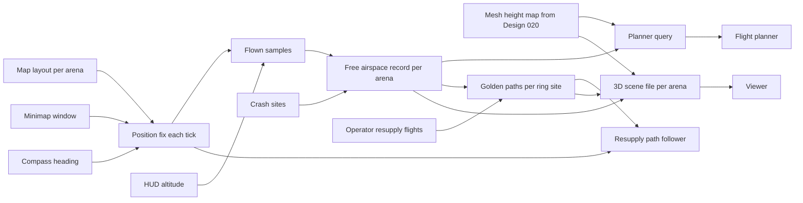
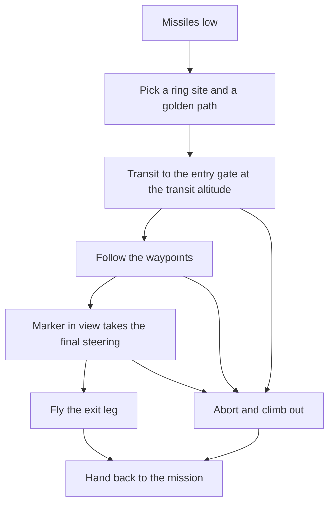
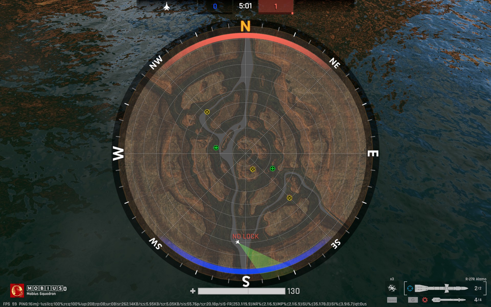
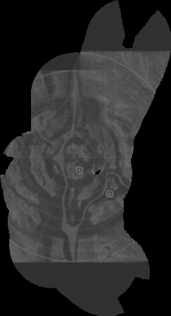

# Design 017 — Free Airspace Record and Golden Resupply Paths

| Status | Date       | Wingman Version |
|--------|------------|-----------------|
| Draft  | 2026-11-15 | 1.9.4           |

Operator, 2026-11-15: "we should be able to stitch together a full map layout using the minimap or use the
full map display, this in coordination with a mapping of altitude and map location can give us a record of
free airspace which can be used by flight planner to determine if a flight path is safe to fly. we can also
fly a golden path for resupply points and ensure wingman follows a golden path to resupply without
crashing". And: "also include a way to visualize 3d view of the map, propose a format such as stl, step, or
obj file, etc, and tool to view it in for showing free airspace, collision blocks and golden flight paths".

## Summary

Every place an aircraft has flown through and survived is free air. Wingman already knows where it is on the
map on most battle ticks and reads its altitude on every tick. This design keeps those two readings
together, for every flight, as a **free-airspace record** of each arena, and uses it in two ways:

- **The flight planner asks it whether a path is safe.** A path that stays inside airspace already flown is
  proven. A path outside it is "not known", never "clear".
- **Resupply follows a golden path.** For each resupply ring, a flight that reached the ring and left without
  crashing is kept as a golden path. Wingman flies to the ring along it.

It has four parts: a layout of each arena, the aircraft's position on it, the record, and the golden paths.
The first two exist ([Design 020](020-terrain-service-from-the-maps-own-geometry-hldd.md)). The last two are
this design's work. A fifth piece lets a person check all of it by eye: each arena is exported as one 3D
scene file (glTF binary, `.glb`) showing the collision geometry, the free airspace and the golden paths,
to open in Blender ("Seeing it in 3D").

**This document was rewritten on 2026-11-15.** The earlier design built a height map by reconstructing
terrain from flight footage, with a survey mission to fly each arena in passes. That is dropped:

- The survey mission was removed on 2026-10-14
  ([ADR 160](../adr/160-acs-mission-and-j20-are-the-only-missions.md)). This design does not bring it back.
  The record grows from ordinary battles and from the operator's own flying.
- Heights now come from the game's collision meshes (Design 020), so nothing is reconstructed from footage.
- The earlier text, with its fifteen survey flights and the reconstruction spike, is in this file's git
  history (last changed in PR 83). The measurements this design still rests on are in "Measurements
  carried over" below.

## Status

| Part | State |
|---|---|
| Map layout per arena | On hand for all six arenas: the game's own minimap texture (Design 020, 2026-11-07). Stitching from minimap windows was measured on 2026-10-03. The full-map reader is built and dormant |
| Position on each tick | Live in shadow since 2026-11-07 (Design 020): a fix on 92% of minimap crops where the compass reads, logged on the `TERRAIN:` line. Logged in manual flight too (2026-11-26, "Phase 1 results"). Icebound and Stormbreak fix on 1% and 5% of their lines |
| Free-airspace record | Built offline, 2026-11-26: `wingman/airspace.py` and `scripts/airspace-record.py`, from 88 logs (2026-11-18 to 11-26). 25 to 31% of the canyon arenas trusted, 1% or less of the island arenas |
| Planner query | Built and scored offline, 2026-11-26 (`AirspaceQuery`, `scripts/airspace-score.py`): it cannot gate paths yet. "Not known" is coverage, not terrain; the mesh's "ground" is the signal ("Phase 2 results") |
| Golden paths | Candidates built, 2026-11-26 (`scripts/airspace-golden.py`, "Phase 4 results"): 113 from wingman's own clean re-arms on four arenas, none accepted yet. Ring sites on the same four; Icebound and Stormbreak have positions since the scale fix and will follow |
| Path follower | Not built |
| 3D scene export | Built, 2026-11-26: `export_scene.py` writes the `.glb`, a top-down picture and a plotly page for each arena. No desktop 3D viewer is installed on VEDA |
| Live view of the jet | Built, 2026-11-26: `make airspace-view` shows the jet flying through the scene in a browser, live from `wingman.log` or replayed from an archived log ("Seeing it in 3D") |

## Why

- **Resupply runs mostly fail.** Of 419 resupply runs on Crimson Canyon from 2026-11-01 to 2026-11-08, 20%
  re-armed, 29% crashed, 37% were shot down and 14% ran out of round (Design 020, "Phase 6").
- **The operator flies the same ground and rarely crashes.** Below 1,000 m the operator crashed 6.3 times an
  hour against wingman's 47.2 ([Research 020](../research/020-the-operators-flying-as-the-terrain-reference.md)).
  The operator's flights are a record of where low flying is safe, and nothing keeps them.
- **The mesh height map predicts; a flown record proves.** Design 020's height map says where the ground
  should be. It has known gaps: Icebound's sea has no collider, Crucible's islands float over a kill floor,
  and Countdown's water plane is approximate. A game update can change a map before the meshes are rebuilt.
  A record of flights does not depend on the game's files.
- **No model is needed.** A flown sample makes no prediction. The aircraft was there and lived.

## Goals

1. A free-airspace record for each arena, built from every flight and improved by each one.
2. A query the flight planner can ask about any proposed path, with three answers: free, ground, not known.
3. A golden path to each resupply ring on each arena, and a resupply run that follows it.
4. Each step checked offline against recorded flights and crashes before anything flies.
5. A 3D view of each arena that a person can turn and fly through, showing the collision geometry, the free
   airspace and the golden paths together.

## Non-goals

- **No survey mission.** The record is fed by ordinary battles and the operator's flights (ADR 160).
- **No reconstruction from footage.** Dropped with the earlier design.
- **No replacement for Design 020.** Its height map, position fix and trajectory predictor stay. The record
  is a second source beside the height map, and the two check each other.
- **No `m` key in flight.** The full map is not opened during a battle ("The full map" below).
- **No learning to fly.** This is a record and a lookup.

## Design



In words: the position fix and the altitude of the same tick make a flown sample. Samples from every flight
build the record. The planner's query reads the record and the mesh height map together. Resupply flights
that worked become golden paths, and the follower flies them using the same position fix. The record, the
mesh and the golden paths are also written into one 3D scene file per arena, for a person to look at.

### The map layout

The layout is a top-down picture of the arena in the arena frame: the arena's centre at the origin, north
up, metres. There are three ways to get it.

| Source | State | Use |
|---|---|---|
| The game's own minimap texture (4,096 px, 10 km each way from the centre) | On hand for all six arenas (Design 020) | The layout wingman fixes against today |
| Minimap windows stitched together | Measured 2026-10-03: three battles covered 241 to 337 sq km of the canyon, each joined from a single frame | The layout for an arena whose files are not unpacked, or after a game update |
| The full map display (`m`) | Reader built (`wingman/full_map.py`), dormant | An offline check of a fix. Not opened in flight |

Wingman uses the first where it exists. The stitched layout is the fallback, and the route this design
keeps open for a new arena. It needs no game files. Both are stored in the same frame, so the record and the
golden paths do not care which one a fix came from.

### Position

Position comes from Design 020's terrain service, unchanged: the minimap window, turned north-up with the
compass heading, is matched against the layout. This design adds nothing to it and depends on it entirely.

- **Rate.** One fix a battle tick (1.5 s) on the `TERRAIN:` line. The fix itself costs about 7 ms, so it can
  run more often where a follower needs it.
- **Lost.** Without a fix the position is carried for 2 s and then counted lost. A lost position records no
  sample and answers "not known".
- **After a death.** The minimap is off screen in the death camera, 5 to 8 s before the logged death.

### The free-airspace record

**A sample** is one tick's position fix with the altitude read on that tick: "an aircraft was at this place,
at this height, alive".

**The record** is a grid over the arena, 64 m to a cell (two minimap pixels; a starting value). Each cell
holds:

- the **flown floor**: the lowest altitude any accepted sample passed through the cell;
- how many separate passes reached within 50 m of that floor, and when the last one was;
- any **crash sample**: the altitude of a crash in the cell.

**What the record claims.** In a cell, air at or above the flown floor is free. Terrain is a surface, so if
an aircraft flew through at 400 m, the ground there is below 400 m and everything above is open. The one
exception is an overhang or arch. Design 020's height map marks those cells, and in them only the flown
altitude itself counts, not the air above it.

**Which samples count.** A wrong sample is dangerous: a river-level sample placed on a mesa top would call
low air free where there is rock. So a sample is accepted only when all of these hold:

- the tick has a real fix, not a carried position;
- the altitude reading is a clean one (the 2026-11-08 parser rule: digits with a unit, a minus sign kept);
- the altitude is not below the mesh ground under the fix (Design 020's `inside_ground` case, a fix off at a
  cliff or a stale altitude);
- the tick is not in the last 8 s before a death;
- between two fixes one tick apart, the cells on the straight line between them are filled with the higher
  of the two altitudes, never an interpolated lower one.

A cell's floor is trusted once two separate passes agree on it. On an arena with no mesh height map, that
two-pass rule is the only guard.

**Crash samples** come only from deaths the kill card names as a crash (`wingman/kill_card.py`). The death
label alone over-counts terrain ([ADR 143](../adr/143-classify-died-armed-deaths-enemy-fire-vs-terrain.md)).

**Who feeds it.** Every flight, whoever flies: wingman's battles and the operator's manual flying
(`GAME_BATTLE_MANUAL`). Free air is free for any aircraft, so one record serves every jet.

**Built offline.** A tool reads the session logs and writes the record, by game content build and arena,
beside Design 020's data in the untracked `test_screenshots/terrain/`. It runs after each session, as the
round-score import does. Wingman loads the record at the start of a match and does not write to it in
flight.

**The two sources check each other.** No flown floor may be below the mesh ground of its cell, and every
crash sample should lie on it. A cell that breaks either rule is listed, and shows a fault in the fix, the
altitude or the mesh.

### The planner's query

The planner hands over a path: points with a position and an altitude, a few seconds of flight. That can be
one of Design 020's candidate manoeuvres, a straight leg to a marker, or a golden path. The answer is the
worst case over the path's points:

| Answer | Meaning |
|---|---|
| **Free** | Every point is at or above the flown floor of its cell, with the margins below |
| **Ground** | A point is at or below a crash sample, or inside the mesh ground |
| **Not known** | Anything else. The answer names the first point that is not known |

- **Margins.** A point is tested against the highest floor among the cells within 100 m of it, and must
  clear that floor by 50 m. Both are starting values, set from the offline scoring in phase 2.
- **Not known is never clear.** A cell nobody has flown says nothing. The planner then falls back on Design
  020's time to impact from the mesh, as it does today.
- **With the mesh.** "Free" from the record and "clear" from the mesh agree on most paths. Where the record
  says free and the mesh says impact, the mesh's known gaps are the likely cause, and the case is logged.
  Where the mesh says clear and the record says not known, the path is unproven, and a low-flying tactic
  may refuse it.
- **Cost.** A table lookup per point, inside the terrain service's 20 ms a tick.

The first users are the resupply run (below) and the chase's steer guard
([ADR 176](../adr/176-the-chase-asks-the-map-before-it-dives-or-turns.md)), which already asks the map
before a dive or a turn.

### Golden paths

**A ring site** is a place a resupply ring appears. On Crimson Canyon the re-arm fixes cluster at four
sites (Design 020): two in the river canyon at about 400 m altitude, and two on the plateau at about
1,600 m. The other five arenas' sites are found the same way, by clustering the fixes at `AIRCRAFT
RE-ARMED`.

**A golden path** is one flight through a ring site that re-armed and got out:

- a list of waypoints, one per fix: position, altitude, heading and speed;
- an **entry gate**, its first waypoint, at an altitude that can be reached safely from anywhere;
- the ring, and an **exit leg** from the ring back up to the transit altitude.

**How one is recorded.** The operator flies the ring by hand. Nothing else is needed: wingman already logs
the fix and the telemetry while the operator flies. Offline, each manual flight that re-armed gives a
candidate, cut from 30 s before the re-arm to 15 s after. A candidate becomes golden when:

- no crash or terrain warning followed it within 30 s;
- every waypoint leaves a way out: from that point, a wings-level climb to the transit altitude is free in
  the record or clear of the mesh (Design 020's "a pass that leaves a way out");
- the operator accepts it from the list the tool prints.

Wingman's own clean re-arms are candidates too. A site can hold several golden paths, from different
directions.

**The transit altitude** is one height per arena at which every cell is free: above the highest mesh ground
and the highest flown floor, with the margin.

**How wingman follows one.**



- **Pick.** The nearest site whose golden path has a reachable entry gate. No golden path for this arena
  means today's resupply run, unchanged.
- **Follow.** The follower aims at a point a few seconds ahead on the path. That point is given to the chase
  as its steering target, the way a marker is: the bearing to it against the heading is the horizontal
  error, and the path's altitude against the aircraft's is the vertical error. The chase's existing roll
  and pitch holds do the flying. The airbrake holds the path's speed where the aircraft is faster.
- **The ring.** Once the resupply marker is in view and near the path, today's marker steering takes the
  ring. The path has done its work by lining the aircraft up at the right height and speed.
- **Exit.** After the re-arm the follower flies the path's exit leg, not a fixed climb.
- **Abort.** The follower gives up and climbs out when the position is lost for more than 2 s, the aircraft
  is more than 300 m off the path or 100 m below it, or the terrain service warns. Every golden waypoint
  was accepted with a free climb-out, so there is always one to fly. The values are starting values.

Design 020 found that 88 of 121 resupply crashes on Crimson Canyon came more than 8 s after the marker last
had the steering: after the approach was abandoned, not on it. The exit leg and the abort are aimed at
those.

### What is logged

- `AIRSPACE:` on each battle tick in shadow: the query's answer for the current flight path and the cell's
  flown floor.
- `GOLDENPATH:` while a path is followed: the site, the waypoint, the cross-track and altitude errors, and
  the reason for an abort.

### Seeing it in 3D

The record, the height map and the golden paths are tables and lists. A wrong one is hard to spot in
numbers and obvious in a picture: a flown floor inside a rock wall, a golden path that clips a ridge. So a
tool exports each arena as one 3D scene.

**Format: glTF 2.0 binary (`.glb`).** One file per arena, in metres.

| Format | Fit | Why |
|---|---|---|
| **glTF binary (`.glb`)** | Chosen | One compact file. Named layers that a viewer can switch on and off. Colour and see-through materials. A picture draped on a surface. Opens in Blender, F3D and web viewers |
| OBJ | Second choice | Holds triangles, named groups and colours (in a second `.mtl` file). It is text, so a 2-million-triangle arena is well over 100 MB, and see-through surfaces are handled unevenly |
| STL | Collision geometry only | Triangles and nothing else: no colour, no layers, no see-through. It cannot show free airspace over the ground in one file. Useful only to hand the bare terrain to a CAD tool or a 3D printer |
| STEP | Not suitable | Made for exact CAD solids. A terrain of half a million to two million triangles is not that, and the files and load times would be very large |

The tool can also write OBJ or STL of single layers on request, for a program that does not read glTF.

**What the scene holds.** Each row is a named layer.

| Layer | From | Drawn as |
|---|---|---|
| `collision` | The game's collision triangles, as unpacked (Design 020): 0.25 to 2.1 million per arena | Solid grey. The exact shapes, with arches and overhangs |
| `ground` | The 16 m height map wingman looks heights up in | A surface with the arena's minimap picture draped on it. Shown beside `collision`, it shows where the height map differs from the real shapes |
| `water` and `arena_edge` | The map's water plane and the 10 km ring | A see-through blue plane and a thin ring |
| `flown_floor` | The free-airspace record | A see-through surface at each flown cell's floor, coloured by its height above the ground. Cells seen on one pass only are fainter. Cells never flown have nothing over them |
| `crash_samples` | The record | Red markers at each crash's place and height |
| `ring_sites` | The clustered re-arm fixes | A ring at each site |
| `golden_paths` | One layer per path | A tube 20 m thick with the entry gate, the ring and the exit leg marked. Tubes, because viewers draw plain lines a pixel wide or leave them out |
| `runs` (optional) | One session's log | That session's resupply runs as tubes, coloured by how they ended. For reviewing a run against the golden path |

- **Free airspace is drawn as its lower edge.** The free air is everything above `flown_floor`. Drawn as a
  solid block it would hide the ground and the paths.
- **True scale.** No vertical stretch: an arena is 20 km across with about 2 km of relief, which reads well
  as it is.
- **Axes.** glTF is Y-up. The arena frame's x (east) and height map to glTF's x and y, and north is written
  as glTF's minus z, so the map is not mirrored. Blender shows it with north along its y axis.
- **Size.** Tens of megabytes per arena. The `ground` layer is thinned to 32 m cells for the file.

**Viewer: Blender.** It is free and opens `.glb` directly. Each layer appears by name in its outliner with
an eye icon to hide or show it. The walk and fly navigation follows a golden path at cockpit height, and
the measure tool reads a clearance between a path and a wall.

- **For a quick look: F3D**, a small viewer that opens the same file from the command line
  (`f3d crimson-canyon-airspace.glb`). It shows everything at once, without per-layer switches.
- **Neither is installed on VEDA.** Ubuntu's own packages have both (Blender 5.0, F3D 3.2). Installing one
  is the operator's call.
- **With nothing installed:** the tool can also write a single web page with the same layers, using the
  plotly package wingman already has. It opens in any browser, the legend switches layers, and hovering
  reads a point's position and altitude. It is slower than Blender on the full collision geometry, so it
  carries the `ground` layer in place of `collision`.

**The jet in the scene, live (added 2026-11-26).** `make airspace-view` serves a page at
`http://127.0.0.1:8765/` that draws the arena's `.glb` with three.js, a browser 3D library. Nothing
is installed.

- It shows the jet as wingman logs it: an arrow along its track, its trail since the last spawn, and
  a line down to the ground.
- A readout gives altitude, the ground under the jet, height over the ground, speed, heading, whether
  the position is fixed, and how far the jet is above or below the record's flown floor.
- It follows `wingman.log` and switches arenas with the match. `LOG=<archived log>` replays a session
  instead, `SPEED=8` times real time by default, from `START=HH:MM` if given.
- It only reads the log, the records and the scenes, so it is safe beside a running session. It is
  also the by-eye check of phase 1, and the place to watch phase 5's follower.
- The server is `scripts/airspace-view.py` (standard library). The page is `scripts/airspace-view/`.
- three.js 0.162 is kept untracked in `test_screenshots/terrain/tools/web/three/`. It is the last
  release that also runs on WebGL 1, the only WebGL a headless software browser could give on VEDA, so
  the page can be checked without a GPU.
- A reading the plausibility filter rejected is kept off the jet. Four of them, at 13,877 to 23,824 m,
  drew the trail into the sky in the first replay.

**Where it lives.** The tool is `export_scene.py`, beside the other terrain tools in the untracked
`test_screenshots/terrain/tools/`. It writes `<arena>-airspace.glb` into the arena's data folder. The
`.glb` is written with numpy alone (the format is a short JSON header and one block of numbers), so it
adds no dependency.

## Phases

Each phase has a check that can fail. Nothing flies before phase 5.

| Phase | What | Check |
|---|---|---|
| 0 | Layout and position | Done by Design 020 for six arenas. Open here: confirm fixes are logged while the operator flies |
| 1 | Build the record offline from the logs on hand, and export the 3D scene | Coverage per arena by altitude band. No flown floor below the mesh ground. Crash samples on the ground. By eye in the scene: no flown floor inside rock |
| 2 | The query, scored offline | On recorded crashes and ordinary flight: how many crash approaches were "not known" or "ground" in their last seconds, against how often ordinary flight is. Sets the cell size and margins |
| 3 | The query in shadow | `AIRSPACE:` live on every arena, within the tick budget |
| 4 | Golden paths recorded | The operator flies each ring site. Every site on an arena has a path that passes the three rules, and is looked over in the 3D scene before it is accepted |
| 5 | The follower in shadow, then flown | Shadow: errors against the golden path on ordinary resupply runs. Flown: a per-round trial, arms drawn per round, on re-arms and crashes per run against the baseline above |
| 6 | The planner uses the query for other paths | The chase's dives and control-point approaches |

Phase 0's open item and phase 1 were done offline on 2026-11-26 ("Phase 1 results" below). Phase 2 is next.

## Phase 1 results (2026-11-26)

Built from the 88 session logs on hand (2026-11-18 07:55 to 2026-11-26 14:29, wingman 1.9.4 to 1.9.5,
game content build 2026-10-28_08-50). The logs of 2026-11-07 to 11-15 named in "Status" have been
rotated away. All figures are measured on these logs.

```bash
uv run --active python scripts/airspace-record.py                 # all logs/*.log; writes <arena>-airspace.npz
uv run --active python test_screenshots/terrain/tools/export_scene.py \
    test_screenshots/terrain/content-2026-10-28_08-50/crimson-canyon-day/crimson-canyon-airspace.npz --html
```

The build takes 14 s. The record lives in the arena's data folder, beside its height map.

**The logs do not keep, so each log's samples are cached.**

- Wingman deletes its oldest rotated logs at each start (`capture_budget.rotated_logs`, 2,048 MB). That
  keeps about eight days of looped sessions.
- So a record rebuilt from `logs/*.log` alone forgets every older flight. The 2026-11-07 to 11-15 logs
  were already gone. At 18:26 on 2026-11-26 the 11-18 07:55 log was deleted in the middle of a
  rebuild: the build crashed, and Countdown lost 153 samples.
- Each rotated log's extraction is now kept in the untracked
  `test_screenshots/terrain/airspace-samples/` (1.9 MB for 119 logs), keyed by the log's name, size and
  mtime. A deleted log keeps counting, and a log that disappears mid-build is skipped.

**How the rules were applied.**

- A sample's altitude is the higher of the two clean HUD readings logged either side of its fix, each
  within 2 s. A climb read late then never lowers the floor. A reading the plausibility filter rejected
  is not clean.
- A death is the `RespawnLatency` edge minus its `no_digits_for`. The 8 s before it, and the death camera
  up to the edge, are left out.
- `GAME_BATTLE_EJECT` is "missiles empty", not a death. The resupply run is flown in it, so it counts.
  (Leaving it out dropped 88% of one session's fixes on the first build.)
- A pass is one life's visit to a cell. A cell's trusted floor is the second-lowest pass's lowest
  altitude: two lives agree that the ground is below it.
- Two rules not in the design, each counted: a fix that both its neighbours reach only above 700 m/s
  is dropped (none were), and the line between two fixes is not filled when the step is that fast (16
  steps).

**Phase 0: the fix is logged while the operator flies.** In `GAME_BATTLE_MANUAL`, 7,713 of 12,376
`TERRAIN:` lines held a fix (62%), and 6,096 became samples.

**Fixes to samples.** 121,092 fixes. 78.1% were accepted, 12.3% fell in the 8 s before a death, 7.0%
had an unclean reading beside them and 2.5% had no reading within 2 s.

| Arena | Samples (manual) | Flown, sq km | Trusted, sq km | Inside the ground | Ring sites |
|---|---|---|---|---|---|
| Crimson Canyon | 22,620 (2,134) | 118 (38%) | 85 (27%) | 0.66% | 4 |
| Stone Forest | 27,007 (2,449) | 133 (42%) | 98 (31%) | 0.39% | 5 |
| Countdown | 17,806 (914) | 121 (39%) | 77 (25%) | 0.26% | 3 |
| Crucible | 25,578 (571) | 60 (19%) | 45 (14%) | 3.4% | 3 |
| Stormbreak | 1,335 (22) | 10 (3%) | 3 (1%) | 0.15% | 0 |
| Icebound, with snow | 285 (6) | 2 (1%) | 0 | 0 | 0 |

The percentages are of the 314 sq km inside the 10 km ring. "Inside the ground" is the share of samples
more than 30 m under the mesh's top surface and outside any overhang gap. Such samples are dropped: a
fault in the fix, the altitude or the mesh.

**Icebound and Stormbreak barely fix.** 0.8% of Icebound's `TERRAIN:` lines (184 of 22,003) held a fix,
1.0% on its snow variant and 5.2% on Stormbreak (1,741 of 33,590). Nearly all the rest were
`weak-match`. The other four arenas fixed on 77% to 84%.

- So none of their 79 re-arms was placed, and neither arena had a ring site.
- **Cause found the same day (measured): both minimaps are zoomed in**, about 24 m/px at 320 against
  the shared 34, as Crucible's is. On that day's black-box frames, 57% and 67% fixed at 24, against 1%
  at 34 (Design 020, Phase 6, under "Crucible is blind").
- Their entries now carry `mpp_at_320px: 24`. The next session's live fix rate is the check.

**Coverage follows the fighting, as the risks said.** Most trusted cells are high. On Crimson Canyon,
11,111 trusted cells have their floor 1,000 m or more over the highest ground in the cell, and 7,161
between 300 and 1,000 m. Only 1,853 are under 300 m (7.6 sq km).

**Check: no flown floor under the mesh ground. Passes, with a finding about the cell size.**

- No cell's floor lies under all of the ground in its cell. Each sample, and each point filled between
  two fixes, is tested against the 16 m height map before it counts.
- A filled point fell inside the rock for 0.2% to 0.7% of the fill on the canyon arenas, and 3.2% on
  Crucible.
- **A 64 m cell is coarser than the ground.** On Crimson Canyon, 224 trusted cells hold rock higher than
  the trusted floor somewhere inside them. Over all flown cells, the rock rises a median of 353 m above
  the floor (p90 927 m). The other arenas have 72 to 301 such trusted cells.
- So the claim "air above the floor is free" holds where the aircraft flew, not across the whole cell.
  The phase 2 query must test each point against the 16 m mesh too, or use smaller cells (open
  question 1).

**Check: crash samples on the ground. Fails.**

- Crash samples come from deaths with no kill card, placed at the last fix within 4 s, carried to the
  death.
- Few lie near the ground: 14% within 100 m on Crimson Canyon (33 of 241), 18% on Stone Forest, 22% on
  Countdown and 3% on Crucible.
- A fix under 1 s old does not fix it. On Crimson Canyon those 54 crashes sit a median of 367 m above the
  ground under them.
- Inferred: "no kill card" holds deaths that were not terrain crashes (ADR 143 says the label
  over-counts), and a carried last fix can be the wrong side of a wall.
- Until a crash is placed better, the query's **Ground** answer comes from the mesh alone, not from
  crash samples.

**Ring sites.** The last fix 3 to 6 s before `RESUPPLY: confirmed ammo`, clustered within 1,200 m, with
at least two re-arms per site. On Crimson Canyon two sites agree with Design 020's measurement:

| Site | Here | Design 020 |
|---|---|---|
| Plateau | (533, -1096) at 1,600 m, 29 re-arms | (324, -1252) at 1,598 m |
| River | (-3190, 3136) at 392 m, 4 re-arms | (-3082, 3087) at 395 m |

The other sites found:

- **Crimson Canyon:** (-51, -5304) at 1,431 m and (-727, -3624) at 1,792 m. Design 020's (3227, -3154)
  river site had no re-arms in these logs.
- **Countdown:** (2797, -3290) at 1,114 m; (-2885, 3357) at 1,106 m; (19, 566) at 871 m.
- **Crucible:** (2638, 94) at 643 m; (-156, 45) at 1,695 m; (-3756, 53) at 886 m.
- **Stone Forest:** (3024, -3107) at 848 m; (-4126, -132) at 1,653 m; (3000, 4142) at 2,005 m;
  (-472, 107) at 1,885 m; (-1760, 332) at 2,087 m.

This answers open question 4 for those four arenas. Whether the sites move with the game mode is still
open.

**The 3D scene.** One `<arena>-airspace.glb` per arena (34 to 68 MB) with these layers:

- `collision`, `ground` (with the minimap draped on it), `water` and `arena_edge`;
- `flown_floor` (trusted, drawn at the trusted floor) and `flown_floor_one_pass`;
- `crash_samples`, `rearm_points` and `ring_sites`.

An independent glTF reader (trimesh) loads all the layers. Crimson Canyon has 562,242 collision
triangles, the count in Design 020. The by-eye check against rock is still owed: no viewer is installed
(open question 9). Until one is, `<arena>-airspace.html` (plotly, any browser) and
`<arena>-airspace-top.png` show the record. There is no `golden_paths` layer yet (phase 4).

## Phase 2 results (2026-11-26)

**Verdict: the record cannot gate a planner's paths yet.**

- Its "not known" answer separates crashes from enemy kills no better than chance.
- It proves only about a quarter of ordinary paths free.
- The terrain signal is the mesh's: "ground" came before 44% of crash approaches, 9% of killed
  approaches and 4% of ordinary ticks.
- So for now the record's use is the flown corridors, the golden paths. It is not a general gate.
- The settings stay at **64 m cells, no side margin, 50 m up and two passes**.

**How it was scored.** `scripts/airspace-score.py` holds out each of the 9 days of logs on hand
(2026-11-18 to 11-26, 88 logs) in turn. The record for that day is built from all the other days,
so a flight never vouches for its own path.

- Each battle tick with a fix and a clean altitude asks the query (`AirspaceQuery`) about the
  straight 3 s path ahead, on the track and climb of the step before it.
- A *crash approach* is the last 8 s before a death with no kill card. A *killed approach* is the
  same before an enemy's kill: the control.
- *Ordinary* ticks have no death in the next 10 s.
- The sample: 795 crash approaches, 2,203 killed approaches and 82,228 ordinary ticks. All figures
  are measured.

| Cell / side / up, m | Crash approaches not free | Killed approaches not free | Ordinary ticks not free |
|---|---|---|---|
| Mesh "ground" alone | 44% | 9% | 4% |
| 64 / 0 / 50 | 94% | 89% | 76% |
| 64 / 100 / 50 (the design's starting values) | 98% | 95% | 90% |
| 128 / 0 / 50 | 83% | 64% | 52% |
| 64 / 0 / 50, one pass trusted | 88% | 75% | 60% |
| 128 / 0 / 50, one pass trusted | 74% | 50% | 37% |

**"Not known" is coverage, not terrain.** With the mesh's share taken out, "not known" alone came
before about as many killed approaches as crash approaches at every setting. A 3 s path is about
600 m. The flown tracks are stripes, so most paths cross a cell nobody has flown twice.

**The settings.**

- **Side margin 0.** 100 m cost 14 points of ordinary flight at 64 m and separated nothing.
- **Cells of 64 m, not 128 m.** 128 m proves twice as much, but none of the gain separates crashes,
  and it blurs canyon floors that are already coarse at 64 m (phase 1).
- **Two passes kept.** Trusting one pass freed 16 points of ordinary flight and bought no
  separation, so the guard against a misplaced sample stays.

**Coverage grows with data, and has not levelled off.** The share of ordinary paths proved free,
with the last two days held out and the record built from only the days before them:

| Days of record | 64 m cells | 128 m cells |
|---|---|---|
| 1 | 3% | 8% |
| 2 | 6% | 16% |
| 4 | 13% | 33% |
| 7 | 22% | 44% |

**The record is empty where it matters most.** Ordinary ticks not free at 64 / 0 / 50, by what was
being flown:

| Flying | Not free | Ticks |
|---|---|---|
| The chase (`GAME_BATTLE`) | 44% | 6,847 |
| Missiles empty (`GAME_BATTLE_EJECT`) | 77% | 57,878 |
| Resupply runs | 82% | 12,072 |
| The operator's own flying | 95% | 5,431 |

Resupply runs go low, into the canyons, and the record is mostly high air. The operator flies where
wingman does not. That is the risk "Coverage follows the fighting", now measured.

**What this changes.**

- Phase 3, a live `AIRSPACE:` line, would mostly print "not known". It waits until the record is
  denser.
- Phase 6, the planner using the query for other paths, waits on the same.
- Phase 4 goes next. A golden path is flown air by construction, so it needs no coverage around it.
  The record then checks only each waypoint's way out.
- The cache keeps every log, so the record keeps growing. Re-score as it does:
  `uv run --active python scripts/airspace-score.py`.

## Phase 4 results (2026-11-26, candidates only)

**113 candidates, none accepted yet.** `scripts/airspace-golden.py` cuts every re-arm on record from
30 s before the re-arm point to 15 s after: 318 re-arms, pruned logs included. It applies the
design's rules to wingman's own re-arms, as "How one is recorded" allows.

| Arena | Re-arms | Candidates | Rejected: no way out | Gap | Crash within 30 s | No life |
|---|---|---|---|---|---|---|
| Stone Forest | 127 | 54 | 17 | 55 | 6 | 7 |
| Countdown | 66 | 30 | 11 | 18 | 6 | 7 |
| Crimson Canyon | 42 | 15 | 13 | 13 | 6 | 2 |
| Crucible | 83 | 14 | 47 | 37 | 15 | 9 |

A re-arm can be rejected for more than one reason, so a row's counts can add up to more than its
rejected re-arms.

- **Way out.** From every waypoint, Design 020's climb (22 deg/s to 50 deg, `fly_candidate`) must reach
  the transit altitude without meeting the mesh.
- **Transit altitude.** The arena's highest mesh ground inside the 10 km ring, plus 50 m. The design's
  "and above the highest flown floor" is left out: one cell flown only at 5,000 m would set it.
- **Gap.** More than 4.5 s between waypoints, which is two missed ticks.
- **No life.** No accepted sample within 2 s of the re-arm point.
- **Not yet applied:** "no terrain warning within 30 s". The record's cache holds no warnings.
- Crucible fails the way out most: climbs from beside its islands meet the islands.

**Re-arms flown by hand were never recorded (found and fixed offline the same day).**

- Wingman logs `RESUPPLY: confirmed ammo` only from its own pursuit, so 1 of 318 re-arms on record had
  been flown by hand.
- The record builder now also finds them from the tick line's missile count, which is read in manual
  flight too: a stable count rising to a stable higher one, at most 12 (`manual_rearms`). That found
  151.
- A rack switch moves the count as well, so a hand-flown re-arm counts only within 1,200 m of a ring
  site that wingman's own confirmed re-arms mark (78 are), and ring sites come from confirmed re-arms
  only.
- 9 of the 78 became candidates. Most failed the way-out rule.

**The way-out rule stays the climb, and it binds because of how wingman flies (measured, all cuts with
8 or more waypoints).**

- Design 020's full way-out set (climb, a turn either way, a turn with a climb, clear for 5 s) added 0
  to 2 candidates per arena.
- Neither rule separated cuts that ended in a crash from clean ones, on 5 to 10 crashes per arena.
- The failing waypoints are not near the mesh: the median is 467 m over the top surface on Crimson
  Canyon and 471 m on Stone Forest.
- Nor is it the noise in the climb rate: flying every waypoint level freed only 1 to 13 more clean cuts
  per arena.
- From those points, no manoeuvre at wingman's measured rates (turns about 10 to 12 deg/s, the climb
  to 50 deg) clears the terrain in time. The aircraft got through by flying harder than wingman can.
  The operator's low passes do that most.
- Such a path is safe for wingman only if it never aborts, so the rule keeps rejecting it. The full set
  stays available as `candidates_for(..., rule="any")`.

**Reviewing and accepting.**

- `make airspace` (also run after every session) writes `<arena>-golden-candidates.json` and draws the
  candidates as the scene's `golden_candidates` layer: amber tubes, off by default in the viewer.
- `scripts/airspace-golden.py --accept ARENA:ID` copies one into `<arena>-golden.json`. It is drawn as
  `golden_paths` (gold tubes) with `golden_entry_gates` at the first waypoint.
- In the live view (`make airspace-view`), clicking an amber tube opens its details: the time, the ring
  site, the waypoints, the lowest point, who flew it, and the command that replays it.
- The panel's "Accept as golden path" button does what `--accept` does. It matches the log and the
  re-arm time as well as the number, because the list renumbers as logs are added. The tube turns
  gold, and the arena's scene is re-exported in the background.
- That button is the only thing the viewer writes.
- The operator accepts. Nothing is accepted by the tool.

## Runs

| Started | Run | Code state | Game | What it is for | Result |
|---|---|---|---|---|---|
| 2026-11-26 20:19 | operator `make r` loop | 1.9.5, working tree with the Icebound and Stormbreak scale of 24 | content 2026-10-28_08-50 | Live check of the scale | Icebound 81% of 219 lines fixed, Stormbreak 78% of 89; no `weak-match` (measured). 8 missions; stopped with `z` at 21:10 |
| 2026-11-26 21:15 | `make r1` (/iterate) | the same, plus the loop rebuilding the record after each session, manual re-arms and the candidates' accept | the same | The first loop that rebuilds by itself; the first placed re-arms on Icebound and Stormbreak | Running. At start: `XKey listener thread died` (`BadLength`, opcode 145/5; in 6 of 119 logs since 2026-09-06), reconnected after 3 s |

## The full map

Pressing `m` in battle shows the whole arena, north-up, with the aircraft's icon and view cone at their
true place:



- It gives an absolute position and heading from one picture. The survey mission read it about 230 times on
  2026-10-04.
- Measured on the picture above (1920 by 1200): the arena circle is centred at (960, 600) with a radius of
  473 px, and the own icon is at (929, 946). That is 0.064 radii west and 0.732 radii south of the centre,
  heading 129 degrees from the view cone. `tests/test_full_map.py` checks the reader against it.
- It covers the forward view and the speed and altitude readouts while open, and is drawn 0.3 to 0.6 s
  after the key.
- **`m` is only safe on the flight HUD.** On 2026-10-04 at 18:50:24 it was pressed with the scoreboard menu
  on screen, and the match was exited two seconds later.
- So this design does not press it in flight. A screenshot of it, taken by hand, is a check on a minimap
  fix and a picture of an arena to stitch against.

## Measurements carried over

From the earlier design's work, 2026-10-03 and 2026-10-04, and still relied on here.

| What | Result |
|---|---|
| Minimap on screen | 68% of recorded frames; the rest are lobby, loading and respawn |
| Minimap scale | Fixed. About 32 m a pixel at full resolution on recordings (34 m live, Design 020), a window about 4 km in radius |
| Minimap frames matched 2 s apart, turned north-up | Median score 0.92 |
| Stitching | Each battle joined the stitched picture from a single frame, with a clear margin |
| Fixes half a second apart against the step between them | Median about 30 m; 98 to 100% within 130 m |
| Canyon, position not lost | 97%, 99%, 81% and 98% of alive frames on four held-out battles |
| Island arena, position not lost | 73% and 64%. Open water has almost nothing to match |
| Compass against the full map's view cone | Median 2 to 4 degrees apart over 200 pairs, padlock off |
| The minimap turns with the camera, not the aircraft | Inferred. Position is unaffected; aircraft heading in padlock is |
| Arena size | About 9.4 km in radius from fixes against HUD speed; the game's texture puts the ring at 10 km |

How far a carried position can be trusted, measured by predicting each fix from an earlier one:

| Carried for | Error, median | Error, 9 in 10 under |
|---|---|---|
| 1 s | 45 m | 123 m |
| 2 s | 94 m | 282 m |
| 4 s | 236 m | 723 m |
| 6 s | 425 m | 1,278 m |

That table is why a position is carried for 2 s and no longer.



## Open questions

1. **Cell size and margins.** 64 m cells, 100 m sideways and 50 m up are starting values. Phase 2 sets them.
   Phase 1 found rock above a trusted floor inside 72 to 301 cells per arena at 64 m, so the query also
   needs the 16 m mesh. Phase 2 set 64 m cells, no side margin, 50 m up and two passes. No setting
   made "not known" separate crashes from kills; revisit as the record grows.
2. **Altitudes near and below zero.** The HUD altitude is the mesh height, with a sign. Crimson Canyon's
   river is at -232 m. The minus sign has been read since 2026-11-08; how often it is still dropped decides
   whether river-level samples can be trusted.
3. **Is the fix logged while the operator flies?** Answered 2026-11-26: yes. 62% of the `TERRAIN:` lines
   in manual flight held a fix, and 6,096 samples came from them.
4. **Ring sites on the other five arenas**, and whether they move with the game mode. Found on Countdown,
   Crucible and Stone Forest on 2026-11-26. None yet on Icebound or Stormbreak: their 79 re-arms had no
   fix, because their minimap scale was wrong (set to 24 the same day). Whether the sites move with the
   game mode is still open.
5. **One golden path for every jet?** Free air is the same for all. Speed and turn radius are not: a path
   flown in an F-100 may be too tight for a J-20. Paths may need a jet class.
6. **How well can the chase follow a point on the map?** It has only ever steered at things on screen. The
   survey mission's own altitude hold swung by about 350 m. Phase 5's shadow measures this before anything
   flies.
7. **The island arenas.** Position is lost more often over open water, so their records fill more slowly.
   Measured 2026-11-26: Icebound fixed on 1% of its lines and Stormbreak on 5%, against 77% to 84%
   elsewhere. The cause was a minimap scale, not the water: at 24 m/px they fixed 57% and 67% of
   black-box crops. The live rate after the change is still to be measured.
8. **What `m` does on the game's other screens.** Still not known, and not needed while it is not pressed.
9. **Which viewer to install.** Blender is the recommendation, F3D the lighter one. Until one is chosen the
   web page is the only view.

## Risks

- **A misplaced sample calls rock free.** The acceptance rules and the two-pass rule are the guard. Phase 1's
  check against the mesh measures how often it happens.
- **Coverage follows the fighting.** Wingman flies where the targets are, mostly high. Low air will be
  filled mainly by the operator's flights and the golden paths. "Not known" keeps the rest safe.
- **A game update changes a map.** The record is kept by game content build. A changed arena starts a new
  record, and the mesh check shows the change.
- **The record goes stale in place.** A cell's floor carries the date it was last flown, so old claims can
  be dropped.
- **Following needs a position at the right moment.** A fix is lost in the death camera, under the padlock's
  swings and over water. The abort covers a lost position, at the cost of an unfinished run.

## References

- [Design 020](020-terrain-service-from-the-maps-own-geometry-hldd.md): the height map, the position fix,
  the trajectory predictor, the resupply run measurements and the ring sites.
- [Design 001](001-terrain-avoidance-hldd.md): forward-view terrain detection and the crash measurements.
- [Design 010](010-mini-map-detection/010-mini-map-detection-hldd.md): how the minimap behaves.
- [Research 020](../research/020-the-operators-flying-as-the-terrain-reference.md): the operator's flying
  as the reference for low flight.
- [ADR 160](../adr/160-acs-mission-and-j20-are-the-only-missions.md): the survey mission's removal.
- [ADR 172](../adr/172-agreeing-terrain-warnings-leave-the-resupply-run-in-half-the-rounds.md),
  [ADR 174](../adr/174-the-map-warning-starts-the-emergency-climb-in-half-the-rounds.md) and
  [ADR 176](../adr/176-the-chase-asks-the-map-before-it-dives-or-turns.md): the trials on the resupply run
  and the map's warnings.
- [ADR 143](../adr/143-classify-died-armed-deaths-enemy-fire-vs-terrain.md): the death labels.
