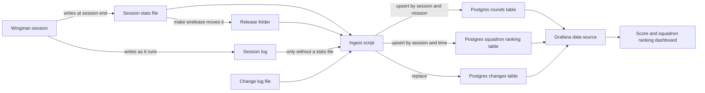

# Design 018 — Score per Round and Squadron Ranking Over Time in Grafana

| Status | Date       | Wingman Version |
|--------|------------|-----------------|
| Draft  | 2026-10-28 | 1.9.3           |

## Overview

Wingman has read the end-of-round PERFORMANCE panel since 2026-10-27 05:45. Each session's summary
prints that session's totals, and its stats file keeps each round's figures. Nothing yet shows them
over time.

This design adds a Grafana dashboard that charts the score of every round over time. It also
aggregates the scores at any granularity from an hour to a year. The aggregate is chosen on the
dashboard, for example the sum of score per month or the mean per week. The design has three parts:

1. **A store.** A PostgreSQL table holds one row per round, with its tags. It runs in a Docker
   Compose stack on VEDA, beside Grafana.
2. **An ingest.** A script reads the session stats files wingman already writes, or the log of a
   session that ended without one, and upserts their rounds into the table. It also loads a
   tracked change log. It runs on `make grafana` and, from Phase 2, after each session.
3. **A dashboard.** It is provisioned from a JSON file in the repository and shows:
   - the score of each round, with a moving average;
   - a chart and a table by period, driven by granularity, aggregate and metric selectors;
   - a marker on every chart for each change that can affect play, from the change log;
   - all of it narrowed by a tag filter, when one is set.

The dashboard pools every round, whichever account or jet flew it (operator, 2026-10-28). Each
round also carries tags, so that a query can filter on them: the account it flew on from the
start, and the jet once wingman records it. The score needs no change to wingman's runtime,
because the data is already in the stats files and logs. One change to wingman came first,
separately: the panel reader missed a third of the rounds, mostly the worse ones. Its cause was
found and the reader fixed on 2026-10-29 (Phase 0, see Rollout and [Action Item 005](../action-item/005-round-performance-reader-and-hldd-018-corrections.md)).

The plan also tracks Mobius Squadron's place on the game's squadron leaderboard and its trophies
(Phase 3). That does change wingman: it opens the leaderboard during `GAME_LOBBY`, through the menu
navigation of [ADR 166](../adr/166-read-the-squadron-leaderboard-from-the-lobby.md) (see Squadron
ranking).

The dashboard runs only on VEDA, and only once it is switched on. Its sources are in the
repository, but the shipped config leaves it off, so a clone runs none of it until its owner
enables it (see "Where it runs, and switching it on").

## Context

### Where the score comes from

- `wingman/round_performance.py` reads the score and K/D/A from the PERFORMANCE panel. The panel
  appears after the first click of the end-of-round click-through. A reading counts only when two
  frames read alike; otherwise the round is not read. `main._note_round_performance` logs
  `ROUND PERFORMANCE: score N, K/D/A k/d/a`, or `ROUND PERFORMANCE: not read`.
- `MissionStatsTracker.record_round_performance` adds the reading to the session totals, which the
  summary prints on its "Round performance" line. It also attaches the reading, as `performance`,
  to the record of the mission that has just ended with the click-to-finish outcome.
- `finalize()` writes `docs/performance/current/run_<stamp>_<account>_stats.json` at session end.
  Each mission record carries:
  - `index`, `start_ts` (epoch seconds), `duration_s` and `outcome`;
  - `performance` (`score`, `kills`, `deaths`, `assists`), when the panel was read.
- `make wrelease` moves the stats files from `current/` to `docs/performance/release/`. Both folders
  are untracked and exist only on VEDA
  ([ADR 100](../adr/100-repository-growth-and-generated-artifacts.md) D8).

### What the files hold (measured 2026-10-28)

Six stats files carry round performance, written from 2026-10-27 05:45 to 2026-10-28 03:09:

- 182 rounds ended with the click-to-finish outcome, and wingman read the panel of 118 of them (65%).
- The 118 readings total 49,727 points: a mean of 421 per round, with a standard deviation of 212.

Two properties of this data shape the design:

- **A third of the rounds are not read, and they are not a random third.**
  - 70 of the 188 readings failed. The frames did not disagree: none showed a KDA where the
    reader looked. The panel is drawn centred and its height follows the medals the round earned,
    so its figures sit at different heights, and the reader looked at one height only (measured
    2026-10-29 on saved frames).
  - Unread rounds had more deaths than read ones: 3.4 respawns against 2.9 (Welch t = 2.3).
  - Among read rounds, more deaths means a lower score: 756 with none, 361 with four or more.
  - So the unread rounds most likely score lower than the read ones (inferred). The mean per read
    round then overstates wingman, and a sum counts only the read rounds. A bad period also hides
    part of its decline, because more deaths leave more rounds unread.

  A round with more deaths earns fewer medals, so it was more likely to get a panel height the
  reader missed (inferred). Phase 0 fixed the reader on 2026-10-29: it finds the figures at any
  height, and read 25 of the first 26 rounds after the fix, the one miss a score of 0, since fixed
  (see Rollout). Rounds before 2026-10-29 keep their gap, so the dashboard also shows the rounds
  flown and the rounds read beside every aggregate.
- **One round says little.** Scores spread by about 200 points. Account 3, on unchanged code,
  averaged 490 per round from 09:00 to 12:00 on 2026-10-27, then 291 from 12:00 to 15:00, with 21
  rounds in each block. A real 10% change (about 40 points) needs about 400 rounds on each side
  before it shows, if rounds are independent. They are not quite: with 21 rounds a side and a
  spread of 212, the drop from 490 to 291 is about t = 3 (inferred), more than chance. Something
  that moves blocks of rounds, such as the time of day or the opponents in the queue, moves the
  score, so 400 a side is a floor, and the rounds either side of a change marker also differ in
  those block effects. The dashboard therefore shows the count behind each mean and a moving
  average, so a reader can tell a trend from a run of good or bad rounds.

### What exists

- The session summary prints one session's totals.
- `tests/runtime_performance_tracking.py` draws static Plotly charts of runtime performance from
  the run JSONs. It does not read round scores, and a static chart cannot change its granularity
  or aggregate.

## Goals

1. Chart the score of every read round against the time the round ended.
2. Aggregate by hour, day, week, month, quarter or year. The aggregate is sum, mean, median, count,
   minimum or maximum, chosen on the dashboard (for example, the sum of score per month).
3. Show the rounds flown and the rounds read for every period, so that a reader can judge a sum or
   a mean.
4. Keep the whole history. Rounds stay in the store when stats files move or are deleted, and a
   session that ended without a stats file still counts, from its log.
5. Read the score without changing wingman's runtime, and add no Python dependency. The squadron
   ranking is the exception (see Squadron ranking).
6. Keep the dashboard and the table's schema in the repository, so that the stack can be rebuilt
   from it.
7. Tag each round, so that any query can filter by tag: the account now, and the jet or any other
   key once wingman records it. A new key needs no change to the table, the ingest or the
   dashboard.
8. Run only on VEDA, and only once switched on. The sources are tracked, the shipped config leaves
   the dashboard off, and a clone starts nothing until its owner enables it.
9. Mark on every chart when each change that can affect play went live, so that the rounds before
   and after it can be compared.
10. Track the squadron's rank on the game's leaderboard over time, read by wingman in the lobby
    (Phase 3; the menu navigation is TBD).

## Non-goals

- **Panels per account or jet.** It does not matter which account or jet flew a round (operator,
  2026-10-28), so the panels pool all rounds. Tags make a filter possible in any query (see Tags),
  but no panel splits by them.
- **Live updates within a session.** The stats file is written at session end, so a session's
  rounds appear after it ends.
- **Other hosts.** The dashboard runs only on VEDA, and rounds flown anywhere else are not
  collected.
- **Other measures.** Engagement survival, deaths per mission and the runtime timings stay where
  they are. The store could take them later, as new tables.
- **Alerts.** Grafana alerting is not configured.

## Design

### Data flow



The stats file starts in `docs/performance/current/` and moves to `docs/performance/release/`. The
ingest reads:

- both folders;
- the archived logs of sessions that have no stats file;
- `grafana/changes.yaml`, the change log.

### What a round is

A round is a mission whose outcome is click-to-finish. That outcome means it reached the
end-of-round screen, which is where wingman reads the panel.

- **Rounds with a manual takeover** are kept and marked, and charted apart from wingman's own
  (operator, 2026-10-29): the operator flew part of them, so their figures are not wingman's.
  `manual_takeovers` holds the round's count: from `manual_takeover_count` in a stats file, or the
  `Game state: … → GAME_BATTLE_MANUAL` lines of the round in a log. Every panel but Score per
  round leaves these rounds out; Score per round draws them as their own points and moving
  average. Wingman's session summary leaves them out of its round figures, and counts them on a
  "taken over" line. Of the 477 rounds loaded on 2026-10-29, one was taken over (the 17:40
  session's round 6, score 1,100, K/D/A 6/3/0, four takeovers).
- **Time.** `ended_at` is `start_ts` plus `duration_s`, the end of the mission. Every chart plots
  against it.
- **Unread rounds** are rows with empty (NULL) figures. The rounds flown in a period are therefore
  `count(*)`, and the rounds read are `count(score)`.
- **Sessions from before the reader** contribute no rows. These are stats files without a
  `round_performance` block. Their rounds were never read, and counting them as unread would drag
  the read rate down.
- **Readings with no mission behind them** are not rows. On 2026-10-28 00:49 the click-through
  logged 28 readings against 24 missions. The extra ones came from a second click-through of the
  same end screens (open question 4, answered). Since 2026-10-29 06:01 such a click-through reads
  nothing and logs no `ROUND PERFORMANCE` line.
- **Rounds from a log.** For a session that ended without a stats file, each `ROUND PERFORMANCE`
  line in its log is a round, read or not, at the line's time (see The ingest), except a line
  with no `Game state: … → GAME_END_B` line since the last `GAME_END_B →` line: it came from a
  second click-through and is not a round.

### The store

The store is PostgreSQL 16, in the stack's own container, with three tables: the rounds, the change
markers and, from Phase 3, the squadron ranking:

```sql
CREATE TABLE IF NOT EXISTS rounds (
    run_id          text        NOT NULL,  -- the session, e.g. 20261028_004906_acct1
    mission_index   integer     NOT NULL,  -- the mission's index, or the reading's order in a log
    started_at      timestamptz,           -- NULL for a round from a log
    ended_at        timestamptz NOT NULL,  -- the time axis
    score           integer,               -- NULL: the panel was not read
    kills           integer,
    deaths          integer,
    assists         integer,
    wingman_version text,
    tags            jsonb       NOT NULL DEFAULT '{}'::jsonb,  -- see Tags
    PRIMARY KEY (run_id, mission_index)
);
CREATE INDEX IF NOT EXISTS rounds_ended_at ON rounds (ended_at);
CREATE INDEX IF NOT EXISTS rounds_tags ON rounds USING gin (tags);
-- 2026-10-29: the round's manual takeovers; above 0, charted apart from wingman's own
ALTER TABLE rounds ADD COLUMN IF NOT EXISTS manual_takeovers integer NOT NULL DEFAULT 0;

CREATE TABLE IF NOT EXISTS changes (         -- loaded from grafana/changes.yaml
    at    timestamptz NOT NULL,               -- the start of the first session that flew it
    label text        NOT NULL,
    ref   text,                               -- the ADR or document behind it
    PRIMARY KEY (at, label)
);

CREATE TABLE IF NOT EXISTS squadron_rankings (  -- from Phase 3
    run_id  text        NOT NULL,                -- the session that read it
    read_at timestamptz NOT NULL,
    rank    integer     NOT NULL,                -- the squadron's place on the leaderboard
    tags    jsonb       NOT NULL DEFAULT '{}'::jsonb,  -- squadron, account, source
    PRIMARY KEY (run_id, read_at)
);
```

- **Schema.** The ingest applies this schema before every load, so a later column arrives as an
  idempotent `ALTER TABLE … ADD COLUMN IF NOT EXISTS`.
- **The read-only role.** On the first start of an empty volume, the stack's init script creates a
  read-only role for Grafana with `SELECT` on the schema's tables, present and future. Grafana runs
  dashboard SQL exactly as written, so the read-only role keeps an edited panel from changing data.
  "Future" is `ALTER DEFAULT PRIVILEGES`, which covers only the tables created by the role that
  ran it. The init script runs it as the Postgres superuser, and the ingest creates its tables as
  that same superuser; a table created by another role would be hidden from Grafana without an
  error.
- **Persistence.** The rows live in a named Docker volume, which survives `make grafana-down` and
  image upgrades.
- **Rebuilding.** The table is derived data. Every stats file stays on VEDA in `release/` after
  `make wrelease`, so dropping the volume and running `make grafana` rebuilds the table.

**Why PostgreSQL.** The rounds are a relational workload, not a time-series one:

- **Volume.** A round ends about every 5 minutes: 94 rounds in 8.7 hours of flying on
  2026-10-27, and 51 in 4.8 hours that evening. That is about 11 an hour, and under 10,000 rows a
  month even flown around the clock.
- **Writes.** The rounds arrive in a batch after each session, not as a live stream.
- **Questions.** The questions are per calendar month over a year or more, and later the scores
  will be joined with other session data.

| | Real-time device telemetry | Wingman's round scores |
|---|---|---|
| Data | Many readings per second, from many devices | One event about every 5 minutes |
| Typical question | The last hour, minute by minute | Each calendar month, over a year |
| Writes | Pushed live as they happen | Loaded after the session |
| Analysis | Within one series | Joined with other session data |
| Better fit | A time-series store such as InfluxDB | A relational database such as PostgreSQL |

Grafana supports PostgreSQL without a plugin. Its built-in data source provides time macros such
as `$__timeFilter`, and Postgres itself provides:

- calendar truncation in a named time zone: `date_trunc('month', ended_at, 'America/New_York')`;
- window functions, for the moving average;
- `percentile_cont`, for the median.

VEDA already has the `postgres:16` image (16.14). "Alternatives considered" compares InfluxDB and
TimescaleDB.

### Tags

Each round carries tags: string keys with string values, such as `account` and `jet`. They live in
one `jsonb` column, so a new key needs no change to the table, the ingest or the dashboard.

- **Where they come from.** The ingest builds each round's tags from its stats file.
  - `account` comes from the `_acctN` suffix of the session's `run_id`, which `make r1` to `r3`
    set through `WINGMAN_ACCOUNT`. A session with no suffix flew `main`, the prefix `make r`
    flies, so there are four accounts: `main`, `acct1`, `acct2` and `acct3` (operator,
    2026-10-29). Score per round draws each in its own colour.
  - A round rebuilt from a log gets `source: log`, and the `account` of the run_id that
    PerformanceTracker's `session data written to …run_<id>.json` line names, the one place a log
    names it. A log cut off before that line has no `account`; Score per round draws its rounds as
    "no account". On 2026-10-30 a `make r2` session the shutdown watchdog ended at 08:54 wrote no
    stats file but did write that line, and its 12 rounds were first drawn as "no account".
  - Any `tags` object in the stats file is copied through. One at the top of the file covers the
    whole session; one in a mission record covers a value that can change between rounds, and
    wins over the session's. Wingman writes neither yet. Recording the jet means writing `jet`
    into one of them, and nothing downstream changes.
- **Past rounds.** The ingest re-reads every stats file and updates rows that already exist, so a
  new tag also reaches past rounds whose files are still on VEDA.
- **In a query.** `WHERE tags->>'jet' = 'j20'` filters on one tag, and
  `WHERE tags @> '{"account": "acct1", "jet": "j20"}'` on several at once. The GIN index serves
  the second form.
- **On the dashboard.** The `tags` variable holds the tags to match, as JSON. Its default, `{}`,
  matches every round, and every panel's query adds `AND tags @> ${tags:sqlstring}::jsonb`.
  Grafana's `sqlstring` format quotes the text and doubles any quote in it, so nothing typed in
  the box can end the string and run as SQL, and malformed JSON shows as an error on the panels
  instead (check the format in the pinned Grafana version; `${tags:raw}` inside quotes did
  neither, and only the read-only role limited the damage). Typing
  `{"account": "acct1"}` narrows every panel to that account. The Tags panel lists each key and
  value among the rounds in range, so the keys in use are easy to find. A dropdown for a key used
  often can be added later as an ordinary dashboard variable.

### Change markers

The dashboard marks each change that can affect play, so that the rounds before and after it can be
compared. `wingman_version` cannot do this. It changes only at releases, and live sessions often run
uncommitted code.

- **The change log.** `grafana/changes.yaml` is tracked and holds one entry per change, with three
  fields:
  - `at`, the start of the first session that flew it, with its offset;
  - `label`;
  - `ref`, the ADR or document behind it.

  The ingest loads it into the `changes` table, replacing what was there.
- **Adding an entry** is part of shipping a change that can affect play: a flight behaviour, a
  tuning value or a new mission. The entry is added when the first session with the change starts.
- **On the dashboard,** an annotation query draws every entry in range as a marker on each time
  panel: `SELECT at AS time, label AS text FROM changes WHERE $__timeFilter(at)`.
- **The first entries** are the changes since the reader started:

  ```yaml
  - at: 2026-10-27T05:45:00-04:00
    label: "D5: a hard emergency ends the missile evade"
    ref: docs/adr/163-the-missile-evade-flies-through-a-pursuit.md
  - at: 2026-10-27T18:32:00-04:00
    label: "Flare roll: roll right through the flares"
    ref: docs/adr/164-roll-right-through-the-flares.md
  - at: 2026-10-27T23:37:00-04:00
    label: "pursuit_share 0: the evade trial ends"
    ref: docs/adr/163-the-missile-evade-flies-through-a-pursuit.md
  ```

### Squadron ranking

From Phase 3 the dashboard also tracks Mobius Squadron's place on the game's squadron leaderboard.
Wingman flies in Mobius Squadron, tag `[ISAF]` ([Job Aid 013](../job-aids/013-join-mobius-squadron.md)).

- **Where the rank is.** It is on a leaderboard in the game's menus, reached by hand through
  Settings, then Leader boards, then Squadrons. The one reading on record is 698th, on 2026-10-13
  at 04:25 ([FUTURE 000](../FUTURE/000-squad-rank.md)).
- **The navigation is [ADR 166](../adr/166-read-the-squadron-leaderboard-from-the-lobby.md)**
  (2026-10-31, from the operator's screenshots). From the lobby, wingman clicks the menu at the top
  right, then LEADERBOARDS, then the SQUADRONS tab. It reads our squadron's row at the bottom of
  the list, rank and trophies, and goes back with the page's back arrow. The navigation must:
  - run only in the lobby between rounds: not during matchmaking, in a party or with an invite
    open, and not when a stop is pending;
  - run at most once an hour (`squadron_ranking.every_min`, a starting value);
  - return to the lobby every time, by the screens' own controls. It must never press ESC, which
    opens Exit to Desktop on the lobby;
  - hold off wingman's stall handling while it runs: the lobby quick-scan, stall recovery (which
    acts after 15 s in `GAME_UNKNOWN`) and the escape loop that presses ESC
    ([ADR 093](../adr/093-lobby-blackout-livelock.md));
  - give up after a set time, return to the lobby and log why;
  - stop at once when the operator takes over or puts wingman on standby;
  - be off by default: `squadron_ranking.enabled` is `false` in the shipped config and is turned
    on per machine in `config.local.yaml`, like the dashboard.
- **What wingman records.** Each reading goes into the session stats file, in a
  `squadron_rankings` list (`ts`, `rank`, `trophies`), and into the log, as a
  `SQUADRON RANKING: rank N, trophies T` line. The trophies were added on 2026-10-31 (operator).
  The ingest loads them into the `squadron_rankings` table, and uses the log only when a session
  has no stats file. Their tags are `squadron` (`ISAF`), `account` and `source`, as for rounds.
- **On the dashboard.** Squadron rank per reading and Squadron trophies per reading plot each
  reading under Score per round, and Squadron now shows the latest; a lower number is a better
  rank. A rank does not add up, so the SUM rule for the score does not apply. The ranking's figure
  for a period is its last reading, the rank at the end of the period, with the best and worst
  readings beside it (open question 7).

### The ingest

`scripts/round-scores.py`, run by `make grafana-ingest`, does six things:

1. It reads every `run_*_stats.json` file in `docs/performance/current/` and
   `docs/performance/release/`.
2. It skips files without `round_performance`. For the rest, it makes one row per click-to-finish
   mission, as defined above, with its manual takeovers counted, taking `run_id` and `wingman_version` from the file and building the
   tags (see Tags).
3. It falls back to the log for a session that ended without a stats file.
   - It reads the first line of each archived log in `logs/`. A stats file's `run_id` is the time
     its session started, within a second of its log's first line.
   - It skips a log when a stats file, or a session already in the table, started within 5 s of
     the log's first line.
   - Any other log with `ROUND PERFORMANCE` lines gives one row per line, except a line with no
     `Game state: … → GAME_END_B` line since the last `GAME_END_B →` line (a second click-through
     of the same end screens):
     - the row's time is the line's, read as America/New_York. Log times carry no UTC offset, so
       a line in the hour that repeats when daylight time ends (01:00 to 02:00 on 2026-11-01) is
       ambiguous; it is read as the first of the two, daylight time. Only sessions without a
       stats file are affected;
     - a `not read` line is an unread round;
     - its `run_id` is the first line's time with a `_log` suffix, for example
       `20261019_044500_log`;
     - its tags are `source: log`, plus the `account` that PerformanceTracker's run-file line
       names, when the log reached it;
     - a session already in the table from its log is read again on every load, so its rows
       take up what a later reader finds in the log.
4. It loads the rows in one transaction: `COPY` into a temporary table, then `INSERT … ON CONFLICT
   (run_id, mission_index) DO UPDATE`. In the same transaction it replaces the `changes` table
   with the entries in `grafana/changes.yaml`. It runs `psql` inside the Postgres container
   (`docker compose exec -T`). The project therefore needs no database driver, and Postgres
   publishes no port.
5. It never deletes a round. When a stats file moves or is deleted, its rounds stay in the table.
   Reading the same file twice writes the same rows.
6. It prints the number of sessions read, from stats files and from logs, and the number of rounds,
   rounds read and new rows.

Two options serve checks rather than the targets: `--dry-run` reads and counts without loading
anything, so it needs no Docker; `--project` and `--env-file` point the load at a throwaway
stack under another Compose project.

From Phase 3 the same steps also load the squadron readings into the `squadron_rankings` table:
the `squadron_rankings` list in a stats file, or the `SQUADRON RANKING` lines of a log without one.

The steps from a stats file or a log to rows are pure functions, so the tests cover them without
Docker. The ingest keeps no state: it reads every file each time, so the next run makes up for a
missed one. Only a log without a matching session is read past its first line, so the logs' size
(up to 130 MB each) costs little.
At about ten sessions a day, with stats files of 2 to 64 KB, a year of files should parse in
seconds (inferred). If it ever stops doing so, the ingest can skip sessions whose `run_id` is
already in the table.

It runs:

- on `make grafana`, before the dashboard's address is printed;
- from Phase 2, after each session, when the dashboard is switched on and the stack is up (see
  Rollout).

### The Grafana stack

`grafana/compose.yaml` defines two services:

| Service | Image | Notes |
|---------|-------|-------|
| `postgres` | `postgres:16.14`, the version VEDA already has as `postgres:16` | Named volume; init script from `grafana/postgres/`; `pg_isready` healthcheck; no published port |
| `grafana` | The official Grafana OSS image, `grafana/grafana:12.2.0` (pinned 2026-10-29) | Published on `127.0.0.1:3000` only; provisioning and dashboards mounted read-only; anonymous Viewer access |

- **Passwords.** The Postgres superuser, the Grafana read-only role and the Grafana admin take
  their passwords from `grafana/.env`. That file is untracked and made from the tracked
  `grafana/.env.example`.
- **Provisioning.**
  - `grafana/provisioning/datasources/` defines the PostgreSQL data source, using the read-only
    role.
  - `grafana/provisioning/dashboards/` loads `grafana/dashboards/*.json`, with saving from the UI
    turned off.
- **Changing the dashboard.** The JSON file in the repository is the dashboard. To change it,
  edit it in Grafana, export the JSON, and replace the file.
- **Home page.** The score dashboard is Grafana's home dashboard, so `http://127.0.0.1:3000` opens
  on it.
- **On demand.** `make grafana` starts the stack and `make grafana-down` stops it. There is no
  restart policy, so nothing extra runs on VEDA unless someone asks for it.
- **No state of its own.** Grafana gets no volume. Its dashboard comes from a file and its change
  markers from Postgres, so `make grafana-down` loses nothing. A marker drawn in the browser would
  be lost, so add it to `grafana/changes.yaml` instead.
- **VEDA only, and off by default.** See the next section.

### Where it runs, and switching it on

The sources are tracked in the repository, but nothing in them runs by default. Every target that
starts or feeds the stack has two gates in front of it, and both must pass:

1. **The host is VEDA.** The targets carry `require-veda`, like the other report targets (ADR 100
   D8), because `release/`, the session history, exists only there.
2. **The dashboard is switched on.** `score_dashboard.enabled` is `false` in the shipped
   `wingman/config.yaml`, and its schema default in `wingman/config_schema.py` is `false` too. The
   operator switches it on for VEDA in the untracked `wingman/config.local.yaml`, by hand, so that
   file keeps its comments:

   ```yaml
   score_dashboard:
     enabled: true
   ```

- **The check.** `scripts/round-scores.py check` merges the overlay over the shipped config and
  validates the result with the same schema, as a live run does (CR-018-16). It exits non-zero
  when the switch is off. `make grafana` and `make grafana-ingest` run it first. When it fails,
  they print the key to set and stop, before pulling an image, starting a container or writing a
  row.
- **After a session** (Phase 2), the ingest checks both gates and does nothing, silently, when
  either fails.
- **Stopping** needs neither gate, so `make grafana-down` can always stop a stack.
- **Tests** run on every machine. V1 needs neither Docker nor the stack, so the code is checked
  even where it never runs.
- **Clones on VEDA** start switched off too. A fresh clone or a git worktree has no
  `config.local.yaml`, so it runs nothing until it is enabled.

### The dashboard

There is one dashboard, "Wingman — score and squadron ranking". Its time zone is America/New_York, the
operator's, which wingman's logs also use. Its default range is the last 30 days.

| Variable | Values | Default |
|----------|--------|---------|
| `granularity` | hour, day, week (ISO, from Monday), month, quarter, year | day |
| `aggregate` | sum, mean, median, count, min, max | sum |
| `metric` | score, kills, deaths, assists | score |
| `window` | 10, 20, 50 read rounds, for the moving average | 20 |
| `tags` | A JSON object of tags to match, in a text box (see Tags) | `{}`, which matches every round |
| `tz` | America/New_York (constant, hidden) | |

`aggregate` is a custom variable that pairs each name with its SQL over a column `x`. For example,
`sum : sum(x)`, `mean : avg(x)` and `median : percentile_cont(0.5) WITHIN GROUP (ORDER BY x)`.

**Period summaries.** A period's value is the chosen aggregate over all the data within the
period: every round whose end time falls inside it, in America/New_York. The month summary takes
every round that ended from the first of the month at 00:00 up to the first of the next month, and
SUM()s its scores (operator, 2026-10-28). An unread round adds nothing to the sum, and the Rounds
per period panel counts it. The SUM rule is for the score. The squadron ranking takes its last
reading in each period instead (see Squadron ranking).

| Panel | Type | Shows |
|-------|------|-------|
| Score per round | Time series: points, plus a line each | Every read round at `ended_at`: wingman's own as dots in one colour per account, with their moving average over the last `window` read rounds pooled over the accounts, and the rounds with a manual takeover as their own dots and moving average (operator, 2026-10-29), to see whether a takeover scores better than wingman alone. The takeover average shows its points: its rounds are few, and a line with one point draws nothing. The account dots come from a `metric` column, so a new account gets its own series with no change to the dashboard |
| By period | Time series: bars | `aggregate` of `metric` per `granularity`, for example the sum of score per month |
| Rounds per period | Time series: stacked bars | Rounds flown and rounds read per period |
| Totals in range | Stat | Rounds flown, rounds read, total score, and the mean and median per read round, for wingman's own rounds; and the rounds with a manual takeover, counted apart |
| Periods | Table | One row per period: rounds flown, rounds read, sum, mean, median, minimum and maximum |
| Tags | Table | Each tag key and value among the rounds in range, with its count of rounds |
| Squadron rank per reading and Squadron trophies per reading (Phase 3, operator 2026-10-31) | Time series | One line with a dot at each reading, under Score per round. The figures are the squadron's, so the account does not matter and the tags box does not apply |
| Squadron now (Phase 3, operator 2026-10-31) | Stat | The latest reading in the time range: the squadron's rank and trophies, and how long ago it was read |

Every time panel shows the change markers (see Change markers). The wingman version stays in each
row but gets no marker. It has stayed 1.9.3 since 2026-10-18, while D5, the flare roll and the end
of the evade trial all went live.

The two main queries are sketched below. The final SQL lives in the dashboard JSON.

```sql
-- Score per round, with the moving average
SELECT ended_at AS time,
       score,
       avg(score) OVER (ORDER BY ended_at
                        ROWS BETWEEN ${window:raw} - 1 PRECEDING AND CURRENT ROW) AS "moving average"
FROM rounds
WHERE score IS NOT NULL AND $__timeFilter(ended_at)
  AND tags @> ${tags:sqlstring}::jsonb
ORDER BY ended_at;

-- By period
SELECT date_trunc('$granularity', ended_at, '$tz') AS time,
       ${aggregate:raw} AS "${aggregate:text} of $metric"
FROM (SELECT ended_at, ${metric:raw} AS x
      FROM rounds
      WHERE $__timeFilter(ended_at)
        AND tags @> ${tags:sqlstring}::jsonb) AS r
WHERE x IS NOT NULL
GROUP BY 1
ORDER BY 1;

-- Squadron ranking at the end of each period (Phase 3)
SELECT DISTINCT ON (date_trunc('$granularity', read_at, '$tz'))
       date_trunc('$granularity', read_at, '$tz') AS time,
       rank AS "rank at period end"
FROM squadron_rankings
WHERE $__timeFilter(read_at)
  AND tags @> ${tags:sqlstring}::jsonb
ORDER BY date_trunc('$granularity', read_at, '$tz'), read_at DESC;
```

Grafana's transformations allow further changes without writing SQL. For example, "Add field from
calculation" provides cumulative and window functions, and "Filter data by values" filters rows. A
panel changed this way is kept by exporting the dashboard JSON, as above.

**Reading the dashboard.**

- Compare periods by the mean per read round, with the count beside it, and only where nearly
  every round was read. Before 2026-10-29 the unread rounds are the worse ones (see Context), so a
  low read rate flatters the mean. A sum also counts the hours flown.
- A pooled line also moves with the mix of accounts flown. Per-session means on 2026-10-27 and 28
  ran from 393 to 566 per round across three accounts. Before reading a trend, check the mix on the
  Tags panel, or filter to one account.
- The two lines on Score per round compare wingman with the operator's hand on the stick. The
  operator expects the rounds with a manual takeover to score higher, and the two lines to close
  as wingman improves (2026-10-29). Taken-over rounds are rare (one of 477 on 2026-10-29), so
  their line moves a lot on each new one; read it with its count on the Totals panel.
- Judge a change by the rounds on each side of its marker, with their counts, over several
  sessions at different times of day: blocks of rounds a few hours apart differ by more than their
  counts explain (see Context).
- The first and last periods of a range are usually partial.
- With fewer than a few hundred rounds in a period, a difference in the mean is mostly noise (see
  Context).

### Make targets

| Target | Does |
|--------|------|
| `make grafana` | Checks both gates, starts the stack (`docker compose up -d --wait`), runs the ingest, and prints `http://127.0.0.1:3000` |
| `make grafana-ingest` | Checks both gates and runs the ingest; the stack must be up |
| `make grafana-down` | Stops the stack, without checking either gate; the volume stays |

`grafana-check`, which `make grafana` and `make grafana-ingest` run first, is the switch's check
followed by a check that `grafana/.env` exists.

### Files

| Path | Holds |
|------|-------|
| `grafana/compose.yaml` | The two services |
| `grafana/.env.example` | The password template; `grafana/.env` is untracked |
| `grafana/postgres/` | The init script that creates the read-only role |
| `grafana/schema.sql` | The three tables and their indexes, which the ingest applies before each load |
| `grafana/changes.yaml` | The change log: one entry per change that can affect play |
| `grafana/provisioning/datasources/wingman.yaml` | The PostgreSQL data source |
| `grafana/provisioning/dashboards/wingman.yaml` | The dashboard provider, with UI saves off |
| `grafana/provisioning/plugins/`, `grafana/provisioning/alerting/` | Empty on purpose: the mount replaces the image's provisioning folder, and Grafana logs an error at start when these are missing |
| `grafana/dashboards/score-per-round.json` | The dashboard |
| `scripts/round-scores.py` | The ingest, and the `check` that the targets run first |
| `tests/test_round_scores.py` | V1 |
| `wingman/config.yaml`, `wingman/config_schema.py` | `score_dashboard.enabled`, shipped `false`, and its schema default. From Phase 3, `squadron_ranking.enabled` (shipped `false`) and `squadron_ranking.every_min` |
| `wingman/squadron_ranking.py`, `wingman/main.py`, `wingman/analyzer.py` (Phase 3, ADR 166) | The lobby navigation and the leaderboard reader, with their `SQ_*` crops in `wingman/config.yaml` |
| `Makefile`, `.gitignore` | The three targets; `grafana/.env` |

Everything in this table is tracked, except `grafana/.env`. The switch is turned on in
`wingman/config.local.yaml`, which is untracked too.

## Validation

- **V0, the reader** (Phase 0). Over a session of at least 50 rounds, at least 95% of the panels
  are read.
- **V1, tests** (`make test`, no Docker). `tests/test_round_scores.py` covers:
  - **The rows from a stats file.**
    - Only click-to-finish missions become rows.
    - Figures are empty when the panel was not read.
    - `ended_at` is the start plus the duration.
    - A file without `round_performance` gives no rows.
  - **Tags.** `account` comes from the `run_id` suffix, and is `main` without one. Session and
    mission `tags` are copied through, with the mission's value winning.
  - **Idempotence.** The same file read twice gives the same keys.
  - **The log fallback.** A log with `ROUND PERFORMANCE` lines and no stats file gives one row per
    line, unread lines included, tagged `source: log` and with the account its run-file line names.
    A log within 5 s of a stats file, or of a session already in the table from a stats file, gives
    none, and so does a line with no battle → GAME_END_B
    transition before it since the last GAME_END_B exit.
  - **A manual takeover.** A mission's takeovers are counted, from a stats file or a log, and a
    takeover does not carry into the next round. Every panel but Score per round leaves taken-over
    rounds out, and Score per round averages them apart.
  - **The change log.** `grafana/changes.yaml` parses, and every entry has a label and a time with
    its offset.
  - **The load.** The CSV for `COPY` is correct.
  - **The dashboard JSON.** It parses, and every `$variable` its queries use is defined.
  - **The switch.** `check` fails on the shipped config and passes with an overlay that sets
    `score_dashboard.enabled: true`. `tests/test_config_defaults.py` already checks the key's
    default against its schema leaf.
- **V2, the stack**, on VEDA.
  - Before the overlay switches it on, `make grafana` stops at the check, names the key, and
    starts no container.
  - With the switch on, `make grafana` brings both containers up healthy and prints the address.
    The dashboard opens without a login at `http://127.0.0.1:3000` and does not answer on VEDA's
    LAN address.
  - Record both containers' memory while a session runs.
- **V3, the numbers.**
  - The first ingest finds the six stats files written from 2026-10-27 05:45 to 2026-10-28 03:09.
  - With the range set to those times (America/New_York), the Totals panel shows:
    - 182 rounds flown and 118 rounds read;
    - a total score of 49,727, a mean of 421 per read round.
  - Narrowed to the 06:07 session (2026-10-27 06:05 to 16:35), it shows 62 rounds read and
    24,347 points, the figures in that session's summary.
  - Over the full range, the tag filter `{"account": "acct1"}` shows 34 rounds flown, 22 read and
    11,527 points: the 23:37 and 00:49 sessions.
  - The three first changes show as markers at 2026-10-27 05:45, 18:32 and 23:37.
  - On a fresh volume, with the 23:37 session's stats file set aside, the ingest rebuilds that
    session from `logs/wingman_20261028_004832.log`. It shows 10 rounds, 6 read and 2,472
    points, tagged `source: log`.
- **V4, after a session** (Phase 2). A session's rounds appear on the dashboard after it ends,
  without a manual ingest. After a session ended by Ctrl-C or a signal, they appear after the
  next ingest.
- **V5, the squadron ranking** (Phase 3), over a session with it switched on:
  - every navigation returns to the lobby. There are as many `SQUADRON RANKING` or give-up lines
    as navigations, and no ESC press or stall-recovery action while one runs;
  - no match start is missed because of it;
  - the readings show on the squadron charts, and the first matches the leaderboard by eye.

## Rollout

- **Phase 0, the reader.** Done 2026-10-29, Validation V0 in progress ([Action Item 005](../action-item/005-round-performance-reader-and-hldd-018-corrections.md)).
  - Each unread panel's OCR text was logged and its frames saved. No frame showed a KDA where the
    reader looked: the panel's height follows the medals earned, so its figures move. Neither the
    score counting up nor two-digit counts was the cause.
  - The reader now finds the KDA in a tall band of its column by the panel's "KDA" label under
    it, which also rules out the scoreboard page (its KDAs have their header above them), and reads
    the score on that row. A second click-through of the same end screens reads nothing.
  - Validation V0.
- **Phase 1.** The stack, the ingest with its log fallback, the change log, the dashboard and the
  three targets. Validation V1 to V3. Implemented 2026-10-29:
  - V1: `tests/test_round_scores.py` passes, without Docker.
  - V2, before the switch: `make grafana` stops at the check, names the key and starts no
    container. The rest of V2 was run on a throwaway stack (Compose project
    `wingman-scores-verify`, its own passwords and volume, removed afterwards): both containers
    came up healthy in 40 s; Grafana answered on 127.0.0.1:3000 and not on VEDA's LAN address;
    anonymous viewers got the dashboard as the home page, without saving; the data source
    connected as `grafana_reader`, which was refused a write; every panel's query ran. Memory:
    Grafana 104 MiB, Postgres 29 MiB, idle.
  - V3, on the same stack: the ingest loaded 477 rounds, and a second run added none. For
    2026-10-27 05:45 to 2026-10-28 03:09 the Totals query gave 182 rounds flown, 118 read, 49,727
    points and a mean of 421.4, through Grafana's data source too, and the Tags query 34 rounds
    tagged `acct1`. The three markers loaded. From the same files, offline (the ingest's own
    functions): the 06:07 session 62 read and 24,347 points; `acct1` 34 flown, 22 read, 11,527
    points; the 23:37 session rebuilt from `logs/wingman_20261028_004832.log` 10 rounds, 6 read,
    2,472 points, `source: log`.
  - The operator's stack, 2026-10-29 19:29 (`grafana/.env` made, the switch on in
    `config.local.yaml`, the full suite green at 3,505): `make grafana` brought both containers up
    healthy and loaded 477 rounds, 320 read, with the three markers; the home page is the
    dashboard, the data source connects, the V3 range reads 182, 118 and 49,727 through
    Grafana, no error in Grafana's log, and nothing answers on the LAN address.
  - Open: the dashboard's rendering in a browser, checked by eye.
- **Phase 2.** The post-session ingest in `make r`, which `r1` to `r3` run. After wingman exits,
  `r` runs the ingest when the host is VEDA, the dashboard is switched on and the stack is up.
  Otherwise it does nothing and prints nothing, so `make r` on a clone behaves as before. It
  prints an ingest failure and ignores it, and keeps wingman's exit status. A session stopped
  with Ctrl-C or a signal can end the recipe before the ingest runs; nothing is lost, because the
  ingest keeps no state and the next one (after the next session, or `make grafana`) loads it.
  Validation V4. Implemented 2026-10-30: `scripts/round-scores.py after-session`, which `r` runs
  once wingman exits (`status=$$?; … after-session; exit $$status`). Tested without Docker: it
  ingests when every gate passes, stays silent off VEDA, with the switch off or the stack down,
  and prints a failed ingest without failing; the recipe kept a failing and a passing command's
  exit status. V4 waits for the first session started after it: a running `make` keeps the recipe
  it began with.
- **Phase 3, the squadron ranking.** Built 2026-10-31, in live trial: the navigation is
  [ADR 166](../adr/166-read-the-squadron-leaderboard-from-the-lobby.md). Wingman reads the rank and
  the trophies and records them, the ingest loads them into `squadron_rankings` (which gains a
  `trophies` column), and the squadron charts draw both. Validation V5 and ADR 166's.

## Risks

| Risk | Mitigation |
|------|------------|
| A misread panel enters as a reading. The reader needs two frames that read alike, so only a repeated misread gets through | It stands out on the per-round panel; an outlier rule is open question 2 |
| Unread rounds are the worse ones (more deaths), so the mean overstates wingman and a sum is short | Phase 0 fixed the reader on 2026-10-29 (V0 in progress); for the sessions before it, rounds flown and read stay beside every aggregate |
| Sums move with the hours flown | Rounds flown are shown beside every aggregate; compare means |
| Small periods mislead (standard deviation 212 per round) | Counts beside means, the moving average, and "Reading the dashboard" |
| A session ends without writing its stats file. 3 of 68 October sessions did, two on a traceback, with about 6 hours of flying between them | The ingest rebuilds the session from its log; those rows have no `account` tag |
| A change goes live without an entry in the change log, so no chart marks it | Adding the entry is part of shipping a change that can affect play |
| The squadron navigation strands wingman outside the lobby, trips stall recovery or the escape loop, or presses ESC (Exit to Desktop) | The requirements under Squadron ranking: the screens' own controls, stall handling held off, a time limit, at most once an hour; V5 counts every return |
| A game update moves the leaderboard or its buttons | A failed read is logged and skipped, and the crops are recalibrated with `make calibrate-crop` |
| Memory on VEDA, which had 4 to 8 GB of swap in use during the 2026-10-27 and 28 sessions | The stack runs on demand; V2 measures it |
| A Grafana upgrade changes the dashboard JSON schema | The image is pinned; upgrade deliberately and re-export the JSON |
| A tag value spelt two ways (`j20` and `J-20`) splits a filter | Wingman writes the values, not a person; the Tags panel shows every value in use |

## Alternatives considered

- **SQLite with a community Grafana plugin.** A single file with no server, and an ingest that
  needs only the standard library. Rejected: SQLite has no named time zones and no median, and
  Grafana reads it only through a community plugin. Monthly buckets in the operator's time zone,
  and the median, would have to be built by hand.
- **InfluxDB, with wingman writing each round to it.** InfluxDB is built for the central server
  that real-time devices report to. Many devices send frequent readings, and the questions cover
  recent windows in fixed steps, with live dashboards, alerts and thinning of old data. InfluxDB 3
  Core's default 72-hour query window suits that recent-data view. It is not meant to run on the
  device itself: devices usually buffer a few readings and forward them to it.

  It is strong where this design is weakest:
  - Its tags are native. Grafana's ad hoc filters apply them to every panel without editing a
    query; those filters do not work directly on SQL data sources.
  - Its HTTP write API takes one line of text per point, so wingman could push each round live
    with only the standard library. This design loads rounds after the session, so that goes
    unused.

  Beyond those, the two are close. Both have medians and moving averages, both handle a round
  loaded twice without a duplicate, and Grafana supports both without a plugin. Postgres keeps an
  edge for analysis: joining scores to other session data is plain SQL, and InfluxQL has no joins.

  Rejected for the month summaries. A bar per calendar month needs month buckets, and each of
  InfluxDB's query languages falls short:
  - InfluxQL groups time only into fixed lengths, of a week at most.
  - Flux has calendar months, but it is in maintenance mode, and InfluxDB 3 does not run it.
  - InfluxDB 3 Core limits a query to about 72 hours by default, shorter than the month a summary
    covers. Raising the limit slows long queries. InfluxDB 3 Enterprise has no cap and is free for
    home use, but needs a licence.

  If live updates or tag dropdowns came to matter more than a bar per calendar month, InfluxDB 2
  with Flux would work, accepting that Flux is frozen.
- **TimescaleDB.** It is PostgreSQL with time-series features: automatic partitioning by time,
  compression and time bucketing. It would suit a store that had to take both kinds of data in the
  table under "Why PostgreSQL". At about 11 rounds an hour it adds nothing yet. It keeps the same
  SQL and the same Grafana data source, so the store could move to it later without changing the
  dashboard.
- **Prometheus.** It scrapes current values, so loading dated past rounds needs a separate
  backfill tool, and PromQL has no calendar months. Rejected.
- **Grafana reading the stats files directly,** through a JSON data source plugin and a small file
  server. There would be no store, but every query would parse every file, and grouping by month
  would fall to transformations. The history would also go when the files go. Rejected.
- **More static charts beside the runtime ones.** No new stack, but also no interactive granularity
  or aggregate, which is the point. The operator chose Grafana.
- **Wingman writing each round to the database as it reads it.** The charts would be live, but the
  main loop would depend on a database server, and the stats file already holds every read round.
  Not now (see Non-goals).

## Open questions

1. **Answered** (operator, 2026-10-28). A period's summary SUM()s all the data within the period,
   with no estimate for the unread rounds (see Period summaries).
2. **Answered** (operator, 2026-10-29). Kept as read, with no outlier rule: all 32 readings checked
   against their saved panels on 2026-10-29 were correct (Action Item 005).
3. **Answered** (2026-10-28). Yes: the ingest rebuilds a session without a stats file from its log
   (see The ingest).
4. **Answered** (2026-10-29). On 2026-10-28 00:49 the click-through logged 28 readings against 24
   missions. Each extra one came from a second click-through of the same end screens: wingman had
   moved to the lobby with the end screens still up, and ADR 087's lobby scan found the prompt
   again 4 to 15 s later. They are not rounds. Since 2026-10-29 such a click-through reads nothing
   (AI-005-3 in [Action Item 005](../action-item/005-round-performance-reader-and-hldd-018-corrections.md)).
5. Should the stack start at boot instead of on demand?
6. **Answered** (2026-10-31). The squadron navigation is
   [ADR 166](../adr/166-read-the-squadron-leaderboard-from-the-lobby.md): the operator showed the
   route, and it returns by the page's back arrow.
7. Is the rank at the end of a period the right figure for the ranking? The SUM rule is for the
   score.
8. How often should wingman read the rank? Once an hour is a starting value.

## References

- `wingman/round_performance.py`: the panel reader.
- `wingman/mission_stats.py`: `record_round_performance`, `finalize` and the `round_performance` block.
- `wingman/main.py`: `_note_round_performance`.
- [ADR 100 — Repository Growth and Generated Artifacts](../adr/100-repository-growth-and-generated-artifacts.md):
  D8, `release/` and the report targets live on VEDA.
- `tests/runtime_performance_tracking.py`: the static runtime charts.
- [Job Aid 013 — Join Mobius Squadron](../job-aids/013-join-mobius-squadron.md): the squadron.
- [FUTURE 000](../FUTURE/000-squad-rank.md): the path to the squadron leaderboard and the first
  reading.
- [ADR 093](../adr/093-lobby-blackout-livelock.md): the escape loop that presses ESC in the lobby.
- For the InfluxDB alternative: [Query data in InfluxDB 3 Core](https://docs.influxdata.com/influxdb3/core/get-started/query/)
  (the 72-hour query range), [The future of Flux](https://docs.influxdata.com/flux/v0/future-of-flux),
  and [InfluxDB 3 Enterprise free for at-home use](https://community.influxdata.com/t/announcing-influxdb-3-enterprise-free-for-at-home-use-and-an-update-on-influxdb-3-core-s-72-hour-limitation/56109).
- Grafana's ad hoc filters and SQL data sources:
  [Enhanced ad hoc filters support](https://grafana.com/whats-new/2025-09-05-enhanced-ad-hoc-filters-support/).
