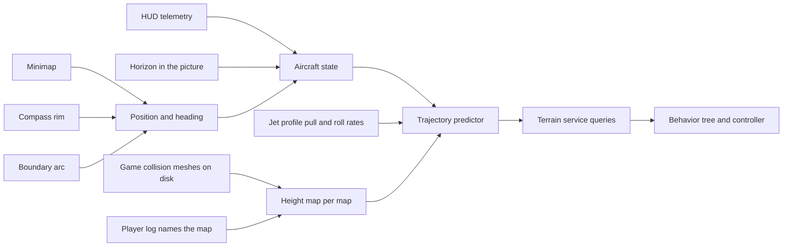

# Design 020 — Terrain Service From the Map's Own Geometry

| Status | Date       | Wingman Version |
|--------|------------|-----------------|
| Draft  | 2026-11-04 | 1.9.4           |

Operator, 2026-11-04: "see how i avoid terrain, this is the biggest wingman issue", then "no terrain
avoidance is still the major blocker it needs advanced logic to calculate trajectory and detect terrain
with accuracy this is the blocker preventing other advanced behavior tree tactics", then "create a hldd to
track this".

## Summary

Wingman cannot tell how far away the ground ahead is, and every tactic that needs low flying waits on that:
holding a control point, a resupply run, a chase through a canyon. This design gives wingman a **terrain
service**: it knows where the aircraft is on the map, knows the ground's height there from the game's own
collision geometry, predicts where each candidate manoeuvre takes the aircraft in the next few seconds,
and answers two questions for the rest of wingman:

- **Is this path clear?** For a manoeuvre, an approach to a marker, or the current flight path: the time
  to impact, or none.
- **What is the way out?** The manoeuvre that clears the ground soonest from here, when the current path
  does not.

Each stage is scored offline against recorded crashes and ordinary flight before anything flies, as
[Research 017](../research/017-camera-vision-for-terrain-avoidance.md) scored its candidates. The first
stage needs one decision from the operator: unpacking the game's installed files to read the collision
meshes ("Open decisions").

## Status

| Phase | What | Status | Evidence |
|---|---|---|---|
| 0 | One map's height map from its collision meshes | Not started: waits on the unpacking decision | |
| 1 | Position on the map from the minimap | Not started; [Design 017](017-terrain-map-from-flight-footage-hldd.md) measured the minimap's raw signals | |
| 2 | State brought up to now: the reading carried forward, bank from the picture | Not started | |
| 3 | Trajectory predictor and the two queries, scored offline | Not started | |
| 4 | Shadow live | Not started | |
| 5 | The way out flies, as a per-round trial | Not started | |
| 6 | Behavior tree tactics on the service | Not started | |

## Why

### The picture alone has been tried four times

From [Research 018](../research/018-sky-and-terrain-from-flown-paths.md) and Research 017 (measured):

| Attempt | Result |
|---|---|
| Sky fraction (colour) | 3.1% of warnings followed by a crash |
| Looming, shapes, the clear-path planner (ESCAPE) | 5.3% to 10.0% |
| Terrain share by texture ahead | adds nothing to the telemetry |
| Depth model | ranks crash windows best (AUC 0.79), adds nothing in ordinary flight |

None of them knows the distance to the ground. [Design 001](001-terrain-avoidance-hldd.md) (2026-10-24):
"the ground ahead is the missing input".

### The operator's flying says the gap is knowledge, not handling

[Research 020](../research/020-the-operators-flying-as-the-terrain-reference.md), measured over 121 logs
(2026-10-20 to 11-04) and the operator's flights of 2026-11-04:

| | Operator | Wingman |
|---|---|---|
| Share of flight below 1,000 m | 49% | 9% |
| Crashes an hour | 6.7 | 12.4 |
| Crashes per hour flown below 1,000 m | 6.3 | 47.2 |
| Fastest nose-up rate per pull-out, median | 21.7 deg/s | 23.9 deg/s |

Wingman pulls out as hard as the operator. The operator flew the same line three times on one map (level
at about 1,250 m, nose down under a rock arch, along the canyon floor through Point B, out into open sky):
part of their terrain avoidance is knowing the map. All four of the operator's crashes that day came in
close combat; 81% of wingman's come in ordinary flight.

### What the triggers it has now get wrong

- **The pull-out model is pessimistic and blind.** It assumes 5 to 8 deg/s of nose-up above 800 KPH
  (`wingman/pullout.py`) where both fliers' fastest rates run near 22, and it knows the altitude above sea
  level, not above the ground. It fired 42 times on the operator's 13 minutes of low flying, none before a
  crash, and its 600 m floor is meaningless where the ground is at 900 m or at sea level.
- **The agreement fires on a dive at anything on the ground.** It broke off 340 resupply runs from
  2026-10-26 to 11-04, a crash following 13.5% of them
  ([ADR 172](../adr/172-agreeing-terrain-warnings-leave-the-resupply-run-in-half-the-rounds.md)).
- **The recovery pulls without knowing where the ground is.** 2026-11-04: the J-20's emergency
  climb held nose-up for 6 s at knife-edge and turned into a canyon wall. Later that day the icon law pushed
  9.4 s from level to vertical toward an enemy below, its floor checked 3 s ahead with no pull-out height,
  and the recovery came too late. A planner that tests the pull against the ground would have pulled
  earlier, or rolled first.
- **Telemetry is up to 1.5 s old.** Speed and altitude are read once a tick (every tick since Code Review
  019 cycle 10; before that, every second tick left them up to 3 s old), and at 1,000 KPH a 1.5 s old
  reading is 400 m behind the aircraft.

### What is blocked

Holding a capture point (the operator's rounds scored about 250 more than their kills, deaths and assists
predict, against about 20 for wingman, 5 and 10 rounds, inferred to be objective points), a resupply run
that is not broken off by false alarms, a chase that follows a target into low terrain, and terrain
masking against missiles. Each needs "is this path clear" answered with accuracy.

## Goals

1. The ground's height under any point of the arena, for the maps wingman plays, with a known error.
2. The aircraft's position and heading on the arena, on every battle tick it can be had, with a stated
   error and a "lost" state.
3. A predicted flight path for each candidate manoeuvre over the next 5 s, from a state no more than one
   tick old.
4. The two queries, cheap enough for every tick (a budget of 20 ms).
5. Each scored offline before it flies, and each flying part judged by arms drawn per round.

## Non-goals

- Building heights from flight footage. [Design 017](017-terrain-map-from-flight-footage-hldd.md) tried it
  with survey flights; [ADR 160](../adr/160-acs-mission-and-j20-are-the-only-missions.md) removed the survey
  mission. Its position work is taken up here; its reconstruction is not.
- A new picture-based warning. Picture cues stay as fallbacks where the map is not known.
- Opening the full map (`m`) in battle: not safe on every screen (Design 017, fifteenth flight).
- Touching the game's memory or process. The service reads files on disk and the screen, nothing else.

## Design

In words: the height map comes from the game's collision meshes for the map the log names; position comes
from the minimap matched against that height map, with the compass and the boundary arc; the state joins
position, the last telemetry reading carried forward to now and the bank angle from the horizon; the predictor rolls each candidate
manoeuvre forward with the jet's measured rates and tests it against the height map; the behavior tree and
the controller ask the service instead of guessing.

### Height map

- **Source.** The game's collision meshes. `Player.log` lists them when a map loads
  (`stoneforest_valley_wall_west_03_col`, Research 017 step 2), so they are in the installed files, in Unity
  asset bundles. Read with the game closed, once per game version, never at run time.
- **Form.** For each map, a grid of ground heights, the highest collision surface in each cell, at a
  resolution set by the minimap's scale (about 32 m a pixel, Design 017): 16 m cells to start. Overhangs and
  arches (the canyon's rock arch) are a second layer: the lowest underside where one exists, so a path under
  an arch is not called blocked and one into it is.
- **Arena frame.** Arena centre at the origin, north up, metres. The arena edge is a circle (Design 017,
  "The full map"), which gives the scale and centre to check the mesh frame against.
- **Which map.** From `Player.log` at each map load, already read for `GAME STATS` (`wingman/game_stats.py`).
- **Stored** under an untracked folder, by game version and map. A game update that changes a map is
  detected by the mesh names or a checksum and the map is rebuilt.

### Position

Design 017's five parts, unchanged in shape, with the height map as the reference instead of stitched
footage:

1. **Heading** from the compass rim (`wingman/compass.py`, flown since 2026-10-04: within 2 to 4 deg of the
   full map's view cone).
2. **A fix** by matching the minimap, turned north-up, against a top-down render of the height map in the
   minimap's own style (relief and water). The minimap matches frame to frame at a median score of 0.92
   (Design 017); matching it against a render is the open measurement.
3. **A fix from the boundary arc** when the edge is in the window ([ADR 107](../adr/107-boundary-turn-tactic.md)).
4. **Dead reckoning** between fixes on ground speed, which needs the flight-path angle as well as HUD speed.
5. **A lost state**, with an error that grows without a fix. A lost position answers "not known", and the
   current triggers keep flying.

A sanity check comes for free: the aircraft's altitude must never be below the ground under its estimated
position. Every reading that is says the position, the height map or the altitude is wrong.

### State

- **The state brought up to now.** Telemetry is read once a 1.5 s tick (`telemetry.ocr_every_n_ticks` 1).
  The predictor starts from the last reading carried forward to the present with the keys held since it
  (the actuator knows them) and the jet's rates, rather than from the reading itself.
- **Bank from the picture.** The horizon line's angle, or the minimap's rotation rate against the compass,
  gives the roll the pull will be made in. The J-20 canyon-wall crash of 2026-11-04 was a pull at knife-edge.
- **Flight-path angle** from the altitude rate over ground speed (`wingman/telemetry.py` already bounds it).

### Trajectory predictor

- **Candidates.** Hold; pull; push; bank left and pull; bank right and pull; roll wings level then pull. Each
  for 5 s at 0.1 s steps.
- **Rates per jet.** Pull, push and roll rates by speed from the jet profile, measured from logs (the
  per-pull-out rates of Research 020 by speed), replacing the single table in `wingman/pullout.py`.
- **Test.** Each predicted point against the height map, with a margin that grows with the prediction's
  age and the position's error. The answer is the first time inside the margin, or clear.
- **The two queries.** `path_clear(manoeuvre)` gives the time to impact or none. `way_out()` gives the
  candidate clear for longest, ties going to the one that turns least.

### At run time

The service runs in the main loop's tick after telemetry (no thread of its own), within 20 ms, on a height
map loaded at the map's start. Until it has a position and a height map it answers "not known", and wingman
flies exactly as now.

## Phases

Each phase has a pass mark, and the next waits on it.

**Phase 0, one map.** Unpack one map's collision meshes (Crimson Canyon, the operator's canyon of
2026-11-04), build its height map, render it top down. Pass: the render shows the arena circle and the
canyon, river and rock pillars where the full map and the minimap frames show them, by eye on ten frames.

**Phase 1, position, offline.** On recorded sessions of that map: match the minimap against the render and
dead-reckon between fixes. Pass: a fix on 80% or more of battle ticks with the minimap on screen; the fixes
agree with dead reckoning and the boundary arc to under 150 m on 90%; under 1% of altitude readings below
the ground at the estimated position.

**Phase 2, state.** The reading carried forward to now, scored against the next reading (the error of the
carried altitude and path at 1.5 s), and the bank from the picture, scored against the operator's recorded
key presses (a roll key held should show as the bank changing that way).

**Phase 3, the predictor, offline.** On the black box's death windows (506 labelled at 2026-10-24, more
since) and whole recorded battles: how often `path_clear` warns 2 to 6 s before a crash, against how often
it warns 8 s or more before any death and in ordinary flight. Pass: it beats the live pull-out trigger (26.4%
of crashes at 5.3% false alarms, Research 017) on both. On the operator's demonstration flights it should
almost never warn, since they did not crash. And the way out: replayed against each crash window, whether
its manoeuvre clears where the logged one did not.

**Phase 4, shadow live.** Logged, not flown: alarms a mission, against the pull-out and the agreement on
the same ticks, and every crash with the service's view of it.

**Phase 5, the way out flies.** It replaces the blind emergency climb where the service knows the ground,
drawn per round as ADR 165 and ADR 172 do. Verdict: no-card deaths per round, then score.

**Phase 6, tactics.** The service opens the tactics that wait on it, each its own ADR and trial: approach
planning for the resupply, control points and the priority target; holding a control point; a chase that
follows a target low; terrain masking against missiles. The terrain triggers it outperforms are retired then,
each by its own ADR.

## Open decisions

- **Unpacking the game's files** to read the collision meshes (operator; Research 017 left it open).
  Read-only, with the game closed, in a separate folder; nothing is written back.
- **The first map.** Crimson Canyon proposed.

## Risks

- **The meshes may not be readable.** The asset bundles may be packed in a form no open tool reads. Phase 0
  finds out in a day.
- **The collision mesh may not be the drawn ground.** If the two differ, the margin covers it, and the
  sanity check (no altitude below the ground) measures it.
- **The minimap may not match a render.** Its style (colours, water, the view cone over it) differs from a
  height render. Fallback: match against stitched minimap frames (Design 017's plan), with the height map
  only for heights.
- **Open water.** Under a tenth of the island arena's window is terrain (Design 017): position rests on dead
  reckoning between islands, and is lost more often.
- **Game updates.** A changed map changes the meshes; the rebuild is per game version.
- **The CPU.** The game already runs under 50 FPS on Stone Forest with wingman alone (Research 017). The
  service has a 20 ms budget a tick; Phase 4 measures it.

## Data on hand

- Black-box death windows: `test_screenshots/path_blackbox/` (18 s before each death, three frames a second)
  and the dataset folder Design 001 secured.
- Session logs back to 2026-10-20: `logs/`, with `MATCH:` and `GAME STATS:` lines naming maps.
- The operator's demonstration flights of 2026-11-04: `test_screenshots/demonstrations/20261104/` (frames at
  5 a second in takeovers, every key press), the reference for safe low flight.
- Design 017's recordings and its minimap measurements.

## References

- [Design 001 — Terrain Avoidance](001-terrain-avoidance-hldd.md): the triggers flying now and why the ground
  ahead is the missing input.
- [Design 017 — Terrain Map From Flight Footage](017-terrain-map-from-flight-footage-hldd.md): the position
  design and the minimap's measured signals.
- [Design 010 — Mini-Map Detection](010-mini-map-detection/010-mini-map-detection-hldd.md): how the minimap
  behaves.
- [Research 017 — Camera Vision for Terrain Avoidance](../research/017-camera-vision-for-terrain-avoidance.md):
  the scoring method, and the collision meshes named in `Player.log`.
- [Research 018 — Sky and Terrain from the Paths Actually Flown](../research/018-sky-and-terrain-from-flown-paths.md).
- [Research 020 — The Operator's Flying as the Terrain Reference](../research/020-the-operators-flying-as-the-terrain-reference.md).
- [ADR 172 — Agreeing Terrain Warnings Leave the Resupply Run in Half the Rounds](../adr/172-agreeing-terrain-warnings-leave-the-resupply-run-in-half-the-rounds.md).
