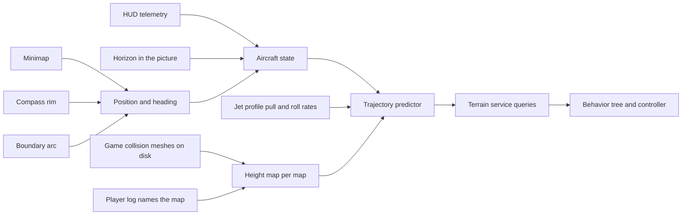

# Design 020 — Terrain Service From the Map's Own Geometry

| Status | Date       | Wingman Version |
|--------|------------|-----------------|
| Draft  | 2026-11-04 | 1.9.4           |

Operator, 2026-11-04: "see how i avoid terrain, this is the biggest wingman issue", then "no terrain
avoidance is still the major blocker it needs advanced logic to calculate trajectory and detect terrain
with accuracy this is the blocker preventing other advanced behavior tree tactics", then "create a hldd to
track this".

## Summary

Wingman cannot tell how far away the ground ahead is, and every tactic that needs low flying waits on that:
holding a control point, a resupply run, a chase through a canyon. This design gives wingman a **terrain
service**: it knows where the aircraft is on the map, knows the ground's height there from the game's own
collision geometry, predicts where each candidate manoeuvre takes the aircraft in the next few seconds,
and answers two questions for the rest of wingman:

- **Is this path clear?** For a manoeuvre, an approach to a marker, or the current flight path: the time
  to impact, or none.
- **What is the way out?** The manoeuvre that clears the ground soonest from here, when the current path
  does not.

Each stage is scored offline against recorded crashes and ordinary flight before anything flies, as
[Research 017](../research/017-camera-vision-for-terrain-avoidance.md) scored its candidates. The first
stage, unpacking the game's installed files to read the collision meshes, ran on 2026-11-07 ("Phase 0
results").

## Status

| Phase | What | Status | Evidence |
|---|---|---|---|
| 0 | One map's height map from its collision meshes | Height map built 2026-11-07; matches the game's own minimap texture. The ten-frame check is open | "Phase 0 results" |
| 1 | Position on the map from the minimap | Live, full resolution, 2026-11-07: a fix on 92% of crops where the compass reads, 99.6% continuous. The HUD altitude offset is open | "Phase 1 results" |
| 2 | State brought up to now: the reading carried forward, bank from the picture | Not started | |
| 3 | Trajectory predictor and the two queries, scored offline | Passes on 39 live Crimson Canyon crashes (2026-11-07): with no margin it warns before 67% at 4.6% of ordinary ticks, against the pull-out's 26.4% at 5.3%. One map only; `way_out()` not built | "Clearance margin sweep" |
| 4 | Shadow live | Built 2026-11-07: `wingman/terrain_service.py` logs a `TERRAIN:` line each battle tick on Crimson Canyon (day and sunrise): the fix, the ground, the speed, and the time to impact under both HUD readings. Median 7.3 ms a tick | "Phase 4 shadow" |
| 5 | The way out flies, as a per-round trial | First step built 2026-11-08 ([ADR 174](../adr/174-the-map-warning-starts-the-emergency-climb-in-half-the-rounds.md)): in half the rounds a `ttc_y` of 2 s or less starts the existing emergency climb. Choosing the way out is not built | ADR 174 |
| 6 | Behavior tree tactics on the service | Not started | |

## Why

### The picture alone has been tried four times

From [Research 018](../research/018-sky-and-terrain-from-flown-paths.md) and Research 017 (measured):

| Attempt | Result |
|---|---|
| Sky fraction (colour) | 3.1% of warnings followed by a crash |
| Looming, shapes, the clear-path planner (ESCAPE) | 5.3% to 10.0% |
| Terrain share by texture ahead | adds nothing to the telemetry |
| Depth model | ranks crash windows best (AUC 0.79), adds nothing in ordinary flight |

None of them knows the distance to the ground. [Design 001](001-terrain-avoidance-hldd.md) (2026-10-24):
"the ground ahead is the missing input".

### The operator's flying says the gap is knowledge, not handling

[Research 020](../research/020-the-operators-flying-as-the-terrain-reference.md), measured over 121 logs
(2026-10-20 to 11-04) and the operator's flights of 2026-11-04:

| | Operator | Wingman |
|---|---|---|
| Share of flight below 1,000 m | 49% | 9% |
| Crashes an hour | 6.7 | 12.4 |
| Crashes per hour flown below 1,000 m | 6.3 | 47.2 |
| Fastest nose-up rate per pull-out, median | 21.7 deg/s | 23.9 deg/s |

Wingman pulls out as hard as the operator. The operator flew the same line three times on one map (level
at about 1,250 m, nose down under a rock arch, along the canyon floor through Point B, out into open sky):
part of their terrain avoidance is knowing the map. All four of the operator's crashes that day came in
close combat; 81% of wingman's come in ordinary flight.

### What the triggers it has now get wrong

- **The pull-out model is pessimistic and blind.** It assumes 5 to 8 deg/s of nose-up above 800 KPH
  (`wingman/pullout.py`) where both fliers' fastest rates run near 22, and it knows the altitude above sea
  level, not above the ground. It fired 42 times on the operator's 13 minutes of low flying, none before a
  crash, and its 600 m floor is meaningless where the ground is at 900 m or at sea level.
- **The agreement fires on a dive at anything on the ground.** It broke off 340 resupply runs from
  2026-10-26 to 11-04, a crash following 13.5% of them
  ([ADR 172](../adr/172-agreeing-terrain-warnings-leave-the-resupply-run-in-half-the-rounds.md)).
- **The recovery pulls without knowing where the ground is.** 2026-11-04: the J-20's emergency
  climb held nose-up for 6 s at knife-edge and turned into a canyon wall. Later that day the icon law pushed
  9.4 s from level to vertical toward an enemy below, its floor checked 3 s ahead with no pull-out height,
  and the recovery came too late. A planner that tests the pull against the ground would have pulled
  earlier, or rolled first.
- **Telemetry is up to 1.5 s old.** Speed and altitude are read once a tick (every tick since Code Review
  019 cycle 10; before that, every second tick left them up to 3 s old), and at 1,000 KPH a 1.5 s old
  reading is 400 m behind the aircraft.

### What is blocked

Holding a capture point (the operator's rounds scored about 250 more than their kills, deaths and assists
predict, against about 20 for wingman, 5 and 10 rounds, inferred to be objective points), a resupply run
that is not broken off by false alarms, a chase that follows a target into low terrain, and terrain
masking against missiles. Each needs "is this path clear" answered with accuracy.

## Goals

1. The ground's height under any point of the arena, for the maps wingman plays, with a known error.
2. The aircraft's position and heading on the arena, on every battle tick it can be had, with a stated
   error and a "lost" state.
3. A predicted flight path for each candidate manoeuvre over the next 5 s, from a state no more than one
   tick old.
4. The two queries, cheap enough for every tick (a budget of 20 ms).
5. Each scored offline before it flies, and each flying part judged by arms drawn per round.

## Non-goals

- Building heights from flight footage. [Design 017](017-terrain-map-from-flight-footage-hldd.md) tried it
  with survey flights; [ADR 160](../adr/160-acs-mission-and-j20-are-the-only-missions.md) removed the survey
  mission. Its position work is taken up here; its reconstruction is not.
- A new picture-based warning. Picture cues stay as fallbacks where the map is not known.
- Opening the full map (`m`) in battle: not safe on every screen (Design 017, fifteenth flight).
- Touching the game's memory or process. The service reads files on disk and the screen, nothing else.

## Design

In words: the height map comes from the game's collision meshes for the map the log names; position comes
from the minimap matched against that height map, with the compass and the boundary arc; the state joins
position, the last telemetry reading carried forward to now and the bank angle from the horizon; the predictor rolls each candidate
manoeuvre forward with the jet's measured rates and tests it against the height map; the behavior tree and
the controller ask the service instead of guessing.

### Height map

- **Source.** The game's collision meshes. `Player.log` lists them when a map loads
  (`stoneforest_valley_wall_west_03_col`, Research 017 step 2), so they are in the installed files, in Unity
  asset bundles. Read with the game closed, once per game version, never at run time.
- **Form.** For each map, a grid of ground heights, the highest collision surface in each cell, at a
  resolution set by the minimap's scale (about 32 m a pixel, Design 017): 16 m cells to start. Overhangs and
  arches (the canyon's rock arch) are a second layer: the lowest underside where one exists, so a path under
  an arch is not called blocked and one into it is.
- **Arena frame.** Arena centre at the origin, north up, metres. The arena edge is a circle (Design 017,
  "The full map"), which gives the scale and centre to check the mesh frame against.
- **Which map.** From `Player.log` at each map load, already read for `GAME STATS` (`wingman/game_stats.py`).
- **Stored** under an untracked folder, by game version and map. A game update that changes a map is
  detected by the mesh names or a checksum and the map is rebuilt.

### Position

Design 017's five parts, unchanged in shape, with the height map as the reference instead of stitched
footage:

1. **Heading** from the compass rim (`wingman/compass.py`, flown since 2026-10-04: within 2 to 4 deg of the
   full map's view cone).
2. **A fix** by matching the minimap, turned north-up, against a top-down render of the height map in the
   minimap's own style (relief and water). The minimap matches frame to frame at a median score of 0.92
   (Design 017); matching it against a render is the open measurement.
3. **A fix from the boundary arc** when the edge is in the window ([ADR 107](../adr/107-boundary-turn-tactic.md)).
4. **Dead reckoning** between fixes on ground speed, which needs the flight-path angle as well as HUD speed.
5. **A lost state**, with an error that grows without a fix. A lost position answers "not known", and the
   current triggers keep flying.

A sanity check comes for free: the aircraft's altitude must never be below the ground under its estimated
position. Every reading that is says the position, the height map or the altitude is wrong.

### State

- **The state brought up to now.** Telemetry is read once a 1.5 s tick (`telemetry.ocr_every_n_ticks` 1).
  The predictor starts from the last reading carried forward to the present with the keys held since it
  (the actuator knows them) and the jet's rates, rather than from the reading itself.
- **Bank from the picture.** The horizon line's angle, or the minimap's rotation rate against the compass,
  gives the roll the pull will be made in. The J-20 canyon-wall crash of 2026-11-04 was a pull at knife-edge.
- **Flight-path angle** from the altitude rate over ground speed (`wingman/telemetry.py` already bounds it).

### Trajectory predictor

- **Candidates.** Hold; pull; push; bank left and pull; bank right and pull; roll wings level then pull. Each
  for 5 s at 0.1 s steps.
- **Rates per jet.** Pull, push and roll rates by speed from the jet profile, measured from logs (the
  per-pull-out rates of Research 020 by speed), replacing the single table in `wingman/pullout.py`.
- **Test.** Each predicted point against the height map, with a margin that grows with the prediction's
  age and the position's error. The answer is the first time inside the margin, or clear.
- **The two queries.** `path_clear(manoeuvre)` gives the time to impact or none. `way_out()` gives the
  candidate clear for longest, ties going to the one that turns least.

### At run time

The service runs in the main loop's tick after telemetry (no thread of its own), within 20 ms, on a height
map loaded at the map's start. Until it has a position and a height map it answers "not known", and wingman
flies exactly as now.

## Phases

Each phase has a pass mark, and the next waits on it.

**Phase 0, one map.** Unpack one map's collision meshes (Crimson Canyon, the operator's canyon of
2026-11-04), build its height map, render it top down. Pass: the render shows the arena circle and the
canyon, river and rock pillars where the full map and the minimap frames show them, by eye on ten frames.

**Phase 1, position, offline.** On recorded sessions of that map: match the minimap against the render and
dead-reckon between fixes. Pass: a fix on 80% or more of battle ticks with the minimap on screen; the fixes
agree with dead reckoning and the boundary arc to under 150 m on 90%; under 1% of altitude readings below
the ground at the estimated position.

**Phase 2, state.** The reading carried forward to now, scored against the next reading (the error of the
carried altitude and path at 1.5 s), and the bank from the picture, scored against the operator's recorded
key presses (a roll key held should show as the bank changing that way).

**Phase 3, the predictor, offline.** On the black box's death windows (506 labelled at 2026-10-24, more
since) and whole recorded battles: how often `path_clear` warns 2 to 6 s before a crash, against how often
it warns 8 s or more before any death and in ordinary flight. Pass: it beats the live pull-out trigger (26.4%
of crashes at 5.3% false alarms, Research 017) on both. On the operator's demonstration flights it should
almost never warn, since they did not crash. And the way out: replayed against each crash window, whether
its manoeuvre clears where the logged one did not.

**Phase 4, shadow live.** Logged, not flown: alarms a mission, against the pull-out and the agreement on
the same ticks, and every crash with the service's view of it.

**Phase 5, the way out flies.** It replaces the blind emergency climb where the service knows the ground,
drawn per round as ADR 165 and ADR 172 do. Verdict: no-card deaths per round, then score.

**Phase 6, tactics.** The service opens the tactics that wait on it, each its own ADR and trial: approach
planning for the resupply, control points and the priority target; holding a control point; a chase that
follows a target low; terrain masking against missiles. The terrain triggers it outperforms are retired then,
each by its own ADR.

## Phase 0 results (2026-11-07)

Crimson Canyon (day scene), content build 2026-10-28_08-50. Tools and outputs are in the untracked
`test_screenshots/terrain/` folder (see its README). Measured unless marked.

- **The files are readable.** All 11,617 bundles in `Metalstorm_Data/content-bundle` are plain UnityFS
  (Unity 6000.3.25f1, LZ4), and UnityPy 1.25.4 reads them. Indexing every bundle takes 7 s. The bundle
  names are readable (`…_maps_map-crimson-canyon_map-crimson-canyon-day-scene_unity`), so a map is found by
  name. Six scenes cover the map: day, sunrise and night, each at full and low quality.
- **The ground is meshes only.** The day scene has 218 `MeshCollider`s and no Unity Terrain. 217 resolve
  to 562,242 world-space triangles. The 218th is the water plane, a solid collider at y = -232.3 m
  spanning about 31 km. All are on layer 0 except the two tunnel props (layer 20), and none is a trigger.
  The ground is at about -165 m, mesa tops are at 1,400 to 1,450 m, and the highest point is 2,282 m.
- **Height map.** 16 m cells over ±12.8 km (1,600 by 1,600), built in 5 s. Each cell holds the top surface
  and, where there is one, an overhang: the lowest underside with at least 100 m of air below it.
  4.5% of cells have an overhang, mostly undercut cliff lips round the mesas and the outlying spawn rocks.
- **Frame and scale.** The game's minimap texture (4,096 px) spans exactly ±10,000 m and is centred on the
  origin, with +x east and +z north. The texture's river matches the height map's water at IoU 0.61,
  against 0.13 and 0.16 for the two mirror images. The texture's grid rings fall every 1,000 m out to
  9,950 m. That puts the arena edge at a 10 km circle (inferred: the outermost ring), inside Design 017's
  measured 8.8 to 10.3 km. A render of the height map puts the canyon, the river, the road arms, the
  islands and the pillars where the texture draws them (`crimson-canyon-render-800.png` beside
  `crimson-canyon-minimap.png`).
- **Not done: the ten-frame check against recorded minimaps.** `CompassReader` reads no heading on the
  960 by 600 demonstration frames, at 1x or 2x, so the rotation is unknown. A blind search over rotation,
  scale and position matched noise: scores of about 0.3, the scale stuck at the edge of the range, and its
  one high score (0.95) fell on a frame of sky. Registering frames is Phase 1's open measurement, so this
  check moves there. It needs full-resolution minimap crops with a compass reading.
- **HUD altitude against mesh height is not settled.** HUD altitudes logged on Crimson Canyon since
  2026-10 go down to 0 to 25 m (66 readings). That fits the HUD measuring height above the water plane
  (HUD = y + 232, which puts the canyon floor at about 67 m), but it is not shown. Phase 1's check that no
  altitude falls below the ground settles it.

## Phase 1 results (2026-11-07, offline)

The tools are `test_screenshots/terrain/tools/register.py`, `score_fixes.py` and `crash_check.py`. The
data is the operator's Crimson Canyon flights of 2026-11-04 (2,215 frames, 960 by 600, 5 a second) and
today's black box. Each claim is marked measured or inferred.

- **Heading on recorded frames needs its own thresholds (measured).** JPEG compression drains the N
  letter's saturation from 210 to about 130, so the live profile reads 0 of 652 recorded frames. A
  recorded-frame profile (S of 110 or more, V of 170 or more, letter area 0.001 to 0.006 of R²) reads 80%
  of them. Against the live `hdg=` on ticks where the heading was steady, the median error is 1.5 deg and
  93% are within 10 deg. The live profile reads 86% of battle ticks (7,128 of 8,273 attempts, session of
  2026-11-07 08:25) and is unchanged.
- **The minimap's scale is fixed (measured).** With rotation taken from the compass, every frame picks
  the same scale, 66 to 68 m per recorded pixel (Design 017: 64). That is about 33 m per pixel at full
  resolution.
- **Fixes (measured).** Matching the north-up crop against the game's minimap texture gave a fix on
  1,273 of 2,215 frames (57%). A fix needs a score of 0.5 or more, at least 0.15 above the best match
  elsewhere. The compass is the limit: 1,472 frames had a heading. 99% of consecutive fixes, 0.2 s apart,
  agree within 150 m plus flight distance. The median step between them is 68 m, one matching pixel.
  Sub-pixel refinement is the obvious next gain.
- **Altitude against the ground (measured; the offset is inferred).** Against the ground under the fix,
  8.2% of readings are below it if the HUD shows the mesh height (y), and 16.5% if it shows y + 232
  (height above the water). Against the lowest ground within 100 m, allowing for the fix's error, the
  figures are 1.1% and 4.4%; within 200 m, 0.0% and 1.5%. This favours HUD = y but does not prove it.
- **Black-box crashes (measured, three of them on Crimson Canyon Sunrise, 2026-11-07).** The Sunrise and
  day scenes have identical collision geometry. The minimap is gone 5 to 8 s before the black box's death
  time: the death camera. The 13:51:44 crash was east along the river at 826 KPH, 300 to 500 m up. The
  straight track meets a 730 m wall 1.0 to 1.5 s after the last fix, under either altitude reading. The
  13:49:26 and 13:56:18 crashes have no terrain on the straight track. They were turning or hit something
  else (inferred).
- **Correction: the first search could not reach the arena's edge (measured).** The template had to lie
  inside the texture, which limited fixes to ±5.7 km of the centre. 85 accepted recorded fixes (6.7%) were
  pinned to that edge. Padding the texture fixed it. On the corrected run there are 1,327 fixes,
  continuity is 99%, and 1.0% (y) and 4.3% (y + 232) of readings are below the lowest ground within
  100 m. The other figures above are from before the correction and barely move.
- **Live, full resolution (measured).**
  - Data: 2,211 minimap crops from display :3, two a second, read-only, over three Crimson Canyon rounds
    (16:50 to 17:08), paired with `wingman.log`.
  - Compass: the live profile reads 75% of crops. The rest include death cameras, respawn screens and
    the scoreboard.
  - Scale: fixed at 34 m per pixel.
  - Fixes: with a score of 0.4 or more and a gap of at least 0.15 over the best match elsewhere, 92% of
    the crops the compass reads get a fix (1,530). 99.6% of consecutive fixes agree.
  - Altitude: 0.7% (y) and 1.6% (y + 232) of readings fall below the ground under the fix. With 50 m
    allowed for position error, 0.0% and 0.3%. Most of the recorded frames' 8% was position error.
- **Crashes caught on the live picture (measured; the cause is inferred).** A no-kill-card crash
  replaces the minimap with the death camera within 0.5 s of the last fix. Ground ahead is read from the
  last fix along the track, ±15 deg, for 3 s.

  | Crash (respawn screen) | Last fix | Ground on the track | Impact predicted if HUD = y | Impact predicted if HUD = y + 232 |
  |---|---|---|---|---|
  | 16:54:38 | HUD 1,511 m over the canyon floor, 157 m/s | 1,190 to 1,244 m, 2.7 to 2.9 s ahead | none in 3 s | 1.8 to 2.3 s |
  | 16:55:29 | HUD 1,523 m over the north mesa, 181 m/s | a 1,901 m spire, 1.5 s ahead | 0.9 to 1.2 s | 0.8 to 1.0 s |
  | 16:58:08 | HUD 1,785 m over the canyon floor, 326 m/s | 2,030 m, 2.5 to 3 s ahead | 2.5 to 2.6 s | 1.9 to 2.1 s |
  | 17:02:23 | HUD 2,248 m over a 1,990 m cliff top, 253 m/s | 2,035 to 2,196 m, 0.5 to 0.7 s ahead | none in 3 s | 0.2 s |
  | 17:10:58 | HUD 1,039 m diving at 159 m/s toward a mesa side, 100 m/s across the ground | 1,207 to 1,454 m, 2.6 to 3.0 s ahead | 1.6 to 1.9 s | 1.6 to 1.9 s |
  | 17:13:57 | HUD 1,577 m climbing at 66 m/s over the canyon floor, 154 m/s | at most 1,260 m within 3 s | none | none |
  | 17:16:00 | HUD 1,190 m (1.2 s old) diving at 103 m/s into a slope rising from -50 m to 983 m, 247 m/s | 983 to 1,008 m, 0 to 2 s ahead | 1.8 to 2.2 s | 0.1 s; clearance 85, 56, then -25 m over the last three fixes |

  | 17:18:12 | HUD 1,634 m over the gap between the mesas, 218 m/s, turning right | 1,661 m, 1.3 s ahead on the track turned 15 deg right | 1.2 s (turned track only) | 1.1 s (turned track only) |

  | 17:22:37 | HUD 1,287 m level, 252 m/s, into ground rising 1,204 then 1,405 then 1,855 m over the last three fixes | 1,857 m, 0.3 s ahead | 0.1 s | 0.1 s |

  With the 13:51:44 river wall, eight of ten canyon crashes have terrain on the track. The 17:13:57
  crash has none under either reading: a turn or a collision (inferred). In each crash the minimap gives
  way to the death camera within 0.5 s of the last fix. In all four crashes where the two readings
  disagree (16:54, 16:58, 17:02, 17:16), y + 232 predicts the earlier impact, closer to what was
  observed. A stale altitude in a dive makes both predictions late. Wingman's
  picture-based escape was firing over, left and right before the 16:55 crash, without the obstacle's
  height.
- **Settled 2026-11-07 19:48 (measured): the HUD shows the mesh height y itself, signed, and wingman
  drops the sign.**
  - The operator skimmed the Crimson Canyon river (water plane at y = -232.3) and saved three
    screenshots (`tests/test-output/screenshot_20261107_1948*.png`). The HUD read -206, -195 and -220 m,
    12 to 37 m above the water.
  - Wingman logged those ticks as +137 to +193. `_row_value` in `analyzer.py` takes `\d+`, so the minus
    is lost. EasyOCR does see it, as `-`, `+` or `"` (raw: `-206 m`, `+195m`, `"220m`).
  - So below y = 0 every logged altitude is the absolute value. That is why `ttc_sea` (altitude - 232)
    looked better below: it was a closer stand-in for the true negative height. The two readings
    weighed below were the wrong question.
  - **Fixed 2026-11-07 (cycle 7).**
    - The altitude row keeps a leading `-`, `+`, `"` or Unicode dash as a minus (`_ALT_MINUS_GLYPHS`).
      On 124 full-resolution positive altitude rows, only `i` and `'` ever led the digits.
    - The telemetry filter accepts altitudes down to `telemetry.min_altitude_m` (-1,600; Crucible's kill
      floor is -1,480) instead of rejecting anything below 0.
    - Effect on flight: below y = 0 the time-to-ground (`alt / -rate`) is now negative while
      descending, so the emergency climb fires there. Before, it saw |y|. That is under 1% of canyon
      ticks, all of them deep in the canyon.
    - The terrain service's `ttc_y` is now the meaningful reading on every map. `ttc_sea` is kept in
      the log for comparison only.
  - The evidence once weighed both ways, kept for the record:
  - For y + 232 (height above the water): the crash timings above, and the 16:54 and 17:02 crashes are
    explained only by it. With
    100 m allowed for position error, the closest wingman came to terrain in 961 live fixes is 38 m
    under y + 232, against 270 m under y, in rounds where it flew into terrain four times.
  - For y: the recorded frames' below-ground shares, and HUD readings of 4 m held for 5 s on Crimson
    Canyon. Only 12 of 70 readings under 30 m were followed by a respawn within 8 s, against about 10%
    for any tick.
  - The cheapest decider is the HUD reading while skimming the river, from the operator or a live frame.
- **Against the pass mark.**
  - Continuity: met.
  - Fix rate: met live (92%), taking "the compass reads" for "the minimap is on screen". Not met on the
    recordings.
  - Altitude check: met live with 50 m allowed for position error, under either offset.
  - Boundary-arc agreement: not run.

## Phase 3, first score (2026-11-07, offline on live fixes)

The tool is `test_screenshots/terrain/tools/phase3.py`. The data is 4,611 full-resolution minimap crops
from 16:50 to 17:29, giving 3,085 accepted fixes over Crimson Canyon rounds, with `wingman.log` for
altitude, respawns and death cards. 24 deaths had a fix in the 15 s before: 12 crashes (no kill card)
and 12 kills. 10 of the crashes have a usable window.

**The warning.** At each fix, ground speed and track come from the previous fix (0.3 to 1.2 s earlier).
Altitude is the last logged reading carried forward at its logged rate. The path is projected on the
track and 15 deg either side. The warning fires if the path meets the height map within the horizon.

**Scoring.** A crash counts as warned if any fix 1 to 6 s before it warns. Ordinary flight is every fix
with no death of any kind in the next 10 s.

| HUD reading | Horizon | Crashes warned 1 to 6 s before | Ordinary flight warned | Median first warning before the crash |
|---|---|---|---|---|
| y | 3 s | 8 of 10 (80%) | 4.2% of 2,663 fixes | 2.0 s |
| y | 5 s | 9 of 10 | 7.7% | 2.5 s |
| y + 232 | 3 s | 9 of 10 (90%) | 8.7% | 3.5 s |
| y + 232 | 5 s | 10 of 10 | 13.3% | 5.0 s |

The live pull-out trigger warns on 26.4% of crashes at 5.3% false alarms (Research 017).
- **Read with care.** 10 crashes is far below the 40 this project trusts for any rate. "Ordinary flight"
  includes near misses that wingman's own escape pulled out of, so part of that column is true warnings.
- **Next.**
  - Phase 4 shadow, logging both altitude readings on every canyon tick, gives the same score at scale
    with no screen grabbing.
  - More maps need their height maps, which can only be built with the game closed.

## Phase 4 shadow (2026-11-07)

`wingman/terrain_service.py` runs on the BT tick, after its log line, in live runs only.

- **When it logs.** On a battle tick with health being read, on a map named in `terrain_service.maps`, it
  logs one line, for example:
  `TERRAIN: map=CRIMSON CANYON fix=-537,-2175 score=0.46/0.19 ground=-152 speed=104 ttc_y=clear ttc_sea=clear ms=7`.
  With no fix the line reads `fix=none(no-compass|weak-match)`.
- **Data.** The map data comes from the untracked `test_screenshots/terrain/` folder. Without it the
  service warns once and logs nothing.
- **The fix.** It is Phase 1's matcher (live compass profile, 34 m per pixel at 320 px, score of 0.4 or
  more and a gap of 0.15 or more), with sub-pixel peaks. With a fix in the last 2 s it searches ±2.5 km
  round it first.
- **Cost.** Measured on 40 live crops 1.5 s apart: median 7.3 ms, p90 39 ms (a whole-map search), and
  0.7 s once on the first tick of a map, to load it. The windowed fixes equal the whole-map ones (0 m
  over 38).
- **The predictor.** It is Phase 3's: the track from the last two fixes (at most 2 s apart), ±15 deg, a
  3 s horizon. It reports both HUD readings, `ttc_y` and `ttc_sea`.
- **Shadow.** Nothing steers on it. Tests are in `tests/test_terrain_service.py`, on synthetic data,
  including a fix 8 km out, the edge the first search could not reach.

### Live shadow score (2026-11-07, 18:11 to 19:46, Crimson Canyon only)

Scored by `test_screenshots/terrain/tools/score_shadow.py` on the `TERRAIN:` lines of two sessions:
2,088 lines, 80% with a fix, and 1 fix in 1,671 repeating the previous one. There were 17 crashes (no
kill card) and 27 kills with shadow lines before them. A crash counts as warned if a line in the 8 s
before the death camera warns. Ordinary ticks are those with no death in the next 10 s.

| Warning | Crashes warned | Median first warning | Ordinary ticks warned |
|---|---|---|---|
| `ttc_y` 3 s or less | 13 of 17 (76%) | 3.2 s before | 4.3% |
| `ttc_y` 2 s or less | 13 of 17 | 1.7 s before | 2.9% |
| `ttc_sea` 2 s or less | 16 of 17 (94%) | 4.0 s before | 5.4% |
| `ttc_sea` 1 s or less | 12 of 17 | 3.2 s before | 3.5% |

- **Against the pull-out trigger.** It warns on 26.4% of crashes at 5.3% false alarms. At a similar
  false-alarm rate the map-based warning catches about three times as many.
- **Sample.** 17 crashes is under the 40 this project trusts for a rate, and all are on one map.
- **The two readings (measured; what it means is inferred).** No crash was warned under `ttc_y` and
  missed under `ttc_sea`. Three were the other way round (18:41, 19:18, 19:36). One crash (19:15) had
  no terrain on any projected track. This is more evidence for the HUD showing height above the water.
- **Where.** Many of the crashes cluster round the south mesa (x -500 to 500 m, z -2,200 to -800 m).

### Clearance margin sweep (2026-11-07, 39 crashes)

`test_screenshots/terrain/tools/margin_sweep.py` re-runs the shadow's prediction from the logged fixes and
BT altitudes, requiring the path to clear the ground by a margin.
- **Data.** Three sessions (18:11 to 21:03 and after), 3,894 ticks with a track, 39 crashes and 65
  kills, all on Crimson Canyon.
- **Scoring.** A crash counts as warned if a tick 1 to 8 s before its death camera warns. Ordinary ticks
  are those with no death in the next 10 s.

| Margin | Crashes warned | Median lead | Ordinary ticks warned |
|---|---|---|---|
| 0 m | 26 of 39 (67%) | 3.8 s | 4.6% |
| 50 m | 29 of 39 (74%) | 3.2 s | 5.3% |
| 100 m | 31 of 39 (79%) | 4.4 s | 5.9% |
| 150 m | 33 of 39 (85%) | 3.2 s | 6.6% |
| 200 m | 34 of 39 (87%) | 4.5 s | 7.7% |
| 250 m | 36 of 39 (92%) | 4.5 s | 8.6% |
| 300 m | 36 of 39 (92%) | 4.6 s | 10.1% |

- **Against the pull-out trigger.** At its false-alarm rate (5.3%, margin 50 m) the map-based warning
  catches 74% of crashes against its 26.4%. With no margin it beats it on both counts.
- **Phase 3's pass mark is met on this map.** Caveats: the pull-out's figure was measured on black-box
  windows, not ticks; "ordinary ticks" include near misses wingman's own escape pulled out of; and this
  is one map.
- **The second log field.** It is now `ttc_m`: the path within `clearance_margin_m` (150) of the ground.
  The discredited "height above the water" reading is gone. Its edge was a 232 m margin by accident;
  the session after the sign fix, all altitudes positive, still gave it 7 of 8 against 5 of 8.

### The way out, offline (2026-11-08, 93 crashes)

Operator, 2026-11-08: "forced climbs arent always the way to go, sometimes it may need to be turning left
or right to avoid terrain, shouldnt this terrain work be focused on identifying good flight paths?"

- **Turn rates (measured).** Over 9,300 tick pairs of compass heading, wingman turned faster than
  20 deg/s on 15% of ticks (p90 29 deg/s). Vertical rate ran from -142 to +167 m/s (p5 to p95).
- **The candidates** (`tools/way_out.py`, then `fly_candidate` in `wingman/terrain_service.py`): hold;
  climb (path angle rising 22 deg/s to 50 deg); left and right (25 deg/s, path angle held); left and
  right with a climb (18 deg/s turn, 15 deg/s pull). Each starts after 0.5 s of reaction on the
  current path, and is projected 5 s against the height map.
- **The test.** At the earliest tick 1 to 6 s before each crash where holding course meets the ground
  within 5 s:

| Outcome | Crashes |
|---|---|
| A climb clears (a turn too: 30) | 41 |
| Only a turn clears (plain, or with a climb) | 14 |
| Nothing clears | 18 |
| Holding course never met the ground (a turning crash, a collision or a bad fix) | 17 |
| No track before the crash | 3 |

- **What it says (inferred from the model; not yet flown).** Of the 73 crashes that flew into the
  terrain ahead:
  - A turn is the only escape in 14 (19%), which a forced climb cannot save.
  - The best candidate clears in 55 (75%), against 41 (56%) for the climb alone.
  - Nothing clears by the time of the warning in 18 (25%). Those need warning earlier, or a route that
    keeps out of such places (Phase 6).
- **Shadow (built 2026-11-08).** On every tick whose path warns, the `TERRAIN:` line carries
  `way_out=<best> [hold=… climb=… left=… right=… left+climb=… right+climb=…]`. Nothing flies on it.
  The forced climb of ADR 174 is unchanged.

### The way out, live and deciding earlier (2026-11-08, 107 crashes)

- **Live way-out shadow (measured).** 02:39 to 03:39 gave 42 warning ticks:
  - Nothing clear: 26 (62%). Hold clear, so the forced climb was not needed: 5 (12%). Climb clear: 6.
    Only a turn clear: 5.
  - Of the 26 with nothing clear, 9 hit with every candidate within 0.5 s, before any manoeuvre can
    start. 8 had the altitude below the ground under the fix itself: a fix about 100 m off at a cliff,
    or a stale altitude.
  - At a 2 s warning on a 1.5 s tick, the warning comes too late to choose.
- **Deciding earlier (`tools/decide_early.py`, measured offline).** Over 107 crashes and six sessions:
  act when the straight path meets the ground within D s, and fly the best candidate. A state with
  the altitude 30 m or more under the ground at the fix counts as a bad fix, not a warning.

| D | Crashes with a clear way out at the first act | Boxed in | No act in time | Acts in ordinary flight, per tracked hour |
|---|---|---|---|---|
| 2 s | 12 | 36 | 59 | 28 |
| 3 s | 35 | 29 | 43 | 39 |
| 4 s | 47 | 23 | 37 | 53 |
| 5 s | 62 (58%) | 17 | 28 | 68 |

  - A tracked hour is about a third of a battle hour, so 5 s means about two acts a round.
  - Most of the gain is from deciding early and choosing the path, not from climbing harder.
- **Fix rate by map, live (measured).** CRIMSON CANYON 94%, ICEBOUND 92% and STORMBREAK 67% of ticks
  with a compass. STORMBREAK is mostly open water, and its accepted fixes score a median of 0.57, which
  confirms the pairing with seastacks.
- **Next.** Fly the way out in the `map` arm: act at 5 s and fly the best candidate. The turn is the
  boundary turn's bank-and-pull (ADR 107/122) toward the chosen side. Then check live that the real
  turn rate matches the model's 25 deg/s. This revises ADR 174, which is still a Draft.

### Stone Forest fixes, and the flown way out's first hour (2026-11-08)

- **Stone Forest barely fixed live (measured).** From 04:47, 75 fixes from 476 compass reads (16%). Its
  minimap draws the forest as fine speckle that the texture lacks.
- **Matching variants on recorded Stone Forest crops (`tools/match_variants.py`).**

| Preprocessing | Stone Forest passing | Median margin | Crimson Canyon passing | Median margin |
|---|---|---|---|---|
| grey (as built) | 0 of 55 | 0.12 | 34 of 34 | 0.49 |
| gradient | 0 of 55 | 0.03 | 13 of 34 | 0.23 |
| high-pass | 0 of 55 | 0.01 | 34 of 34 | 0.43 |
| blur about 100 m | 50 of 55 | 0.19 | 34 of 34 | 0.51 |

  - The blurred Stone Forest fixes are right: 99% of consecutive fixes agree within flight distance
    (87 pairs).
  - Now built: `terrain_service.match_blur_m` (100) blurs both the crop and the texture. On live Crimson
    Canyon crops, fixes went from 38 to 39 of 40, at 8.1 ms median and 13 ms p90 (was 7.3 and 39).
- **The flown way out's first hour (04:47 to 05:30, Stone Forest and Countdown).**
  - In map-arm rounds it acted 3 times, all climbs, and made no terrain turn. Stone Forest gave few fixes
    (above), and on Countdown wingman flew high, at up to 4,200 m.
  - The inside-ground guard suppressed 2 readings at a Countdown spawn on high ground.
- **False minus readings (measured).** On Crucible (04:15 to 04:31) the altitude OCR read three positive
  altitudes near 2,000 m as negative (-1,969, -2,188, -2,229). The -1,600 m floor rejected all three.
  A tighter floor (-300 m, below Crimson Canyon's water) is the next change.

### First terrain turns flown (2026-11-08, Crimson Canyon)

Four TerrainTurn turns in `map`-arm rounds, 06:30 to 06:49 (measured):

| Start | Side | Heading over the turn | Outcome |
|---|---|---|---|
| 06:30:20 | left | 272 then compass unread | death 5 s later, no card read. It started in a -69 deg dive at 281 m/s, the altitude froze at 1,654 |
| 06:31:08 | left | 54, 57, 52, 33 (about -6 deg/s; nose -32 to +8 first) | survived a ridge-edge near miss, climbing at 190 m/s 6 s later |
| 06:31:41 | left | 196, 172, 132, 56 (-40 deg/s) | survived |
| 06:49:19 | right | 262, 284, 341 (+38 deg/s) | survived |

- **Turn rate.** In level flight the turn runs at about 40 deg/s, above the model's 25. From a dive it
  is slower, because the bank-and-pull first lifts the nose.
- **Dives.** A bank-and-pull in a steep dive mostly turns the dive. A pull-out may be the better
  answer there.
- **Sample.** Four turns are too few for any outcome rate; the trial's arms decide.
- **Altitude sign, still unproven live (measured).** No negative altitude was accepted in about 16,000
  ticks after the fix, across every map. Crimson Canyon's lowest read was +1 m, over a floor at -165.
  Since 2026-11-08 07:00 every parsed altitude under 300 m logs its raw OCR text (`ALT RAW:`). That
  shows whether a minus glyph is there and missed, or absent.

### The 07:42 crash after the resupply, and two fixes (2026-11-08)

Operator, 2026-11-08: "in this case turning left or right after the resupply would have avoided terrain"
(screenshots `tests/test-output/screenshot_20261108_074233.png` and `074236.png`).

- **What happened (measured).**
  - Wingman dived at the resupply ring in the canyon. At 07:42:31 the agreement and the pull-out fired
    ("climb forced"). ADR 172's arm for the round kept the hold-off, so the run went on.
  - At 07:42:36 it re-armed (B secured) at 278 m by the HUD, with a wall filling the view.
  - The terrain service acted only at 07:42:37. Every candidate then hit within 2.2 to 2.8 s, and it
    turned left into a crash.
- **Why it was late.**
  - **Stale altitude.** It used the smoothed altitude: 627 m at 07:42:36.1, against 278 m on the HUD at
    07:42:36.9, in a -166 m/s dive. Design 020 Phase 2, "the state brought up to now", had not been
    built.
  - **Turns that kept diving.** The model's turns held the dive angle. The flown bank-and-pull holds the
    nose up and levels the dive.
- **The fixes (built 2026-11-08).**
  - The service is given `altitude_ahead(0)`: the last accepted reading carried to now at its rate,
    downward only. It falls back to the smoothed value when no fresh reading exists.
  - The left and right candidates raise a dive toward level at 13 deg/s (the 06:31:08 turn: nose -32
    to +8 deg in about 3 s).
- **Replay of the crash with both fixes**, using the altitude from the screenshots:
  - At 07:42:34.0 (750 m) the straight path is clear for 5 s, and nothing acts.
  - At 07:42:35.5 (506 m) the straight path hits at 3.9 s. The action is left, with left and right both
    clear for 5 s. That is a tick before the real decision, which had nothing clear.

### The flown way out over 41 rounds, and an honest turn model (2026-11-08)

- **Trial arms on the way-out rule** (04:47 to 09:20; rounds on maps with data; measured):

| Arm | Rounds | Crashes per round | Score per round | Terrain turns per round |
|---|---|---|---|---|
| map | 20 | 0.90 | 336 | 1.1 |
| control | 21 | 1.29 | 356 | 0 |

  30% fewer crashes in the `map` arm at about the same score. 18 against 27 crashes is not yet
  significant (one-sided p about 0.2).
- **The 21 flown terrain turns (measured).**
  - The heading came round at a median of 10 deg/s (1 to 43), against the model's 25.
  - 10 were followed by a respawn within 8 s. Of the 15 the model had called clear, 8 died: 7 crashes
    and 1 kill.
  - Most decisions came with the straight path 1 to 2.5 s from impact, not 4 to 5 s.
  - Most of these turns predate the fresh-altitude fix (08:35).
- **Turn model brought to measurement (built 2026-11-08 09:30).**
  - Left and right turn at 12 deg/s after a 1.0 s roll-in. The climbing turns turn at 10 deg/s after
    1.0 s. The climb keeps 22 deg/s after 0.5 s.
  - Replaying 07:42 with this model and fresh altitude, it acts at 07:42:35.5 and turns left. That is no
    longer called clear: left is the latest impact, at 4.9 s.

### Altitude reads: garbles dropped, and a real negative (2026-11-08)

- **What the raw text showed (measured).** 43 low reads (`ALT RAW:`, 07:22 to 11:00) were mostly high
  altitudes with a digit read as a letter. The old parser took the first digits:
  - `1B10 m` (1,810) parsed as 1, `Y78 m` (1,878) as 78, and `38*6m` as 38.
  - Other garbles of the same kind: `e188`, `1g03 m`, `17M7 m`, `208Bm` and `12o56`.
  - A false low altitude can start the pull-out and time-to-ground climbs.
- **Now built (`_altitude_token_value`).** The altitude token must be digits, with an optional minus
  glyph in front and an `m` behind. Anything else makes the read unreadable, and the row's fallback
  passes get their turn.
  - On the 43 reads it drops 28, every one of them a garble, and keeps 9 clean ones.
  - Of the kept, `125 m` to `298 m` are low passes, and `-142m` is a real negative: 08:43:22 on Crimson
    Canyon over ground at -139, at the crash.
  - It also drops `'1973 m`, probably a real 1,973. Losing a read there is the safe failure.
- **The sign fix works live.** `-142m` is the first negative altitude read in flight, at the moment the
  aircraft met the canyon floor.
- **First live run of the parse fix.** It started 2026-11-08 12:21 on account 3 (`make r3`), with the
  measured turn model. The code is commit `ebdc2be` plus the uncommitted `analyzer.py` and
  `terrain_service.py` changes, gated at 4,087 passed. The game content build is unchanged
  (2026-10-28_08-50).
  - Before it, the account 2 session (10:21 to 12:11, old parser) accepted 4 impossible low stable
    altitudes, 4.0 m among them. That is the garble the fix drops.
  - Watched for: any stable altitude under 20 m in battle.
  - **Seen at 12:36:06 (measured).** After a respawn, a bare `3` (no unit) seeded the altitude at 3.0 m.
    The next read was 893 m, the spawn. The low bare reads seen live were all fragments of one or two
    digits (`3`, `6`, `7`, `8`, `0`, `30`, `41`).
  - **Fixed.** A token without a unit (`m` attached, or `m`/`feet` as the next word) must have three
    digits or more. The real-image telemetry corpus test still passes, since OCR often drops the unit
    off a good read and the row splitter keeps only boxes with digits.

### The measured turn model in flight (2026-11-08, 10:21 to 14:17)

Sessions: account 2 (10:21 to 12:11), account 3 (12:21 to 13:17 and 13:17 on). Measured.

- **Terrain turns.** 13 flown. 12 were survived for 8 s, and 1 crashed (the model had called it clear).
  On the 25 deg/s model before it, 11 of 21 were survived.
- **Trial arms on this rule** (rounds on maps with data):

| Arm | Rounds | Crashes per round | Score per round |
|---|---|---|---|
| map | 18 | 1.00 (18 crashes) | 536 |
| control | 21 | 1.10 (23 crashes) | 544 |

  No difference to speak of yet. Each change to the way-out rule splits the trial, so the rule is held
  steady until both arms reach 40 or more rounds.
- **Impossible low altitudes.** Account 2 (old parser) accepted 4. The first account 3 run accepted 1
  (the bare `3`). The run since the fragment fix (13:17) has accepted none.

### Deciding earlier from the heading: rejected (2026-11-08, measured)

The idea: project the straight path along the compass heading (current each tick) rather than the
track between two fixes 1.5 s apart, which lags in a turn. Replayed on 2026-11-08's logs (50 crashes with
a track in the 8 s before, 14,544 ordinary ticks):

| Projection | Acted before | A clear way out at the first act | Acts on ordinary ticks |
|---|---|---|---|
| fix track (as flown) | 37 of 50 | 18 | 7.1% |
| compass heading | 39 of 50 | 20 | 7.0% |

- **Verdict.** No real gain. It is not built, which spares a rule change that would split the trial.
- **What limits saves.** It is that a clear way out exists at the first act for only 18 to 20 of 50
  crashes. Most are already boxed in when any projection sees them.
- **Where crashes happen (two days of logs, 404 crashes).** 79 (20%) came within 10 s of flying at the
  resupply marker, the 07:42 pattern.
- **The next target: Phase 6, starting with the resupply approach.** Before and during a resupply run,
  check that the pass through the ring leaves a way out, and change the approach when it does not. It
  needs a design of its own: the marker is on screen, not on the map.

### Phase 6, first target: a resupply pass that leaves a way out (design, 2026-11-08)

- **The trial so far** (current rule, 10:21 to 16:19; measured): `map` 30 rounds, 1.07 crashes a
  round; `control` 28 rounds, 1.32. That is 19% fewer, with a one-sided p of 0.22. Score is 488
  against 515, within its noise.
- **Ring positions are not in the game files (measured).** `tools/extract_locators.py`, run with the
  game closed, finds in every map's scene a `MapObjectiveAndPickupLocatorSpawner` that holds only
  references to the pickup and objective prefabs. The scenes name capture-point scenery but no resupply
  locators. Rings are placed at run time (inferred: by the game mode), so the plan has to locate them
  live.
- **Locating a ring live.**
  - The resupply marker's place on screen gives its bearing from the nose: horizontal from the marker's
    x and the camera's field of view, vertical from its y. Off screen, the ring pin gives the
    horizontal bearing.
  - With the fix and heading each tick, two bearings from points a few hundred metres apart cross at
    the ring, with no distance needed. More ticks refine it.
  - The marker's growing size is a check on range.
- **Planning the pass.** With the ring on the map, project the run through it and the exits beyond it
  (`way_out` from the ring's position, at the run's speed and descent):
  - If no exit is clear, take an approach that leaves one: offset to the open side, or come in along the
    canyon, not across it.
  - If none exists, skip the ring this pass. That is ADR 172's hold-off, but decided by the map rather
    than by a coin.
- **Steps.**
  1. Log the marker's bearing with the fix and heading. Triangulate offline, and check it against the
     place the aircraft re-arms (`AIRCRAFT RE-ARMED`).
  2. Shadow the pass plan.
  3. Fly it per round.
- **Step 1, done offline (2026-11-08, measured; `tools/triangulate_resupply.py`).**
  - **No new logging was needed.** The `RESUPPLY:` lines give the marker's screen position and size
    about three times a second; `TERRAIN:` and BT lines give the fix and heading; `RESUPPLY: rearm
    climb-out` marks the re-arm. The check used 49 re-arms from four sessions, with the padlock off.
  - **Bearings alone fail along the line of sight.** Wingman flies nearly straight at the marker (a
    median of 64 px from screen centre), so the rays are near parallel. Across track the median error
    is 156 m; along track it is 1,481 m. The field of view (60 to 110 deg tried, 70 best) does not rescue
    it.
  - **Marker size gives a coarse range.** Median sizes: 60 px at 200 to 600 m, 54 px at 600 to
    1,200 m, 44 px at 1,200 to 2,500 m, 36 px at 2,500 to 6,000 m. The correlation with 1/distance is
    0.75. It is an icon that scales only mildly, not one drawn to size.
  - **Bearing with a size-read range** puts the ring at a median 335 m from the fix at the re-arm: 47%
    within 300 m and 73% within 500 m.
  - Caveats: the size table is fitted on the same data. The re-arm line comes after the aircraft has
    passed through the ring, so the reference itself carries an offset along track.
  - Not yet the about 200 m a pass plan needs. Next: a better reference (the closest approach to the
    marker's line, or the moment the marker leaves the screen), and checking the size table on held-out
    sessions.
- **Every resupply run, before and after (2026-11-08, measured; `tools/resupply_runs.py`).** At the
  operator's request, each rearm run is now reviewed from its start (`missiles exhausted` or
  `urgency overtook`) to its end (re-arm, death card, or round end). Crimson Canyon, 11-01 to 11-08:
  - **Outcomes:** 419 runs. Killed 37%, crash 29%, re-arm 20%, round end 14%. On the 11-08 logs,
    Crimson re-armed in 20% of runs against 39% on the other maps.
  - **The rings sit at fixed sites, so the triangulation above is not needed on Crimson.** The re-arm
    fixes cluster at four sites: (-3082,3087) at 395 m altitude, 574 m above the river (8 re-arms);
    (3227,-3154) at 416 m, 564 m above it (6); (324,-1252) at 1,598 m, 388 m above the plateau (16); and
    (218,-1818) at 1,648 m (2).
  - **Crashes come after the approach is abandoned, not on it.**
    - 88 of 121 crashes came more than 8 s after the marker last had the steering.
    - About 13 came on the approach itself.
    - 20 came in runs where the marker never took the steering.
  - **What breaks the approach off:**
    - a map-warning climb, in 42 runs that did not re-arm;
    - a dive steeper than the ring needed, in 35 (17:13: -90 deg where 28 deg reached the ring);
    - starting too high to make the ring straight, in 27;
    - a false pass climb-out, in 11.
  - **False pass climb-outs, fixed.** Across the 11-01 to 11-08 logs, 36 of the 62 climb-outs whose
    marker came back within 3 s had it 52 px across or less. Only 1 of the 196 climb-outs a re-arm
    followed had it under 53. `pass_trigger.min_size_px` goes from 50 to 53.
  - **Next: plan the descent to the known ring height.** The map warning should judge the planned
    path to the ring, not the straight dive extended past it.
  - **The approach limits are measured, not guessed (2026-11-08 18:45).** The first draft of this plan
    said "no more than about 15 deg, under about 700 kph". The data contradicts it. Crimson runs where
    the marker took the steering, 11-01 to 11-08, 240 runs:

    | Steepest dive | Runs | Re-arm | Crash | Killed |
    |---|---|---|---|---|
    | 0 to 10 deg | 47 | 21% | 34% | 45% |
    | 10 to 20 deg | 47 | 28% | 30% | 43% |
    | 20 to 30 deg | 47 | 34% | 30% | 36% |
    | 30 to 45 deg | 43 | 44% | 28% | 28% |
    | over 45 deg | 56 | 29% | 43% | 29% |

    - Under 700 kph, 11 to 14% re-armed and 50 to 57% were killed. At 900 kph and up, 38 to 41%
      re-armed.
    - Part of this is selection (inferred): the runs that got close to the ring are the fast, steep
      ones.
    - Even so, slowing down and flying shallow are not supported. The supported limit is a dive no
      steeper than about 45 deg.
- **The chase is the next risk, not the recovery (2026-11-08 19:20, measured, open).**
  - **Hand-backs raise the risk.** A climb handed back because a target or the ring came into view was
    followed by a no-kill-card death 3 to 22 s later 13% of the time (176 of 1,369, 11-01 to 11-08).
    A climb that ended because the crash was cleared: 5%. A random battle tick: 6%.
  - **Nothing measured at the hand-back separates the bad ones.**

    | Measured at the hand-back | Crash rate afterwards |
    |---|---|
    | Path angle, any band | 7 to 14% |
    | Height above the map ground | 5 to 17%, small samples |
    | Map's straight path clear for 5 s | 10% (n = 227) |
    | Map's straight path hits within 2.5 s | 17% (n = 12) |

  - **Inferred:** the danger is the chase's next dive or turn. Stone Forest, 18:52: the map read clear
    3 s before impact, the chase turned about 15 deg into a pillar, and the next reading was 2 s for
    every way out.
  - **Lead:** check the chase's intended dive and turn against the map before flying it, not only the
    straight path.
  - **D6 (map climb on a climbing path) flew once live**, 19:14:00 on Stone Forest: level at 1,714 m,
    1,156 m ground 1 s ahead. It climbed, the map cleared, it handed back after 2 s, and the aircraft
    lived.
- **Crucible is blind (2026-11-08 20:40, measured, open).**
  - Since the service went live there has been 1 fix in about 1,800 Crucible readings. All 13 of
    today's Crucible rounds had none.
  - Crucible rounds count as rounds with map data in the ADR 174 trial, yet neither arm can act in
    them.
  - The live minimap draws dark navy sea where `crucible-minimap.png` has light blue.
  - Inverting the brightness does not help. On four full-resolution live grabs (`grab_minimap.py`),
    the best score was 0.38 to 0.50 either way, with a runner-up within 0.09, at random places.
  - The stored texture has the same size and range-ring spacing as Crimson's (4,096 px, 204 px), so
    the stored scale is consistent. What the game draws differs: a different zoom on this map, or a
    different picture.
  - The bundle lists a `top-down-lightmap-map-crucible-night-scene.png`, and the minimap background
    is drawn by a shader (`ui-minimap-background-shader`).
  - Next, with the game closed: extract the night lightmap and the shader, and measure the live
    minimap's metres per pixel on Crucible from its range rings.
  - **Cause found the same evening (20:45, measured): the game zooms Crucible's minimap in.**
    - A sweep of the scale over live full-resolution grabs (`grab_minimap.py`, shipped acceptance
      thresholds) fixed 10 of 12 grabs from 19 to 23 m/px, 8 at 24, 2 at 25, and none at the shared
      34.
    - At 22 m/px two consecutive grabs scored 0.81 and 0.75 against runners-up near 0.50, 50 m apart.
    - No textures were needed: the dark sea is a tint the masked correlation tolerates once the
      scale is right.
    - `terrain_service.maps.<name>.mpp_at_320px` now overrides the shared value per map, and
      Crucible's entries carry 21.
- **Getting the ring, then the canyon floor (2026-11-08 21:30, measured).**
  - The tool counted a run that re-armed and crashed seconds later as a re-arm.
  - Over 11-01 to 11-08, 6 of 116 Crimson re-arms had a crash card within 15 s. Elsewhere it was 1
    of 333.
  - Crimson Canyon Sunrise, 21:28: the north-west ring was 2.9 km off at a 15 deg descent. Wingman
    dove to -37 deg at up to 1,320 kph and took the ring at 397 m. Every way out then hit, the best
    being a climb at 4.6 s. It crashed into the canyon floor 2 s after the confirmation.
  - `resupply_runs.py` now reports these as `rearm+crash`.
  - **A dive cap alone is not supported (22:45, measured).** The evening's cases looked like "too
    steep at the ring", but 198 runs at known ring sites crash at the same rate however much
    steeper the dive was than the ring needed:
    - within 15 deg: 33% (n = 124);
    - 15 to 35 deg steeper: 28% (n = 40);
    - over 35 deg steeper: 35% (n = 34).

    The cases share no exit after the ring, which depends on the site and the approach direction.
    The next measurement: pickups made with every way out under 3 s, and how many of those crash.
    That is the signal a pass plan would act on.
  - **The map's exit at the pickup does not separate the crashes either (22:50, measured).** Over
    158 pickups with a map reading (11-07 to 11-08), a crash card followed within 15 s:
    - straight path clear: 12% (n = 111);
    - a way out clear: 8% (n = 24);
    - every way out under 3 s: 10% (n = 20).

    About 1 pickup in 9 is followed by a crash whatever the dive angle or the map's exit says.
    Neither signal yet supports a pass plan. Open: what does separate them (the site, the approach
    heading, the speed at the ring, or the climb-out itself).
  - The tool also folds lighting variants (SUNRISE, NIGHT) into their base map, so the ring sites
    apply.

### Phase 7: the chase asks the map before it dives or turns (design, 2026-11-09)

- **The gap (measured, 11-08 and 11-09).** The chase steers at a target by screen error and never
  consults the map. Its dives went from -15 to -90 deg inside one 1.5 s map reading, with the
  straight path reading clear 3 s before impact; a climb handed back to the chase crashed 13% of
  the time against a 6% base rate, and nothing at the hand-back separates the bad ones. The reflex
  layer (ADR 174, D1 to D8) is tuned to its limit.
- **The design ([ADR 176](../adr/176-the-chase-asks-the-map-before-it-dives-or-turns.md)).** On
  the chase's own tick, project the held pitch and roll through the height map from the last fix
  carried forward along its track, four ways: as commanded, nose-down withheld, roll flipped, no
  command. A command that meets the ground within 3 s while the withheld or flipped one stays
  clear is a verdict. The pitch is withheld, never pulled.
- **Step 1, shadow (this revision):** `TerrainService.steer_check` and
  `Controller._steer_guard_shadow`, called after the steering block each tick. `STEERGUARD:` on
  every tick with a command, one INFO line per verdict change. No key is pressed.
- **Step 2:** actuate under the ADR 174 arm draw, once the shadow shows the verdicts precede
  crashes and says what the withheld pushes would cost the chase.
- **Validation:** no-kill-card deaths 3 to 15 s after a verdict tick against ticks left alone,
  per map (Stone Forest apart: fixes there score 0.5 to 0.6), over 40 verdicts; the share of chase
  ticks changed, per round.

## All six arenas (2026-11-07)

`test_screenshots/terrain/tools/build_all_maps.py` built every map with the game closed, in 75 s. The
summary is in `maps-summary.json` beside the data.

| Map (game name) | Triangles | Water plane | Ring spacing | Night and snow variants |
|---|---|---|---|---|
| crimson-canyon (CRIMSON CANYON) | 562,242 | -232.3 | 204 px | sunrise identical; night differs in 0.0001% of cells |
| stoneforest (STONE FOREST) | 1,789,563 | -68.7 | 204 px | night identical |
| countdown (COUNTDOWN) | 488,680 | 12.0 | 204 px | night identical |
| seastacks (STORMBREAK, inferred) | 483,576 | 0.0 | 204 px | night: 0 cells differ |
| crucible (CRUCIBLE) | 2,113,617 | none | 204 px | night identical |
| arctic-3 (ICEBOUND) | 252,508 | none | 204 px | night identical; snow differs in 0.02% of cells (own build) |

- **Scale (inferred).** Every minimap texture is 4,096 px with grid rings 204 px apart: 1 km at ±10 km.
  So the 34 m per pixel live scale holds on every map.
- **The renders.** Each matches its minimap by eye.
- **Names checked on black-box frames (measured).**
  - ICEBOUND fixes on arctic-3 with a median score margin of 0.48, against 0.01 to 0.02 on the other
    maps.
  - STONE FOREST fixes on stoneforest at 0.12, against at most 0.02. The forest's texture matches less
    sharply.
  - STORMBREAK is not yet checked.
- **Water per map.** The "height above the water" reading uses each map's own water plane (`water_y` in
  `terrain_service.maps`). It is close to the mesh-height reading on Stormbreak (0) and Countdown (12),
  so only Crimson Canyon and Stone Forest separate the two readings.
- **Known gaps.**
  - ICEBOUND's sea has no collider. Below it the height map falls to the lowest collider (-1,305 m), so
    crashes into that sea are not predicted.
  - Crucible's islands float over a kill floor (-1,480 m).
  - Countdown's water plane is treated as covering the whole map at 12 m. Where the valleys lie below
    it, warnings come early by up to their depth.

## Open decisions

- **Unpacking the game's files.** Decided 2026-11-07 (operator: "proceed with the map unpack"). The read is
  read-only and done with the game closed.
- **The first map.** Crimson Canyon, done.

## Risks

- **The meshes may not be readable.** The asset bundles may be packed in a form no open tool reads. Phase 0
  finds out in a day.
- **The collision mesh may not be the drawn ground.** If the two differ, the margin covers it, and the
  sanity check (no altitude below the ground) measures it.
- **The minimap may not match a render.** Its style (colours, water, the view cone over it) differs from a
  height render. Fallback: match against stitched minimap frames (Design 017's plan), with the height map
  only for heights.
- **Open water.** Under a tenth of the island arena's window is terrain (Design 017): position rests on dead
  reckoning between islands, and is lost more often.
- **Game updates.** A changed map changes the meshes; the rebuild is per game version.
- **The CPU.** The game already runs under 50 FPS on Stone Forest with wingman alone (Research 017). The
  service has a 20 ms budget a tick; Phase 4 measures it.

## Data on hand

- Black-box death windows: `test_screenshots/path_blackbox/` (18 s before each death, three frames a second)
  and the dataset folder Design 001 secured.
- Session logs back to 2026-10-20: `logs/`, with `MATCH:` and `GAME STATS:` lines naming maps.
- The operator's demonstration flights of 2026-11-04: `test_screenshots/demonstrations/20261104/` (frames at
  5 a second in takeovers, every key press), the reference for safe low flight.
- Design 017's recordings and its minimap measurements.

## References

- [Design 001 — Terrain Avoidance](001-terrain-avoidance-hldd.md): the triggers flying now and why the ground
  ahead is the missing input.
- [Design 017 — Terrain Map From Flight Footage](017-terrain-map-from-flight-footage-hldd.md): the position
  design and the minimap's measured signals.
- [Design 010 — Mini-Map Detection](010-mini-map-detection/010-mini-map-detection-hldd.md): how the minimap
  behaves.
- [Research 017 — Camera Vision for Terrain Avoidance](../research/017-camera-vision-for-terrain-avoidance.md):
  the scoring method, and the collision meshes named in `Player.log`.
- [Research 018 — Sky and Terrain from the Paths Actually Flown](../research/018-sky-and-terrain-from-flown-paths.md).
- [Research 020 — The Operator's Flying as the Terrain Reference](../research/020-the-operators-flying-as-the-terrain-reference.md).
- [ADR 172 — Agreeing Terrain Warnings Leave the Resupply Run in Half the Rounds](../adr/172-agreeing-terrain-warnings-leave-the-resupply-run-in-half-the-rounds.md).
