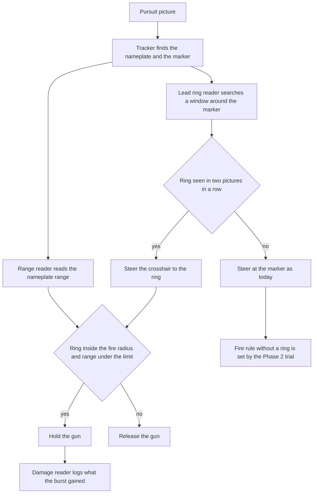

# Design 021 — Gun Aim on the Lead Ring

| Status | Date       | Wingman Version |
|--------|------------|-----------------|
| Draft  | 2026-11-13 | 1.9.4           |

Operator, 2026-11-13: "look at the latest 8 'v' screenshots, it shows a gun lead reticle/circle, we need
to align the crosshair/center dot of screen to the circle. create an hldd for implementing the changes
needed to improve machine gun hit rate".

## Summary

When an enemy is close, the game draws a small ring ahead of it: the point the gun must aim at for the
bullets to meet the target. This document calls it the **lead ring**. The operator flies the crosshair
onto the ring and the hits show as damage text. Wingman does not know the ring exists. It steers at the
target itself and fires when the target is at the middle of the frame, so it aims where the target is
and not where the bullets have to go.

This design makes four changes, each one measured before the next flies:

1. **Find the lead ring** in each pursuit picture.
2. **Fire when the crosshair is on the ring**, instead of when the target is at the frame centre.
3. **Steer the crosshair to the ring** while the ring shows.
4. **Count hits** from the game's own damage text, so each step is judged by damage and not by round
   score.

What the evidence says so far (all measured unless marked):

- In the operator's eight firing frames the ring was a median 30 px from the crosshair. In the five of
  those frames where the tracker had the target, the target was 72 to 331 px from the crosshair.
- Wingman's current fire rule would have opened the gun on none of the operator's frames.
- The ring showed in 12 of 13 frames with a live target at 1.1 km or closer, and in none of 13 frames at
  1.3 km or further. Inferred: the game shows the ring only inside the gun's useful range, about 1.2 km.
- In this morning's session 80% of wingman's gun time was fired on targets between 1.2 and 2.0 km, where
  the operator's frames show no ring.
- Wingman has no measure of hits today. Nothing reads the damage text.

## Status

| Phase | What | Status | Evidence |
|---|---|---|---|
| 0 | The operator's frames measured; a prototype ring reader | Done 2026-11-13: the prototype finds the ring in 12 of 12 frames | "What the screenshots show" |
| 1 | Shadow: the ring reader and the damage reader log, and nothing flies differently | Built 2026-11-13 (`wingman/lead_ring.py`, `wingman/gun_damage.py`); 44 missions flown; baseline: no damage from 41 bursts without a missile | "Phase 1 build" and "Phase 1 trial log" |
| 2 | The gun fires on the ring, as a per-round trial | Folded into Phase 3: with the chase on the marker the ring is a median 275 px from the crosshair, so the ring's fire rule alone would almost never open the gun | [ADR 178](../adr/178-the-chase-steers-the-crosshair-onto-the-lead-ring-in-half-the-rounds.md) |
| 3 | The chase steers on the ring and fires on it, as a per-round trial | Built 2026-11-13 ([ADR 178](../adr/178-the-chase-steers-the-crosshair-onto-the-lead-ring-in-half-the-rounds.md)); live trial on `make r3` | "Phase 3 build" and "Phase 3 trial log" |
| 4 | Finer aim at close range, if Phase 3's numbers call for it | Not started | |
| 5 | Target path projection: where the target will be, for the gun beyond the ring's range, for following a crossing target, and for the missiles | Step 1 (offline) scored 2026-11-13: with wingman's own turning taken out, the projection misses the ring by a median 71 px (no lead: 134 px) and names the side the target is going 89% of the time. Not yet good enough to fire on (24% within 40 px) | "Target path projection" |

Each phase that changes what wingman does gets its own ADR. [ADR 177](../adr/177-the-gun-fires-only-under-2-km.md)
(the gun fires only under 2 km) stays in force throughout.

## What the screenshots show

The frames are 12 operator screenshots from one hand-flown stretch on 2026-11-13: the 8 named in the
request and the 4 taken just before them in the same fight. The log has `GAME_BATTLE_MANUAL` from 11:26:56
to 11:28:53, so the operator was flying and firing in all of them. They are 1920 x 1200. Copies are in
`test_screenshots/gun_lead/` (VEDA only, untracked), with the scripts that produced every number here in
`test_screenshots/gun_lead/tools/`.

### The parts of the HUD that matter

| Part | What it looks like | Measured |
|---|---|---|
| Crosshair | A green cross with a centre dot, fixed on the screen | Centre at x 959.5, y 604.5 to 612.0. The frame centre is (960, 600) |
| Lead ring | A ring 26 px across with four small ears on the diagonals | Red in 10 frames, tan in 2, green in 1 |
| Dotted line | Four green dots from the ring to the target aircraft | The dots sit at fifths of the line (two frames, by eye) |
| Damage text | White "70 DMG" left of the crosshair | Right edge near x 878, y 605. Seen: 30, 70, 80, 200 |
| Hit marker | An X around the crosshair, white on a hit and red on a kill | Red in the kill frame 112712. White ones are in the 2026-11-04 demonstration frames |
| Gun heat bar | An orange bar under the crosshair, and "OVERHEAT" when full | x 760 to 1160, y 813 |

The damage text adds up over one target: it read 30 at 11:27:10 and 11:27:11, and 70 on the kill at
11:27:12 (one engagement).

### The twelve frames

"Marker" is the point wingman steers at today: 100 px below the nameplate's centre, where the aircraft
is drawn. "Not tracked" means a fresh tracker did not accept the nameplate on that single frame.

| Frame | Range km | Gun (by eye) | Ring | Ring to crosshair px | Marker to crosshair px | Ring to marker px | Damage text |
|---|---|---|---|---|---|---|---|
| 112707 | 1.0 | idle | red | 91 | not tracked | | |
| 112710 | 0.56 | firing | red | 29 | not tracked | | 30 |
| 112711 | 0.67 | firing | red | 80 | not tracked | | 30 |
| 112712 | 0.78 | firing | none: the kill frame | | not tracked | | 70 |
| 112721 | 0.81 | firing | red | 19 | 128 | 141 | |
| 112722 | 0.77 | firing | red | 17 | 148 | 149 | |
| 112723 | 0.34 | idle | green | 457 | 322 | 136 | 70 |
| 112752 | 0.39 | firing | red | 31 | not tracked | | |
| 112801 | 0.55 | firing | red | 41 | 331 | 307 | |
| 112802 | 0.39 | firing | red | 51 | 269 | 284 | 80 |
| 112810 | 0.73 | firing | red | 17 | 72 | 88 | |
| 112833 | 1.1 | idle, overheated | tan | 69 | 50 | 30 | 200 |

What this says:

- **The operator fires with the ring near the crosshair.** In the eight firing frames with a ring the
  distance was 17, 17, 19, 29, 31, 41, 51 and 80 px: median 30, and seven of eight within 51 px.
- **The target is nowhere near the crosshair while the hits land.** In the five tracked firing frames the
  marker was 72 to 331 px away. The ring leads the marker by 30 to 307 px.
- **Wingman's rule opens the gun on none of them.** Its gun box is 48 px either side of the frame centre
  and 30 px above or below. None of the seven tracked frames is inside it, and the other five have no
  lock at all.

### When the ring shows

Every operator screenshot on file was checked (118 full-size frames, back to 2026-10-09), and the frame
the operator gave for ADR 177. A frame counts when its nameplate range can be read.

| Range | Frames | With a ring |
|---|---|---|
| 0.34 to 1.1 km, target alive | 13 | 12. In the other one the target sits in the frame's corner |
| 1.3 to 13.9 km | 13 | 0. The five from 1.3 to 1.9 km were also checked by eye |

Inferred: the ring shows only inside the gun's useful range, and the edge is between 1.1 and 1.3 km.
The sample is 26 frames. Phase 1 measures the edge on thousands of readings.

Not known yet:

- **What the three colours mean.** Red is not "the gun is firing": frame 112707 has a red ring with the
  gun idle. The tan frames have the gun idle, one of them overheated. The reader takes all three.
- **Whether the ring shows while wingman flies.** Every ring frame is hand-flown. Wingman's own frames on
  file are all beyond 2 km, where no ring is expected anyway. Some of them show a different crosshair (a
  small circle with a dot), which may be a camera or weapon state. Phase 1 answers this first.

## What wingman does now

- **Steering point.** `wingman/tracker.py` finds the nameplate and steers at the marker 100 px below it
  (`red_mass_aim_offset_px`). The error is measured from the frame centre.
- **Fire rule.** `Controller._pursuit_gun_tick` holds the gun while the marker is within
  `gun_centre_err` (0.05) of the frame centre on both axes and a fresh range reading is under 2 km (ADR 177).
- **Hits.** Not measured. No code reads the damage text or the hit marker.

Measured on the 2026-11-13 08:19 to 11:29 session (`make r2`, 29 missions, the ADR 177 code):

| What | Under 1.2 km | 1.2 to 2.0 km | Beyond 2.0 km |
|---|---|---|---|
| Kept range readings (8,062) | 797 (10%) | 846 (10%) | 6,419 (80%) |
| Tracked time | 182 s | 218 s | 1,526 s |
| Marker to frame centre, median | 140 px | 70 px | 43 px |
| Readings with the marker inside the gun box | 13% | 28% | 51% |
| Gun bursts opened (132) | 42 | 90 | 0 (ADR 177) |
| Gun time (115.9 s) | 23.5 s | 92.4 s | 0 |

- 80% of the gun time is fired where no ring shows.
- The closer the target, the worse the aim holds: under 1.2 km the marker is inside the gun box on 13% of
  readings. This is the range where the gun can hit.
- 104 of 132 bursts ended because the marker left the box. The median burst was 0.6 s.

## Design

### Parts

| Part | Where | Job |
|---|---|---|
| Lead ring reader | new `wingman/lead_ring.py` | Find the ring near the tracked target; say where it is and what colour |
| Aim point | `wingman/controller.py`, the pursuit loop | Choose the ring or the marker as the point to steer at |
| Fire rule | `Controller._pursuit_gun_tick` | Hold the gun while the ring is on the crosshair |
| Damage reader | new `wingman/gun_damage.py` | Read the damage text; log what each burst gained |

- The fire radius is `fire_px` and the range limit is ADR 177's `gun_max_range_km`.

### D1. The lead ring reader

- **Input:** the pursuit picture, the tracker's marker, the picture time.
- **Search window:** 900 x 700 px around the marker. The ring was at most 307 px from the marker in the
  frames above; 450 px is the allowance. Named guess.
- **Method:** one mask that admits the three ring colours, then a match against the ring's shape. The
  prototype found the ring in 12 of 12 frames at a score of 0.50 or more. The two lowest (0.50, 0.53)
  are frames where the nameplate text crosses the ring. Phase 1 cuts the template from a real ring.
- **Which target the ring belongs to:** the dotted line runs from the ring to its target. The ring counts
  for the tracked target when at least two of the four dots are found on the line to the marker. A ring
  that fails this is logged as `other` and not used.
- **Two pictures:** a ring is used once it is seen in two pictures in a row within 80 px. A repeated
  picture (same picture time) does not count as the second.
- **Cost:** 6 to 14 ms for the window on an idle machine, against 87 ms for the whole frame. It runs
  inside the pursuit steering tick, as the tracker's 9.5 ms scan does. No new thread.
- **Output:** position, colour, score, picture time, and whether the dotted line agreed.

### D2. The crosshair is the reference

The gun's error is the ring's distance from the crosshair, not from the frame centre. The crosshair sat
5 to 12 px below the frame centre in all 12 frames, which is up to the ring's own 13 px radius. One
calibrated point,
`crosshair_pct`, holds it. The tracker's own errors, its memory of where the target went and the search
keep using the marker and the frame centre.

### D3. The fire rule

- **With a ring:** hold the gun while the ring is within `fire_px` of the crosshair and ADR 177's range
  gate passes. Let go at 1.5 times that distance (the factor the gun already uses), or when no ring has
  been seen for `ring_max_age_s`.
- **Starting value:** `fire_px` 40. The operator fired at a median 30 px, seven of eight times within 51.
  Named guess, tuned in Phase 2 from damage against distance.
- **Without a ring:** two candidates, and Phase 1's damage figures choose.
  - *No ring, no gun* (recommended). The ring's absence is the game saying the target is out of the gun's
    reach (inferred). It removes the 80% of gun time fired beyond 1.2 km.
  - *Keep today's rule* beyond the ring's range. Right only if the damage reader shows bursts between 1.2
    and 2.0 km doing damage.

### D4. Steering on the ring

- While a ring is in use, the roll and pitch holds take their error from the ring against the crosshair.
  With no ring they take it from the marker, as today.
- The ring is kept as the aim point for `ring_memory_s` after it was last seen, so one missed picture
  does not swing the aim back to the marker and out again. The two points were up to 307 px apart.
- Everything that outranks the chase today still does: the dive guard, the terrain rules, the resupply
  run, objectives, the climb-out. They act on whichever error is steering.
- The steering code and the hold model are not changed in this step. Only the point they aim at changes.

### D5. Counting hits

- **Damage text.** The crop left of the crosshair is read with the range reader's method (recognition
  only, a short allowlist, a mask of the white glyphs). `gun_damage.py` holds the crop and the parsing;
  the range reader's existing worker and OCR reader run it. A second EasyOCR reader would cost about
  300 MB.
- **When.** Only while the gun is held and for 2 s after.
- **What is logged.** One `GUNHIT:` line per burst: range and ring distance at the open, burst length,
  damage before and after, damage gained. The session summary adds bursts, bursts that gained damage, and
  damage per gun second, split by range band and by ring distance at the open.
- **Hit rate** in this design means two numbers: the share of bursts that gain damage, and damage per
  second of gun. The game does not show bullets fired.
- **Missiles.** Assumed: missile damage shows in the same text. A gain within a few seconds of a missile
  launch is logged as `mixed` and left out of the gun's figures.
- **Hit marker.** The X around the crosshair is a second, cheaper signal. It is added only if the text
  proves unreliable.

### D6. Finer aim at close range

Phase 3 will show how close the steering holds the ring. Today it holds the marker inside the gun box on
13% of readings under 1.2 km, so the ring is unlikely to be held within 40 px often enough without more
work. The candidates, in the order they would be tried, each as its own ADR:

1. A tighter steering deadband while the ring steers (the resupply run uses 0.025 against 0.05).
2. The hold model's timing at close range. The picture is a quarter second old, and between two of the
   frames above (0.21 s apart) the ring moved 11 px and the marker 20 px.
3. Speed: the airbrake to stop closing on a target and overshooting it. The operator uses it constantly.
4. Rudder for small sideways corrections. Only left rudder is bound today (`YAW_LEFT`).

### Settings

All under `pursuit_mode.gun_lead`, each declared once in `wingman/config_schema.py`. Pixel values are for
a 1,200 px high frame and scale with the frame height.

| Key | Default | Meaning |
|---|---|---|
| `enabled` | `true` | The ring reader and the damage reader run and log |
| `steer_share` | 0.5 in `config.yaml` (schema 0) | The share of rounds that steer on the ring and fire on it (Phase 3, [ADR 178](../adr/178-the-chase-steers-the-crosshair-onto-the-lead-ring-in-half-the-rounds.md)) |
| `fire_px` | 40 | The ring's largest distance from the crosshair for the gun to open |
| `search_px` | 450 | Half-width of the search window around the marker |
| `min_score` | 0.45 | Lowest shape match that counts as a ring |
| `ring_memory_s` | 0.45 | The steering and the gun keep the ring as the aim point this long after it was last confirmed |
| `ring_min_dots` | 2 | Dots found on the line to the marker for the ring to count as the tracked target's |
| `crosshair_pct` | [0.4997, 0.508] | The crosshair's centre as a fraction of the frame |

As first designed the table also had `actuate_fire`, `actuate_steer`, `no_ring_no_gun` and
`ring_max_age_s`. Phase 3 replaced them with `steer_share`, the gun's own memory with
`ring_memory_s`, and the open question of firing without a ring with the marker rule (ADR 178 D3).

## Phases and what ends each one

### Phase 1: shadow

Built: `lead_ring.py`, `gun_damage.py`, a `LEADRING:` line per steering tick with a tracked target under
2 km, the `GUNHIT:` lines, and tests on the 13 frames in `test_screenshots/gun_lead/` cut down to fixtures.
Crops of first detections and of damage reads are saved for checking by eye, with a cap per session.
Nothing wingman does changes.

It ends when these are recorded:

- [ ] The ring is found in at least 90% of pictures with a tracked target under 1.0 km. If it is far
  lower, the ring does not show in wingman's camera or weapon state. That stops the design until the
  cause is found.
- [ ] Of 100 saved first detections, no more than 2 are something other than the ring.
- [ ] The damage reader matches a by-eye reading on at least 95 of 100 saved crops.
- [ ] The range at which the ring appears, from the readings.
- [ ] Ring colour against gun state, heat and distance from the crosshair: what the colours mean.
- [ ] How often the ring belongs to a target other than the tracked one.
- [ ] The baseline over 40 or more rounds: bursts that gain damage and damage per gun second, by range
  band and by ring distance at the open. This decides D3's rule without a ring.
- [ ] The operator's own figure: the damage reader run over the 2026-11-04 demonstration
  ([Research 020](../research/020-the-operators-flying-as-the-terrain-reference.md)'s recording, 443
  hand-flown frames with the gun held).

### Phase 2: fire on the ring

The fire rule of D3, steering unchanged. Half the rounds use it and half keep today's rule, drawn per
round as [ADR 172](../adr/172-agreeing-terrain-warnings-leave-the-resupply-run-in-half-the-rounds.md) and
[ADR 174](../adr/174-the-map-warning-starts-the-emergency-climb-in-half-the-rounds.md) do.

- [ ] 40 or more rounds in each arm.
- [ ] The ring arm's damage per gun second is higher.
- [ ] The ring arm's gun damage per round is not lower. If it is, the gun is being starved, and Phase 3
  is what fixes that, not a wider `fire_px`.

### Phase 3: steer on the ring

D4, with the same two arms.

- [ ] Share of tracked time under 1.2 km with the ring within `fire_px` of the crosshair, against the
  marker arm.
- [ ] Gun damage per round is higher in the ring arm.
- [ ] Deaths per round and terrain crashes per round are not higher. Steering onto a point ahead of a
  turning target near the ground is new behaviour.

### Phase 4: finer aim

Only the D6 candidates that Phase 3's numbers point to.

## Phase 1 build

Built 2026-11-13. Nothing wingman does changes: the gun still fires on ADR 177's rule.

- **`wingman/lead_ring.py`.** `LeadRingWatch.observe` runs on each pursuit steering tick while the tracked
  target reads under `search_max_km` (2.0). It logs one line per new picture:
  - `LEADRING: seen|confirmed at=(x,y) <colour> score=… km=… cross_px=… marker_px=… dots=N gun=fire|- cost=…ms`
  - `LEADRING: none km=… marker=(x,y) gun=… cost=…ms`

  Crops go to `test_screenshots/unknown_anomalies/`: `leadring_*` for each ring's first confirmed picture
  (30 a session) and `leadring_miss_*` for pictures under 1.0 km with no ring (15 a session). The shutdown
  line `LEADRING: <band> found/searched, confirmed; colours` gives the find rate by range.
- **`wingman/gun_damage.py`.** `GunDamageLog` takes a burst from the gun's open to its release. The range
  reader's worker reads the damage text while a burst is open and for 2 s after. Each burst then gets a
  line: `GUNHIT: burst=…s range=… ring_px=… reads=N first=… last=… gain=… drops=N [mixed] values=[…]`.
  The shutdown line `GUNHIT: <band> bursts, gained, s, dmg (per s); N mixed with a missile` sums them.
  Crops are saved as `gundmg_*` (30 a session).
- **Settings:** `pursuit_mode.gun_lead` (`enabled`, `search_max_km`, `search_px`, `min_score`,
  `crosshair_pct`). The actuating keys of the Settings table come with Phases 2 and 3.

Changes from the design, measured while building:

- **One match per colour, not one joined mask.** The joined mask lost the ring in 112721 and 112722, where
  the green crosshair arms and the red name text cross it: no match at 0.5. Matching each colour mask and
  keeping the best found all 11 rings of 2026-11-13 at the right pixel, at 0.50 to 0.69.
- **`min_score` 0.45 in the shadow.** Over the 29 other tracked frames on file, the false match was the
  dashed padlock crosshair at 0.49 (screenshot 20261107_025549). The shadow logs from 0.45 with the score,
  and Phase 2 sets the cut from the saved crops.
- **The ring does show while wingman flies (one frame).** Blackout capture 20261012_154716 (wingman
  flying) has a red ring at 0.69 km, found at 0.57. It is a fixture now. Phase 1 counts how often.
- **Rings on other aircraft.** Screenshot 20261105_005428 has a green ring under a green-plated, non-enemy
  contact at 2.0 km (0.56). The `dots` field logs whether the dotted line runs to the tracked marker. All
  four dots were found in each of the seven frames the tracker had locked; frames with a guessed marker
  found 0 to 2, so the count depends on the tracker's marker being close to the aircraft.
- **`crosshair_pct` y is 0.508**, the median of the 12 frames (609.75 px), not 0.506.
- **Damage text read grey, not with a white mask.** On the six 2026-11-13 frames with the text, grey read
  30, 30, 70, 70, 80 and 200, all right. The white mask read 74 and 2200 for two of them: cloud behind
  the text is white too. Only the number touching "DMG" counts. Two frames without the text read none.
- **A missile launch** within 3 s before a burst, or during it and its 2 s settling time, marks the burst
  `mixed`. Mixed bursts are left out of the gun's sums. A launch is a fall in the missile count the chase
  reads each engage cycle, not a press of `f` (rev 2, below).
- **Rev 2 (live, 13:02):** the damage read starts 6 px left of the number. Inside the crop the text is
  right-aligned: the number ends at column 113 to 114 and "DMG" starts at 127 to 128 on all 18 crops. The
  number's start is the start of the white glyph run that ends there. Without it, texture left of the
  number read as a junk first digit (trial log).
- **Rev 3 (live, 13:48):** a damage value counts only when two readings in a row agree. At 13:48:17 rev 2
  read 94, 94, 941, 94, 94 (a stray glyph before "DMG" read as a 1), and the burst was credited 847. The
  text stays on the screen for seconds and is read about three times a second, so a real value repeats.
  `GUNHIT` lines log every reading (`values=`, up to 30), so a session's bursts can be recomputed offline
  with `gun_damage.burst_gain`.
- **Rev 4 (live, 14:23):** a reading that is the previous value with characters added in front or
  behind counts as the previous value. At 14:23:53 rev 3 read 94 four times, then 4794 twice in a row,
  and credited 4,700. Every junk reading seen from rev 1 on had that shape: 94 as 294, 494, 794, 2494,
  4794, 7094 and 941; 188 as 2188, 3188, 4188 and 6188. A real rise that ends in the old digits (94 to
  194) is lost with them, a known under-count. These readings get their own crop budget
  (`gundmg_junk_*`, 30 a session), because the plain budget of 30 was spent before the first one.
- **Rev 5 (17:20, in the working tree, not yet live):** the wrapped value must have two digits at least.
  At 17:20:20 rev 4 read 100 eight times, then a lone 0 and 710; "100" ends in "0", so the 100s were taken
  for junk around 0. Gain was 0 either way there; the rule could have erased real damage elsewhere. The
  offline rescoring uses the fixed function.
- **Open, rev 4 under-counts the first hit (live, 15:05:03):** a clean burst opened with the ring 17 px
  from the crosshair at 0.48 km, 0.4 s, read 92 once and then 116 eleven times: one gun hit of 24
  (inferred), credited 0, because the value before it was read only once. The readings are in the log, so
  a rule that takes the burst's first reading as its baseline can be scored offline before it changes.
- **Missile and gun steps differ (inferred, one burst):** at 13:46:15 a mixed burst read 94, 188, 282,
  steps of 94; the gun-only steps seen so far were 30 to 52. If missile hits are always 94, a mixed
  burst's gun share could be separated by step size.

Tests: `tests/test_gun_lead.py` (40), on the enumerated fixtures in `tests/fixtures/gun_lead/`. The
folder is git-ignored, as `tests/fixtures/` is, so the fixtures need `git add -f`.

## Phase 1 trial log

| Session | Code | Missions | Ring found under 1.0 km | Confirmed | Bursts gained damage | Damage per gun s | Notes |
|---|---|---|---|---|---|---|---|
| 2026-11-13 17:28 to 18:32, the operator's own run | Phase 1 shadow rev 5 | 9 | 65 of 90 (72%) | 27 | 0 of 4 clean bursts (2.3 s of gun) | 0 | Ring 17 of 21 at 1.0 to 1.2 km, 12 of 171 at 1.2 to 2.0 km; colours green 67, red 12, tan 15. 16 bursts, 12 mixed with a missile. Score 334 per round read (7 rounds), K/D/A 2.0/4.4/0.9, 2 manual takeovers. All three shadow runs with a usable damage reader: 41 clean bursts, 28.0 s of gun, 0 damage over 44 missions |
| 2026-11-13 14:40 to 17:28, `make r3` | Phase 1 shadow rev 4 (rescored offline with rev 5's rule) | 27 | 395 of 489 pictures (81%) | 176 | 0 of 25 clean bursts (15.0 s of gun) | 0 | Stopped by the operator (z in GAME_STARTING). Ring 60 of 91 (66%) at 1.0 to 1.2 km, 76 of 713 (11%) at 1.2 to 2.0 km; colours green 338, red 107, tan 86. 100 bursts: 75 mixed with a missile (847 damage between them, rescored), 25 clean (7 under 1.0 km, 1 at 1.0 to 1.2, 17 at 1.2 to 2.0) with no damage at all; 5 of 100 opened with a confirmed ring, at 17, 124, 191, 202 and 367 px from the crosshair. Jet: Mirage III in 18 lobby reads, F-100 in 12. Score 308 per round, K/D/A 1.6/3.5/1.2. With rev 2's run: 37 clean bursts, 25.7 s of gun, 0 damage over 35 missions |
| 2026-11-13 13:37 to 14:25, `make r3` | Phase 1 shadow rev 2 (rescored offline with rev 4's rule) | 8 | 37 of 43 (86%) | 16 | 0 of 12 clean bursts (10.7 s of gun) | 0 | Stopped with z for rev 4. Ring 8 of 14 at 1.0 to 1.2 km, 5 of 168 (3%) at 1.2 to 2.0 km; colours green 35, red 4, tan 11. Of 25 bursts, 13 were mixed with a missile; the 12 clean ones (10 at 1.6 to 1.9 km, 2 at 0.64 and 0.73 km, none opened with a confirmed ring) saw no damage text at all. The only damage of the session, rescored, was 94 in each of two mixed bursts, in steps of 94. Account 3 flew the F-100 Super Sabre every round (account 2 this morning: Su-57, Mirage 2000, J-10): score 106 per round, K/D/A 0.5/3.6/0.8, a jet and 8-round effect, not attributed. Steering tick mean 0.181 s (morning, no shadow, 0.176 s; rev 1 0.195 s), both shadow sessions sharing the CPU with a 27-minute test run |
| 2026-11-13 12:56 to 13:36, `make r3` | Phase 1 shadow rev 1, uncommitted on acs-j20 | 7 | 65 of 75 pictures (87%) | 36 | not usable (below) | not usable | Stopped with z for rev 2. Ring found 2 of 4 at 1.0 to 1.2 km and 19 of 183 (10%) at 1.2 to 2.0 km. By eye, the three crops of rings confirmed past 1.2 km are real rings on close targets: the nameplate in the picture says 0.99, 0.59 and 0.84 km where the logged range was 1.30, 1.65 and 1.30. Inferred: the range reading lags a fast-closing target (it may be 1.5 s old, and a falling reading is held back one read), so the ring is the earlier sign of gun range. One miss crop (0.83 km) has the ring hidden behind wingman's own aircraft; colours green 71, red 9, tan 6. Score 344 per round, K/D/A 1.3/2.9/1.3 (7 rounds, noise). First mission (CRIMSON): the ring shows while wingman flies (measured, by eye on the saved crops): green, the dotted line to the tracked Su-35, `confirmed` with dots=4 at 0.98 to 0.36 km, 75 to 89 px from the marker and 670 px from the crosshair (wingman steers on the marker). "94 DMG" read right. First burst 1.90 km, no ring, gain 0, mixed with a missile. Two defects in the damage reader, both measured, so this session's `GUNHIT` figures are not usable: (1) the canyon texture left of the number read as a junk first digit ("188 DMG" as 2188, 3188, 4188, 6188; "94" as 294), and one burst's gain came out 6,294; (2) every burst was `mixed`, because the weapon loop presses `f` about once a second whether or not a missile launches (990 presses in 4 minutes). Rev 2 fixes both: the read starts 6 px left of the number (found from its white glyph columns), which read all 18 crops right, and a launch is a fall in the missile count |

## Phase 3 build

Built 2026-11-13, [ADR 178](../adr/178-the-chase-steers-the-crosshair-onto-the-lead-ring-in-half-the-rounds.md).
Both arms keep the Phase 1 shadow and its logs.

- **The arm.** `lead_ring.RingAimTrial` draws `ring` or `marker` at each round start, where ADR 172's
  trial draws (`TickHandlers` on entering a battle state). `GUNAIM TRIAL: round N — <arm> arm` is
  logged and the round is tagged `gun_aim`.
- **The aim point.** `Controller._ring_aim` runs after the shadow on each steering tick. In a `ring`
  round, with a ring confirmed within `ring_memory_s` and `ring_min_dots` dots to the marker, it
  returns the ring's error against the crosshair in the tracker's half-frame units. The pursuit loop
  puts that in place of the marker's `err` and `err_y`, so the steering and every rule above it act
  on it. `GUNAIM: ring|marker` is logged when the point changes.
- **The fire rule.** `_pursuit_gun_tick` opens the gun while the ring is within `fire_px` of the
  crosshair whenever the ring is the aim point, and uses the marker rule otherwise. Each `GUNHIT:`
  line carries `arm=` and `aim=`.
- **The measures.** At shutdown, `GUNAIM: ring within 40 px under 1.2 km: <arm> arm N of M pictures`,
  and the `GUNHIT:` sums by arm. Deaths and score per round come from the `gun_aim` tags in the
  session's stats file.

- **Rev 2 (19:53, live):** the chase steers on a ring only while the tracked target reads under
  `steer_max_km` (1.2). In round 7, the second ring round, at 19:53:41 the chase aimed at a ring for 0.7 s at
  1.9 km. By eye on the crop, it was control point A's red dashed circle, matched at a score of 0.48
  with 3 dots counted, and there was no lead ring on the screen. Of the 277 confirmed rings logged that
  day, 7 scored under 0.50:
  - the 2 under 1.0 km sat 38 and 40 px from the marker, and the one with a crop is a real ring (0.47);
  - the 5 at 1.4 to 1.9 km sat 223 to 357 px from the marker, and the two with a crop are control point
    A (the other three are inferred to be the same).

  A score cut at 0.50 would drop real rings; the range cut drops none of the real ones on file. The
  shadow still searches and logs out to `search_max_km`.

- **Rev 3 (20:50, live):** a ring seen in two pictures in a row is confirmed within 160 px, not 80,
  when both pictures found at least two dots on the line to the tracked marker. With rev 2 live, the
  ring rounds aimed at real rings (green and tan, all four dots) on close, fast passes. The aim kept
  falling back to the marker, because at close range the ring moves fast. Of 38 back-to-back sightings
  under 1.2 km with two or more dots in both, 18 moved 80 px or less, 15 moved 80 to 160 px and 5 more.
  The 80 px rule dropped half of them; 160 px keeps 33 of 38. A sighting without the dots keeps the
  80 px rule. The shadow's "confirmed" counts change with it, so they are not comparable with the
  Phase 1 rows.
- **Seen with rev 2 (measured, rounds 3, 6 and 7, all close, fast passes):** at 20:26:12 the chase rolled
  toward the ring for 1.8 s. The ring came from 445 px to 280 px and held there; the range fell from
  0.95 km to 0.22 km in about 2 s. At 20:50:13 the gun was firing on the marker rule with the target
  centred. When the ring was confirmed 135 px away, the ring rule released the gun, as designed. The
  ring was brought from 431 px to 130 to 170 px, never inside 40.

- **Seen with rev 3 (measured, round 2, 21:18:56 to 21:19:01):** the first gun opened on the ring.
  - The ring was confirmed on 7 pictures in a row and the aim held for 2.1 s: 374 px in to 204 px at
    0.83 to 0.42 km. The behaviour tree held a climb at the same time ("pull-out would not clear" at
    1,141 m, path -39 degrees).
  - Back on the ring at 0.44 to 0.48 km it read 247, 72, 33, 81, 43 and 48 px. The gun opened at 33 px
    and let go 0.2 s later at 81 px (past the 60 px release). It did not reopen at 43 and 48 px, past
    the 40 px opening.
  - No damage text was read during the burst, and the burst was mixed.
  - The open question for `fire_px`: the operator fired 7 of 8 times within 51 px. Opening at 50 px
    would have kept firing through the 43 and 48 px pictures. That waits for damage readings against
    distance.

- **Seen with rev 3 (measured, round 8, 21:51:19 to 21:51:21): gun damage with the ring on the
  crosshair.**
  - The gun opened on the marker rule at 0.76 km. The ring was confirmed 26 px away and held 3 to 39 px
    from the crosshair for 2 s, all 10 pictures within 40 px, with the gun firing.
  - The damage text read 98, then 109, 131 and 153: a gain of 55 in steps of 11, 22 and 22. Inferred:
    gun hits, since missile hits came in steps of 94.
  - A missile left at 21:51:19.2, during the burst, so the burst is `mixed` and out of the gun's figures.
    The missile rule hides the best evidence so far. Separating a mixed burst's gun share by step size
    (Phase 1 note) would count it.
  - The burst is logged `aim=marker`, because it opened before the ring was confirmed. `aim=` alone
    undercounts the ring's part; the per-arm tally of pictures within 40 px is the measure.

- **Hit counter rev 6 (2026-11-14 01:20): the gun's share of every burst.** Bursts near a missile launch
  were left out of the gun's figures whole. That was 48 of 55 bursts in the 21:07 session, and it hid
  the gun hits, as at 21:51.
  - Rises in today's bursts, measured: 9 to 55 (ten), 75 (one), 94 to 142 (nineteen, 98 twelve times),
    300 and more (eight, misreads).
  - Inferred: the small rises are the gun and 94 to 142 are missiles. `gun_gain` counts the rises of 60
    or less (`GUN_STEP_MAX`) between the values `burst_gain` keeps. Each `GUNHIT` line now has `gun=`,
    and the summary adds the gun's share by arm over every burst, mixed or not.
  - Rescored over every Phase 3 round wingman flew (takeover rounds left out):

    | Arm | Bursts | With gun hits | Gun seconds | Gun damage |
    |---|---|---|---|---|
    | Marker | 52 | 4 | 41.3 s | 138 |
    | Ring | 80 | 3 | 59.5 s | 73 |

  - The gun does hit: 7 bursts with gun-sized steps, all hidden before. Seven hits do not separate the
    arms.

- **Rev 4 (2026-11-14): `fire_px` 60, was 40.** The operator's "just get it close" and the table under
  "What the operator knows from flying": from 40 to 60 px the next picture had the ring within 60 px 80%
  of the time. The gun lets go at 90 px (1.5 times). The shutdown tally `GUNAIM: ring within N px`
  counts within 60 px from here, so its rows are not comparable with the earlier ones.

- **Rev 4 and hit counter rev 6 live from 2026-11-14 01:49** (`make r3`, gate 4,297 passed).

- **Account 2 from 2026-11-14 02:07** (`make r2`, same code as the 01:49 run). Account 2's jets
  differ from account 3's (2026-11-13 morning: Su-57, Mirage 2000, J-10), so the trial log names the
  account and jets on each row.

- **First gun hit from a burst opened on the ring (measured, account 2, 2026-11-14 02:16:26).** Ring
  round, Mirage III, 0.36 km. The gun opened with the ring 26 px from the crosshair and held for 1.5 s.
  The damage text read 18, then 36 (a misread 3736 in between taken as 36): gun share 18. A missile was
  launched near it, so before rev 6 it would not have counted.

Tests: `tests/test_gun_lead.py` (Phase 3 section): the ring's error against the crosshair, the memory and
the dots rule, firing on the ring with the marker out of the box, holding fire with the ring off the
crosshair, the marker arm unchanged, the tally, the round draw, the summary by arm and the config.
Also `tests/test_mission_stats.py` (the round tag) and `tests/test_tick_handlers.py` (the round start).

## Phase 3 trial log

| Session | Code | Missions | Ring arm rounds | Marker arm rounds | Ring within 40 px under 1.2 km, by arm | Clean bursts and damage, by arm | Notes |
|---|---|---|---|---|---|---|---|
| 2026-11-14 04:20 to 05:00, `make r2` (account 2) | ADR 179 rev 1 (closing brake) with Phase 3 rev 4 | 5 (2 taken over: rounds 4 and 5) | 0 | 5 (all marker) | marker arm 9 of 106 pictures (the tally includes the taken-over rounds) | One gun hit, 12 at 1.90 km on the marker rule. Closing brake: 4 holds, 4.4 s in all, at 527, 498, 483 and 374 m/s (all head-on speeds); encounters under 1.2 km: brake arm 10, median 1.2 s; control arm 2, median 4.7 s (the brake arm's include the two taken-over rounds; too few to read) | Stopped with z for ADR 179 revs 2 and 3, after the operator flew rounds 4 and 5. Every brake release was logged "the target no longer has the steering"; the causes were a dive brake taking the key (twice, one at 726 KPH where it did not brake), the flare roll, and one unread. Revs 2 and 3 fix that. Score 850 per round read (3 rounds), K/D/A 4.3/2.3/3.3 |
| 2026-11-14 02:07 to 04:00, `make r2` (account 2) | Phase 3 rev 4 (`fire_px` 60) and hit counter rev 6 | 17, none taken over | 10 | 7 | within 60 px: ring arm 23 of 185 pictures (12%); marker arm 0 of 135 | Gun share (rev 6, every burst): ring arm 4 of 35 bursts with gun hits, 28.5 s, 116 damage; marker arm 0 of 20, 14.0 s, 0. The four: 18 at 0.36 km (opened on the ring, 26 px), 36 at 0.49 km (on the ring, 51 px), 8 at 0.96 km and 54 at 1.90 km (both on the marker rule, no ring). The gun opened on the ring 6 times | Stopped by the operator with Backspace during matchmaking at 04:00 (standby). Range readings: 356 of 5,249 under 1.2 km (7%), 372 at 1.2 to 2.0 km. Ring found 216 of 276 under 1.0 km (78%), confirmed 139; 31 of 37 at 1.0 to 1.2 km. Projection against the ring: 299 pictures, miss median 137 px, 15 within 40 px, 66 within 80 px. One burst with no missile launch near it gained 108 with a gun share of 0: a missile-sized rise from a missile launched earlier, so the "clean" sums are not gun-only and the gun share is the figure to use. Mirage III (17 lobby reads), Mirage 2000 (2); maps CRUCIBLE, ICEBOUND, STONE, STORMBREAK. Score 255 per round read, K/D/A 1.1/4.2/1.6 |
| 2026-11-14 01:49 to 02:05, `make r3` | Phase 3 rev 4 (`fire_px` 60) and hit counter rev 6 | 3 | 2 (rounds 1, 2) | 1 (round 3) | within 60 px from here: ring arm 3 of 59 pictures; marker arm 0 of 15 | 5 bursts, all in ring rounds, 2.2 s, no gun hits (rev 6 share 0). One opened on the ring at 50 px, which the 40 px rule would not have opened (01:52:46, 0.77 km): the chase brought the ring 377, 281, 222, 113, 50 px in 1 s; the dive recovery took the aircraft after 0.1 s | Stopped by the operator with z during matchmaking at 02:05. Range readings: 74 of 822 under 1.2 km (9%). Projection against the ring: 62 pictures, miss median 135 px, 6 within 40 px, 20 within 80 px. J35 Draken every round. Score 378 per round read, K/D/A 1.3/2.0/1.3 (3 rounds) |
| 2026-11-14 00:40 to 01:23, `make r3` | Phase 3 rev 3 and the HUD projection | 6 (1 taken over) | 4 (rounds 1, 3, 4, 6; 4 taken over) | 2 (rounds 2, 5) | ring arm 6 of 73 pictures (8%); marker arm 0 of 10 (the tally includes the taken-over round) | ring arm 4 clean bursts at 1.2 to 2.0 km, 3.5 s, 0 damage; 12 bursts mixed. Gun share (rev 6, rescored): ring arm 2 bursts with gun hits, 9 each | Stopped with z for hit counter rev 6. Range readings: 100 of 1,906 under 1.2 km (5%), 108 at 1.2 to 2.0 km. Projection against the ring: 74 pictures, miss median 114 px, 13 within 40 px, 21 within 80 px (the same method offline on this log: 123 px; no lead: 169 px). Jets: Mirage III (5 reads), J35 Draken (2), Mirage 2000 (1), MiG-21 (1); maps COUNTDOWN, CRUCIBLE. Score 209 per round read, K/D/A 1.0/3.8/1.8. An earlier session the same night (23:48 to 00:24, 5 rounds) had 4 of 5 rounds taken over by the operator and is not a row |
| 2026-11-13 21:07 to 23:33, `make r3` | Phase 3 rev 3 (160 px confirmation with the dots) | 24 | 15 | 9 | ring arm 11 of 102 pictures (11%); marker arm 1 of 59 (2%) | ring arm 5 clean bursts, 2.9 s, 0 damage; marker arm 2, 1.3 s, 0 damage. 48 of 55 bursts were mixed with a missile. One burst opened on the ring (21:19, 33 px, 0.2 s, mixed, no damage text read) | Stopped with z for the HUD projection build. Range readings: 184 of 4,778 under 1.2 km (4%), 312 at 1.2 to 2.0 km. The ring arm's 11 pictures are two encounters (rounds 2 and 8, in the build notes above); round 8's showed gun-sized damage steps with the ring on the crosshair, in a mixed burst. Under 1.0 km the ring was found 95 of 136 (70%), confirmed 60 (rev 2: 25 of 79 found); at 1.0 to 1.2 km found 0 of 25. MiG-23 Flogger every round; maps COUNTDOWN, CRIMSON, CRUCIBLE, ICEBOUND, STORMBREAK. Score 202 per round read, K/D/A 0.9/3.5/1.2. By arm over all three Phase 3 sessions (39 rounds, from the `gun_aim` tags; under 40 an arm, so noise): ring arm 21 rounds, score 169 a round, kills 0.8, deaths 3.0, deaths with no kill card 4 (0.2 a round); marker arm 18 rounds, score 214, kills 0.9, deaths 3.7, deaths with no kill card 12 (0.7 a round) |
| 2026-11-13 20:11 to 20:55, `make r3` | Phase 3 rev 2 (`steer_max_km` 1.2) | 7 | 3 (rounds 3, 6, 7) | 4 (rounds 1, 2, 4, 5) | ring arm 0 of 83 pictures; marker arm 5 of 64 (8%) | All 16 clean bursts at 1.2 to 2.0 km, all `aim=marker`: ring arm 11 bursts, 5.1 s, 0 damage; marker arm 5, 2.5 s, 0 damage. No burst opened on a ring | Stopped with z for rev 3. Range readings: 166 of 1,851 under 1.2 km (9%), 254 at 1.2 to 2.0 km. The ring arm aimed at a ring 8 times, every one a real ring (green or tan, 4 dots) on a close, fast pass; the chase rolled toward it and brought it from about 445 to 280 px (20:26) and from 431 to 130 to 170 px (20:50), never inside 40, before the target went by. When the ring was confirmed 135 px away during a marker-rule burst (20:50:13), the ring rule released the gun. The marker arm's 5 pictures on the crosshair are one encounter, round 5 at 20:40:22 to 23: the target dead ahead, closing from 0.80 to 0.46 km, the ring 1 to 11 px from the crosshair, the gun firing. That 2.6 s burst read 164 then 197, a step of 33 (gun-sized; missile steps were 94), marked mixed. Under 1.0 km the ring was found 79 of 113, confirmed 25; at 1.0 to 1.2 km found 3 of 30, none confirmed. The 80 px confirmation dropped half the close-range ring pairs (rev 3). MiG-23 Flogger every round, maps CRUCIBLE and STONE. Score 251 per round read, K/D/A 1.3/3.4/1.7 (7 rounds, not attributed) |
| 2026-11-13 19:18 to 19:58, `make r3` | Phase 3 rev 1 (ADR 178 before `steer_max_km`) | 8 | 3 (rounds 6 to 8) | 5 (rounds 1 to 5) | ring arm 0 of 8 pictures; marker arm 0 of 6 | ring arm 1 burst, 0.4 s, 0 damage; marker arm 1 burst, 0.2 s, 0 damage. Both opened on the marker (`aim=marker`); no burst opened on a ring | Stopped with z for rev 2. The chase rarely got close: of 1,220 range readings with a number, 16 were under 1.2 km, 42 at 1.2 to 2.0 km and 1,162 at 2 km or more. The one aim at a "ring" (round 7, 19:53:41, 0.7 s) was control point A's dashed circle at 1.9 km, the reason for rev 2. Ring found 8 of 12 under 1.0 km and 15 of 50 at 1.2 to 2.0 km (colours red 20, green 2, tan 1); red past 1.2 km is inferred to be mostly the objective markers. MiG-23 Flogger every round, maps CRIMSON and ICEBOUND. Score 100 per round read, K/D/A 0.1/2.8/0.9 (a jet and 8-round figure, not attributed). New hit-counter misread, in a mixed burst at 19:56:40: 113, 113, 713, 713, 1113, 113 gained 600. A "1" read as "7" twice in a row passes both the two-readings rule and the wrapped rule; open |

## Target path projection

Operator, 2026-11-13: project the target's flight path from the rate it moves, for the gun (before the
ring appears too), the missiles and the navigation. "We can see the rate at which a target is moving and
project where it will be in the future."

### What the operator knows from flying

Recorded as the operator's statements of 2026-11-13. They are the premises of this phase, not open
questions.

- **The gun hits before the ring appears.** "The game really does allow hits before ring appears." The
  ring's range is not the gun's range. Wingman's own bursts beyond 1.2 km did no damage because they were
  aimed at the target with no lead, not because the gun cannot reach.
- **Targets are lost because wingman acts too late.** "There are definite cases where we can see target
  movement and we lose the target because wingman couldn't act fast enough." The target's movement is
  visible before the target is gone, and wingman reacts to where the target is, not to where it is going.
- **A fast-crossing target is followed by slowing down in the turn.** "If we see a target is moving
  rapidly to the left or right we can slow down while turning and then speed up quickly to continue
  following target." Slower, the aircraft turns tighter; the speed comes back once the nose is on the
  target again.

- **The game's aim assist finishes the aim.** "We just need to get it close, the game's aim assist will
  zoom the camera in and bring it closer, this may need to be factored into our controls."
  (2026-11-14.) The logs fit it (measured, 466 back-to-back ring sightings under 1.2 km with two or more
  dots):

  | Ring's distance now | Pairs | Next picture within 40 px | Next picture within 60 px |
  |---|---|---|---|
  | 0 to 20 px | 16 | 88% | 94% |
  | 20 to 40 px | 13 | 62% | 77% |
  | 40 to 60 px | 5 | 20% | 80% |
  | 60 to 80 px | 8 | 38% | 38% |
  | 100 to 150 px | 13 | 0% | 0% |
  | 150 to 250 px | 75 | 1% | 3% |

  Once close, the ring stays close. It did so in the Phase 1 shadow too, with wingman steering at the
  marker: 19, 16, 3, 5 px and 9, 9, 10, 12, 13, 18 px. Inferred: that is the assist; under 100 px the
  samples are small. What it means for the controls:
  - the gun opens at 60 px, not 40 (Phase 3 rev 4, below);
  - near the ring the steering keys may fight the assist: the deadband is about 48 px across but only
    30 px up and down. To be measured with rev 4 flying;
  - the zoom: while the camera is zoomed, a held key moves the picture further per second, which
    changes the hold model's rates and the projection's scale. The logs cannot show the zoom yet. Open.

### Plan

Each step that changes what wingman does is a per-round trial with its own ADR, as Phase 3 is.

1. **A projection with wingman's own turning taken out**, scored offline against the ring. The ring is
   the game's own lead point, so under 1.1 km it is the answer sheet. The bar: within about 40 px of the
   ring on most sightings. No change to flying.
2. **How far out the gun hits.** The operator's statement settles whether; the damage reader run over the
   2026-11-04 hand-flown recording (443 frames with the gun held) gives damage by range, which sets how
   far out to fire.
3. **The gun fires on the projected point where no ring shows**, out to ADR 177's 2 km.
4. **The crossing-target turn.** When the target's crossing rate is high, the chase brakes while it
   turns and takes the afterburner once the target is ahead again. The braking half is built
   ([ADR 179](../adr/179-the-chase-brakes-when-it-closes-fast-on-a-near-target-in-half-the-rounds.md),
   2026-11-14, a per-round trial: the airbrake while a target under 1.5 km closes at 150 m/s or more).
   Turning toward the projected side is the half still to build. Live from 2026-11-14 04:20 on `make r2` (gate 4,316 passed). The measure: targets lost within a few
   seconds of a high crossing rate, by arm. D6 item 3 (the airbrake) is part of this.
5. **Missiles.** Measured first: missile hits (the 94-point steps) against the crossing rate at launch.

### Step 2: the operator's recording cannot give the range

Tried 2026-11-14 on the 2026-11-04 recording (`test_screenshots/gun_lead/tools/demo_gun_damage.py`, 234
bursts of the gun key, 571 s held). Measured:

- **Range: not readable.** The tracker does not lock on the half-scale JPEG frames scaled back up, and
  EasyOCR of the nameplates misreads them: "3.9km" read as "3 91m", "1.5km" as "45km". Live data answers
  step 2 instead. Every live burst logs its range at the opening, and rev 6 counts the gun's hits in
  every burst.
- **The operator's gun hits** (no range): 125 bursts had damage readings, 13 of them (10%) with
  gun-sized rises, 517 damage over 363 s held. The frames are about a second apart, so a value is often
  seen once. These are counted with every rise of 60 or less between consecutive readings, not with
  the live rule's "read twice in a row".
  - Wingman's Phase 3 bursts, rescored with rev 6: 7 of 132 (5%), 211 damage over 101 s.
  - Different rules and jets, so a rough guide only.
- **The operator's steps came in 14s:** 28 to 42, 21 to 35 to 70, 14 to 42. Inferred: a fixed damage a
  bullet for that jet. Wingman's live steps were 9, 20 to 33 and 55.

### Why step 4 comes next: close encounters last two seconds

Measured 2026-11-14 on the six Phase 3 logs: 89 encounters with three or more range readings under
1.2 km.

| Measure | Value |
|---|---|
| Time under 1.2 km, median | 2.0 s (quarter under 1.1 s; 71% under 3 s) |
| Closing speed to the nearest point, median | 252 m/s (73% over 150 m/s) |
| Nearest point, median | 0.48 km |
| Ended with the range opening again by 150 m or more | 6 of 89 |

- Wingman arrives in gun range closing at about its own flying speed and has about two seconds there.
  The ring cannot be brought to the crosshair and held in that time, whatever the aim rule.
- Most encounters end at their nearest point with the target lost from view, not with the range
  opening: the target goes out of the picture as wingman goes by (inferred).
- This is the operator's second and third statement measured. Step 4 (brake while turning with a
  crossing target, then speed up) is the lever for time in range. The airbrake already has a holder for
  objective approaches (`_approach_brake`), and the projection names the target's side 89% of the time.

### A gun hit past the ring's range (measured, 2026-11-14 03:57:50, account 2)

A 2.8 s burst on the marker rule at 1.90 km, no ring in the picture, read 119, then 173: a gun-sized rise
of 54 (missile steps are 94 to 142). It is the first measured sign of the operator's first statement,
that the gun hits before the ring appears. One burst, and mixed with a missile launch.

### First check: the marker's screen speed alone does not find the ring

A first offline check, measured on 621 ring sightings under 1.2 km with three or more dots (six logs of
2026-11-13, `test_screenshots/gun_lead/tools/lead_fit.py`). The ring is the game's own lead point, so a
projection that works should land on it. The projection tried: the marker's speed across the screen
between two pictures, times a fitted factor, with and without the range.

| Prediction of the ring's position | Median miss | Within 40 px |
|---|---|---|
| No lead: the marker plus a constant | 134 px | 5% |
| Marker's screen speed | 128 px | 6% |
| Marker's screen speed times range | 132 px | 5% |

- The marker's speed on the screen says almost nothing about where the ring is.
- Inferred causes, not separated: the marker moves on the screen mostly because wingman is turning; the
  marker is a point under the nameplate and not the aircraft; the times are log times, and a quarter of
  pictures repeat.
- A projection worth flying on has to take wingman's own turning out first (step 1 of the plan). Until
  one lands within about 40 px of the ring where the ring shows, it is not a basis for firing where the
  ring does not show.

### Step 1 result: own turning taken out, from the keys the chase held

Measured 2026-11-13 on 630 ring sightings under 1.2 km with three or more dots, six logs
(`test_screenshots/gun_lead/tools/lead_project.py`). Each figure is scored on logs the fit did not see
(fit on every other log, scored on the rest, both ways).

The projection: the marker's speed across the screen, plus the travel the chase's own roll and pitch keys
account for (the hold model's rates and its 0.25 s lag), smoothed over 0.4 s, times the range, times one
fitted factor per axis.

| Prediction of the ring's position | Median miss | Within 40 px | Within 80 px |
|---|---|---|---|
| No lead | 125 to 134 px | 5 to 6% | 20% |
| Marker's screen speed times range | 124 to 136 px | 6% | 23% |
| Screen speed plus the keys' travel, times range, one picture pair | 89 to 94 px | 14 to 22% | 42 to 47% |
| The same, smoothed over 0.4 s | 71 to 72 px | 23 to 26% | 55 to 56% |

- **Taking wingman's own turning out is what makes the projection work.** The miss falls from 134 px to
  71 px. The range matters too: without it the miss is 82 to 86 px.
- **It says which way the target is going.** With the ring more than 60 px to one side of the marker,
  the projection named the side in 419 of 470 sightings (89%). Its direction was within 45 degrees of the
  ring's in 78%, a median 18 degrees off. That is enough for step 4, the crossing-target turn.
- **It is not accurate enough to fire on.** The bar was most sightings within about 40 px; it reaches
  24%. Closer is better: a median 56 px under 0.5 km, 68 px at 0.5 to 0.8 km, 87 px at 0.8 to 1.2 km.
  Beyond the ring's range it would be worse (inferred from that trend).
- **The limit is the estimate of wingman's own turning, not the ring.** The ring's offset from the marker
  changes a median 13 px between two pictures, so the ring is steady. Tried and of no further help: the
  lag from 0 to 0.45 s (best 0.15 to 0.25), the smoothing from 0.2 to 1.5 s (best 0.4 to 0.6), the range
  to another power, and the compass heading's rate (97 px alone, 74 px with the keys).
- **What the keys cannot see** (inferred): the keys held by the climb, the evade and the flare roll; the
  jet's real turn rate, which differs fivefold between jets; and the marker being a point under the
  nameplate and not the aircraft.

Next for the gun (steps 2 and 3): measure wingman's own turning from the picture itself, the travel of
the ground and sky between two pictures. That needs consecutive pictures, so it is a shadow in the chase
or a recorded session (`make r3 v`), not a log study.

### The projection on the live HUD (shadow)

Operator, 2026-11-13: "target projection should be added to the live_hud". Built the same day. Nothing
flies on it.

- **`wingman/target_projection.py`.** `TargetProjection` follows the tracked marker from picture to
  picture. The projected point is the marker, plus a fixed offset, plus the target's own motion times the
  range times a factor per axis. The target's own motion is the marker's travel on the screen with the
  travel the chase's own roll and pitch keys account for added back (the hold models' key history, rate
  and lag), smoothed over `smooth_s`.
- **Settings:** `pursuit_mode.target_projection`: `enabled`, `lead_s_per_km` [0.51, 0.37], `offset_px`
  [14, 4] and `smooth_s` 0.4. The three values are the fit on all 630 ring sightings above.
- **On `live_hud.png`:** a white arrow from the pursuit marker to a white diamond, labelled
  `PROJ <speed> px/s`, the speed being the target's own motion across the screen. It is drawn at every
  range with a fresh range reading, beyond the ring's range too. Where the game draws its ring, the ring
  is in the picture underneath to compare against.
- **In the log:** `TARGETPROJ: at=(x,y) marker=(x,y) v=(vx,vy)px/s km=… ring_miss=N|-` for each new
  picture, the miss being the distance to the game's ring when the ring was found on that picture. At
  shutdown: `TARGETPROJ: N pictures with the ring: miss median … px, … within 40 px, … within 80 px`.
  This scores the projection live, on pictures the fit never saw.
- **Tests:** `tests/test_target_projection.py`.
- **Live from 2026-11-13 23:48** (`make r3`, with Phase 3 rev 3). First line 23:51:20; drawn on
  `live_hud.png` as designed (checked by eye at 23:51:23: arrow from PURSUING to the diamond, `PROJ 47
  px/s`); no projection or render errors.
- **First session (23:48 to 00:24, measured):** 5 rounds. The operator took over 4: rounds 2 and 5 mid-round,
  rounds 3 and 4 by Enter during loading. They then stopped wingman with Backspace and kept flying.
  The projection logged no errors. Scored against the ring on 10 pictures: median miss 99 px, 1 within
  40 px, 3 within 80 px. Too few to compare with the offline 71 px; the chase was rarely in ring range.
- **Second session (00:40 on, measured): the live point is the designed point.** On 2026-11-14's log the
  live miss was a median 112 px over 66 pictures. The offline method with the same fixed values, run on
  the same log, gives the same speeds and misses picture by picture (88 against 89 px, 137 against 138,
  169 against 167). So the code is right; the session's encounters are harder. With no lead the miss
  is 169 px there, against 134 px on the fit's six logs. The projection takes a quarter off the no-lead
  miss there, and half on the fit's logs. How much it helps varies by session; judge it over many.
- **Scored only under 1.1 km.** The factors were fitted on rings under 1.2 km, and the lead grows with the
  range: at 23:51 the target was 7.2 km out, and a drift of 30 to 50 px/s drew a lead over 100 px. Past
  the ring's range the point is an extrapolation that nothing scores yet (inferred). Plan step 2 (damage
  by range) is what would score it there.

### Phase 3 by arm, running total

From the `gun_aim` tags in the stats files of 2026-11-13 and 14, accounts 2 and 3, all revisions, rounds
the operator took over left out. Measured 2026-11-14 04:05.

| Arm | Rounds | Score a round | Kills | Deaths | Deaths with no kill card |
|---|---|---|---|---|---|
| Ring | 37 | 222 | 1.0 | 3.4 | 18 (0.5 a round) |
| Marker | 28 | 211 | 0.8 | 3.8 | 20 (0.7 a round) |

- The ring arm is not worse on any of these. Round score swings by about 200 between rounds on unchanged
  code, so none of the gaps is a result yet; the marker arm is 12 rounds short of 40.
- The revisions changed the ring arm as it went (the 1.2 km limit, the 160 px confirmation, `fire_px`
  60), so the earlier ring rounds are not the current rule.

## Risks and open questions

- **The ring may not show for wingman.** No frame on file shows a ring while wingman flies. Phase 1's
  first check.
- **Little time in range.** Wingman tracked a target under 1.2 km for 182 s in a three-hour session.
  Better aim is worth the most if the chase also gets close more often. That is a separate lever and not
  in this design.
- **Firing less before hitting more.** Phase 2 with *no ring, no gun* cuts gun time by up to 80% while
  the steering still aims at the marker. Gun damage per round can fall until Phase 3. The trial arms show
  it either way.
- **False rings.** The shape match alone fires on menus and round badges (the scan of 1,097 archived
  frames found them), and on at least one of the operator's battle frames. The reader runs only in the
  chase, in the window around a tracked target, and needs the dotted line and two pictures.
- **Red scenery.** The range reader read 57% on the red CRIMSON map against 83 to 86% elsewhere (ADR 177).
  A red ring on red ground is the same problem. Phase 1 reports the find rate by map.
- **The nameplate over the ring.** In two of twelve frames the name text crossed the ring and the match
  fell to 0.50 and 0.53, at the threshold.
- **The lock at close range.** A fresh tracker accepted the nameplate on 7 of the 12 frames. Live, the
  tracker keeps a lock on a looser test, so the live rate will be better (inferred), but a lost lock means
  no window to search.
- **Overheat.** Bursts are 0.6 s today. If Phase 3 works they get long, and the heat bar will need
  reading. Not designed here.

## Not in this design

- Getting closer to targets, or choosing which target to chase.
- Reading the heat bar and pacing bursts.
- Missiles and the special weapon.
- Any change to ADR 177's 2 km gate. It is the operator's rule and the outer limit throughout.
- Requirements: a requirement for the fire rule is added when Phase 2 goes live.

## Related

- [ADR 177](../adr/177-the-gun-fires-only-under-2-km.md): the range gate and the range reader this design
  reuses.
- [Design 015](015-target-tracking-pursuit-mode-hldd.md) and [Design 005](005-target-tracking-hldd.md):
  the chase and its steering.
- [Research 020](../research/020-the-operators-flying-as-the-terrain-reference.md): the operator's flying
  as the reference, and the demonstration recorder.
