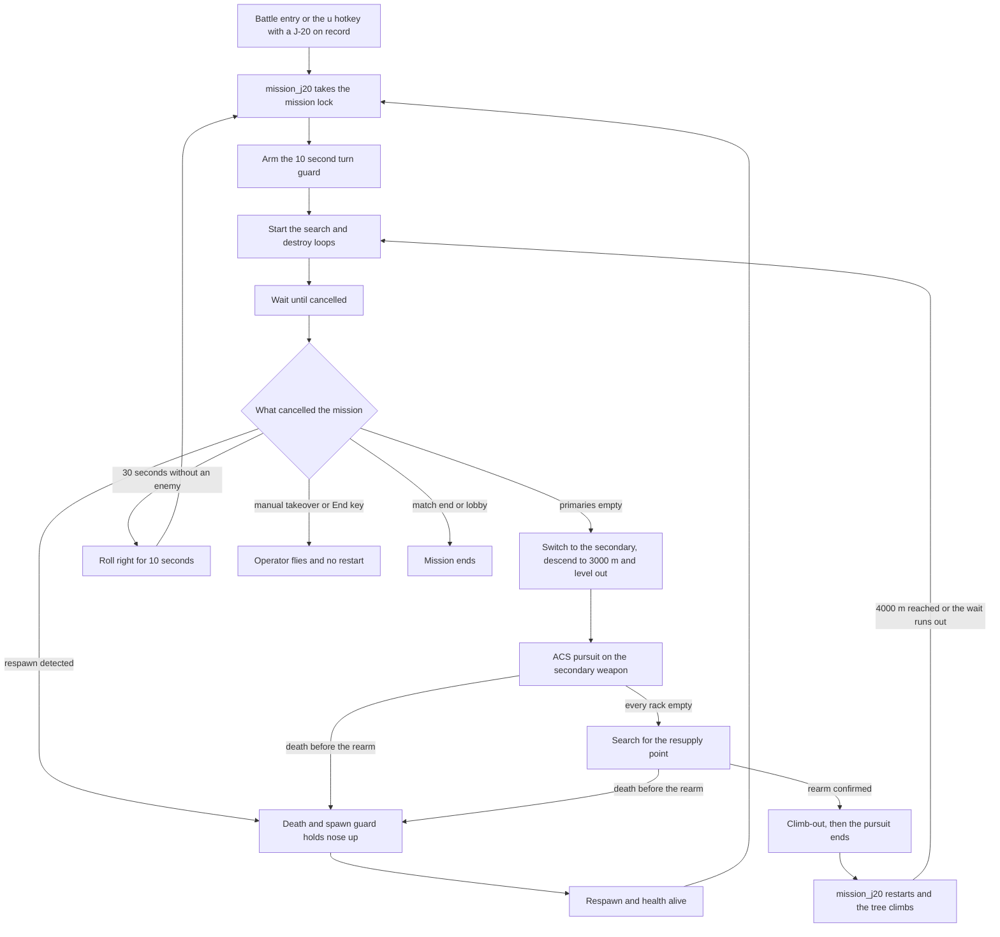

# Mission — J20 (mission_j20)

| Status | Date       | Wingman Version |
|--------|------------|-----------------|
| Draft  | 2026-09-24 | 1.8.11          |

This is `_template.md` filled in for `mission_j20`, followed by how J20 works
today. It is the worked example. To make a new mission, copy `_template.md`,
not this file. The contract is in `README.md`.

Implement per `docs/missions/README.md`.

## name

mission_j20

## sequence

* on battle start or respawn, fly the spawn heading for 10 seconds with no left or right turns
* engage with search_and_destroy; above 5500 altitude and still rising, end a routine climb and hold the nose down until level
* steer at the targets only with the padlock camera confirmed off; with it on or unknown, hold the trajectory
* when the primary runs out, switch to the secondary, descend to 3000 altitude at -20 degrees with the wings level and nothing else steering, and level out at -10 degrees
* then attack with the secondary and boresight, as ACS does
* when every rack is empty, resupply
* after the rearm, climb back to 4000 altitude, then resume search_and_destroy
* run until cancelled

Everything else J20 does (climbing, engaging, evading, turning from the edge,
disengaging, the respawn restart, and the pursuit once it has levelled out) is
shared behavior and comes from `README.md` section 3 unchanged. The descent and
the return from the rearm are ADR 171, the J-20's one exception to section 3.4.

A J-20 flies this mission without being told to: the lobby's jet label is read
(ADR 167, ADR 168) and `jet_profile.profiles.j20` names the mission (ADR 171).
Any other jet flies `mission.default_mission`, shipped `acs`, unless that key
names j20. `u` launches the same mission battle entry would (ADR 145) and, like
every `u` launch (section 2.2, default 2), it skips instead of preempting when a
mission is already running.

---

# Appendix: how mission_j20 works today

Source: `Controller.mission_j20` in `wingman/controller.py`.

## A.1 Life cycle

Fallback if the diagram does not render: a life starts at battle entry or a
respawn restart, runs until something cancels it, and every cancel except
manual takeover, the End key and match end leads back to a fresh
`mission_j20`. The causes are in README section 3.4. A rearm goes back the same
way with no respawn: the pursuit restarts the mission, which holds its loops off
until the tree's climb has reached 4000 m.

FSM states involved: `GAME_STARTING` then `GAME_BATTLE` (mission runs), then
`GAME_BATTLE_EJECT` for the missiles-empty response, back to `GAME_BATTLE` after
a rearm, `GAME_BATTLE_MANUAL` for a takeover. The tree only decides inside
`GAME_BATTLE`.

## A.2 What the mission thread does

In order, as coded:

1. `_mission_lock.acquire(blocking=False)`. If it is held, log "already in progress, skipping" and return. There is no preempt.
2. `arm_turn_guard()` (ADR 132), unless `climb_back`. Battle entry and every respawn restart come through here, which is why the guard is armed at the mission and not at a respawn event. A return from a rearm is neither.
3. `_mission_complete.clear()` and `_mission_cancel.clear()`.
4. Start a runner thread. With `climb_back` it first runs `_j20_climb_back()`: one press to the primary if the rearm left the secondary selected, then a bounded wait for `resume_alt_m`, with the tree flying the climb. It then calls `start_search_and_destroy_loop()`, then loops on `_mission_cancel.wait(timeout=0.5)`, breaking if `_mission_exit_requested()`.
5. On exit, `stop_search_and_destroy_loop()`.
6. `finally`: set `_mission_complete`, release the lock only `if self._mission_lock.locked()`.
7. The calling thread polls `_mission_complete.wait(0.05)` (calling `cancel_mission()` on an exit request), joins the runner for 2 s, sleeps 0.2 s.

`start_search_and_destroy_loop()` starts two daemon threads that stop on their
own stop event or on `_mission_cancel`:

| Thread | Does | Cadence |
|--------|------|---------|
| padlock | `padlock_camera()`, a toggle, skipped while `_padlock_cooldown_until` is in the future | every 6 s |
| weapon | `fire_active_weapon()`; with `target_painting_mode` on, skipped when one missile is left | every `mission.weapon_loop_interval` (1.0 s) |

Start and stop are serialised by a lifecycle lock with a timeout (ADR 118).

## A.3 Configuration that shapes a J20 life

All in `wingman/config.yaml`. Shipped values as of 1.8.11; the file is
authoritative. Shared keys (tree, watchdogs, spawn guard, pursuit) are named in
README section 3.

| Key | Shipped | Meaning |
|-----|---------|---------|
| `mission.default_mission` | `acs` | mission that battle entry launches (`j20` selects this mission) |
| `mission.j20_turn_guard_s` | 10.0 | turn guard span, 0 disables |
| `mission.weapon_loop_interval` | 1.0 | fire cadence in seconds |
| `mission.good_luck_wait_s` | 13.0 | wait after "Good Luck" before launching |
| `j20_mission.target_painting_mode` | false | hold the last missile (ADR 027); read only by the search-and-destroy weapon loop |
| `j20_mission.resupply_return` | true | the cycle (ADR 171); off, the pursuit chases at once and runs on after a rearm until the respawn |
| `acs_mission.climb_alt_m`, `nose_angle_deg` | 3000, -10 | where the descent ends and the angle it levels at: acs's own numbers |
| `j20_mission.descent_angle_deg` | -20 | flight-path angle of the descent; `descent_tolerance_deg` 5 past it brings a pulse back up |
| `j20_mission.descent_pulse_s` | 0.6 | one pulse per new altitude sample |
| `j20_mission.descent_max_s` | 90.0 | bound on the descent; running out starts the chase where the aircraft is |
| `j20_mission.descent_min_pull_kph` | 450 | nothing pulls up under it: slow, a pull steepens the path |
| `j20_mission.resume_alt_m` | 4000 | where search and destroy resumes; 0 resumes at once |
| `j20_mission.climb_back_max_s` | 90.0 | bound on the wait for that altitude |
| `j20_mission.ceiling_alt_m` | 5500 | above it, with the path above `ceiling_path_deg` (5), the mission holds the nose down: this jet coasts out of its climb into a stall |
| `jet_profile.profiles.j20` | `match: J-20`, `mission: j20` | the jet that flies this mission (ADR 171) |

**Naming trap.** The rest of the `j20_mission` block (`bearing_deadzone_deg`,
`coarse_kp`, `orbit_direction` and so on) is not J20's. `BehaviorTreeHandler`
passes it to `EngageNavigator`, so it tunes the shared Engage tactic and
changing it changes every mission.

## A.4 Related documents

* `docs/adr/075-afterburner-fuel-perception-and-fully-adaptive-j20-mission.md`: why J20 is adaptive
* `docs/adr/027-j20-target-painting-mode.md`: `target_painting_mode`
* `docs/adr/132-fly-the-spawn-heading-first.md`: the turn guard
* `docs/adr/171-the-jet-picks-the-mission-and-j20-comes-back-from-a-rearm.md`: the jet picks this mission, and the rearm cycle
* `docs/missions/README.md`: the contract, and the other related documents
